# Architecture

`rancher` is a kubectl-style CLI for Rancher Manager, built for both operators at a
terminal and coding agents (Claude Code, Codex, …). It is agent-first: every command
describes its own surface via `rancher schema`, so automation discovers capabilities
without reading docs, and non-interactive output is a stable, versioned JSON envelope.

## Overview

**Resource operations go exclusively through Rancher's Kubernetes API.** Every `get` /
`create` / `delete` request is a client-go call against Rancher's k8s proxy -
`/k8s/clusters/local` for management-plane kinds, `/k8s/clusters/<id>` for downstream
clusters. There is no Norman/`v3` code on the resource path.

**Two documented exceptions: interactive auth-provider login, and root reads.** `auth
get-token` (the kubectl exec-credential plugin) authenticates against Rancher's legacy
public endpoints - `/v1-public/authproviders` - because no Kubernetes-native login
equivalent exists yet; migrating it is the intended first job of the reserved
`RancherClient` port (see [Key design decisions](#key-design-decisions)). The other is
`engine.RootClient`, a GET-only read port for Steve `/v1` collections and the
channel-server release routes that no per-cluster `/k8s/clusters/<id>` proxy can reach -
writes remain CRD-through-proxy exclusively; nothing on this port can mutate state.

**Output envelope.** All commands emit the versioned `cli.rancher.io/v1` envelope on
stdout and exit with a typed code (`AUTH`, `RBAC`, `VALIDATION`, `CONFLICT`,
`NOT_FOUND`, `CONFIRMATION_REQUIRED`, `DRY_RUN_NOT_APPLICABLE`, `AMBIGUOUS_SELECTION`,
`NOT_LOGGED_IN`, `GENERIC`) - with two raw exceptions. `auth
get-token`'s stdout is a bare `ExecCredential` JSON object for kubectl to parse; that
command sets `runtime.Result.Raw`, which tells the pipeline to emit `Data` with no
envelope. `kubeconfig`'s stdout is a bare kubeconfig YAML document; that command sets
`runtime.Result.RawBytes`, which tells the pipeline to write the bytes verbatim with no
envelope and no encoding.

## Layer map

Responsibilities only - **dependencies live in exactly one place, the mermaid diagram
below.** The `test/conformance/architecture_test.go` conformance test parses that diagram and fails the
build if it drifts from the real package import graph, so there is no "depends on"
column here to fall out of sync (keeping two hand-written views of the same facts is
what drifted the previous revision of this doc).

| Package | Responsibility |
|---|---|
| `cmd/rancher` | Process entrypoint: install the embedded skill source, build the root command, run it, honor the adapter's exit code. |
| `cmd/rancher-credential-vault` | The Vault credential helper binary over `credhelper`. |
| `skills` | The agent skills this repository maintains, embedded as a tree (`go:embed` cannot climb out of its package directory) and read by `cmd/rancher`. |
| `internal/cli` | urfave/cli/v3 surface: declarative entry table, per-invocation cluster-client factory, adapts commands into the runtime pipeline; owns the `completion` command and its embedded shell scripts (`internal/cli/completions`). |
| `internal/commands/auth` | `auth login/logout/check`: the login flows (supplied token, SAML relay, guided TLS trust), logout, and the credential check, as local commands. |
| `internal/commands/configcmd` | The `config` group: server entries (`add-server`, `update-server`, `delete-server`, `use-server`, `ls`), `path`, `info`, `edit`, `set-completion`, `set-token-reuse`. |
| `internal/commands/register` | Server registration shared by `auth login` and `config add-server/update-server`: URL canonicalization, TLS preflight, CA selection, create and update under the config lock. |
| `internal/commands/skill` | `skill install/uninstall/status` over `internal/skillinstall`. |
| `internal/commands/cmdtest` | Test-only fakes and fixtures the local command packages share: input, prompter, config view, fake credential helper, lock-ordering harness. No production importer. |
| `internal/cli/completions` | The four in-repo shell completion scripts `completion <shell>` emits (adapted from urfave/cli's own, MIT-attributed), embedded via `go:embed`. |
| `internal/token` | `auth get-token/list-tokens/delete-token`: the exec-credential plugin (basic / SAML / OAuth login flows) and its token cache. |
| `internal/runtime` | Command contracts and the single middleware pipeline (validate → plan/gate → render), plus registry, resolver, and the `schema` command. |
| `internal/runtime/safety` | Safety value types: closed `Action` vocabulary, `Contract`/`Stability` `Binding`, and the `Effect` mutation-preview model. |
| `internal/runtime/completion` | The live shell-completion seam: a source's `Claim`/`Complete` contract (`Source`, `Request`, `Requirements`, `Result`, the optional `Completer` interface), the request capability the surface builds (`Connection`: private client and bearer, counted allowance, sticky refusal), and the opaque `Path` builders that admit user-derived segments only through `ValidSegment`. A leaf of the standard library. |
| `internal/runtime/completion/completiontest` | Test doubles the live completion sources' tests share: a server answering fixed bodies by path that records every request URI and Accept header, and the fixture documents more than one package asserts against (cloud credentials, the two discovery roots, the subject users). Imported by test code only. |
| `internal/engine` | Pure domain layer: `ClusterClient`/`ClusterClientFactory` ports, downstream-cluster resolution, and reusable plan/execute helpers; depends only on runtime + safety + clierr contracts. |
| `internal/engine/kinds` | Single source of kind knowledge for generic verbs: MCP keys, CLI names/aliases, GVRs, scope, deletability, contract bindings, table columns. |
| `internal/engine/kinds/complete` | The generic live completion source of the kind table: for any Completable kind, its objects' names derived from the row's group, version, resource, namespace policy and scope alone (`KindSource`), plus the shared `--namespace` and `--node` sources, which are that derivation for the namespace and node kinds. A restricted `complete` package under the import and declaration fences. |
| `internal/engine/resources` | Generic table-driven verbs (`get`, `delete`) parameterized by a `kinds.Kind`, including scope-based routing (cluster/namespace, plus `--project` resolution and membership validation) and table projection. |
| `internal/engine/inspect` | Read composites (`inspect pod`/`deployment`/`project`/`cluster`, `images`, `usage`): bespoke ReadCommands joining several cluster reads into one document, degrading metrics/log/prtb/provisioning/registration fetch failures to warnings. |
| `internal/engine/projects` | The bespoke `create project` mutating command (dry-run plan → execute a `management.cattle.io/v3` Project), plus project name resolution and project-namespace lookup. |
| `internal/engine/projects/complete` | The projects' live completion source: `ProjectSource`, the shared `--project` value and the project kind's name (management Projects in the resolved cluster's namespace, every id plus each unique display name). A restricted `complete` package under the import and declaration fences. |
| `internal/engine/provisioning` | Cloud-credential resolution (`cattle-global-data` Secrets, id-or-display-name matching) and the read-only `get cloud-credential` listing - reads Secret metadata and `data` key names only, never a `data` value. Also the per-kind overrides for `clusterregistrationtoken`: `get` reads Steve `/v1` directly (the only place the real token is spliced into the command/manifest fields) and `patch` is refused outright (read-only surface). The CRT decode is a policy-neutral exported boundary (`CRTObject`, `PlaceholderFields`, `FetchDefaultCRT`) consumed by both the get override and `inspect cluster`. |
| `internal/engine/provisioning/complete` | The provisioning commands' live completion sources: `CreateClusterSource` (create cluster's `--machine-config` live half, the typed kind's configs answered behind its `<kind>/` prefix, and `--cloud-credential`, the cattle-global-data credential Secrets by id and unique display name) and `PoolSource` (the cluster-family verbs' `--pool`, the machine pools of the cluster typed as the first positional). A restricted `complete` package under the import and declaration fences. |
| `internal/engine/extres` | The fixed mutating commands for the aggregated `ext.cattle.io/v1` API: `create token` (server-derived tokens) and `create kubeconfig` (server-created kubeconfigs), plus the shared `--ttl` duration parser. |
| `internal/engine/oidcclient` | Curated commands for Rancher's embedded OIDC provider (`management.cattle.io/v3` OIDCClient, feature `oidc-provider`, the first Prime-capability kind): `create oidc-client` (create the client, wait for provisioning, deliver the initial secret once, read live discovery), plus the shared capability/secret-read/TTL helpers the lifecycle verb group also uses. |
| `internal/engine/oidcclient/complete` | The oidc-client secret verbs' live completion source: `SecretNameSource`, the secret name rotate-secret and remove-secret take as their second positional, read from the status of the client typed as the first. A restricted `complete` package under the import and declaration fences. |
| `internal/engine/user` | The `create user` composite: a `management.cattle.io/v3` User plus a same-named `v1 Secret` in `cattle-local-user-passwords` (the server hashes it on write), gated by the ext.cattle.io-discovery capability tier (the first non-Prime one) - the sanctioned two-resource public-API user-password workflow, never Norman. |
| `internal/engine/user/complete` | The users' live completion source: `UserIDSource`, the user kind's name (the ids of the management Users the kind table does not mark as system accounts). A restricted `complete` package under the import and declaration fences. |
| `internal/engine/managementtoken` | Per-kind overrides for `management-token` (management.cattle.io/v3 Token): `patch` is refused outright (writes must go through Rancher's auth lifecycle) and `delete` is guarded - deleting the token backing the active CLI session is rejected with a hint to use `auth logout` instead. |
| `internal/engine/observe` | Curated Rancher-component log reads (`logs <target>`) and the API-reachable support-bundle export: the target table imported from `observe/complete`, one per-pod log fetcher, and the archive writer. |
| `internal/engine/observe/complete` | The logs command's live completion source, `PodSource` (`--pod`: the pods of the typed target in its namespace under its selector, on the local cluster or the resolved downstream cluster as the target's row says), and the curated target table itself, which `observe` imports back. A restricted `complete` package under the import and declaration fences. |
| `internal/engine/rbac` | Subject parsing, type inference, and scope resolution for grant/revoke commands, plus a delete-user override that guards against self-deletion: closed principal-type inference from fully qualified principals (user/group detection), bare-name handling, deterministic user-id hashing matching Rancher's EnsureUser, and binding-kind resolution (cluster/project/global). |
| `internal/engine/rbac/complete` | The rbac commands' live completion sources: `RoleSource` (grant's and revoke's `--role` values, listed from the collection the typed scope selects), `SubjectSource` (the shared `--as` value of the access commands: the non-system management Users by id and unambiguous username), `GrantRevokeSource` (grant's and revoke's own: `--role` and the subject positional together) and the role vocabulary rule `RoleKind` the commands import back. A restricted `complete` package: its imports are an exact allowlist enforced by a conformance test. |
| `internal/engine/kubeconfig` | The direct endpoint entries of a cluster's Authorized Cluster Endpoint for `rancher kubeconfig`: reads the management Cluster (`spec.localClusterAuthEndpoint`, `status.caCert`), the multi-cluster-management Feature and the management Nodes through the local cluster client, validates every entry (an https URL without a path, a parsable CA) and returns the entries to emit with the reasons for anything omitted; the command folds them into the kubeconfig and the exec plugin (`internal/token`) waits for a fresh token to be accepted at the endpoint kubectl is about to use. Provides the `rancher kubeconfig` command (`NewCommand`). |
| `internal/engine/access` | Authorization questions answered by the server's reviews (`access can`, `access list`, `access who-can`): posts SubjectAccessReview, SelfSubjectAccessReview, SelfSubjectRulesReview, and SelfSubjectReview through the Rancher proxy, classifies each answer per the review outcome matrix, and resolves the subject, resource, and scope a question needs. Nothing here evaluates a Role's rules client-side. `who-can` reads the cluster's RBAC binding subjects as candidates and asks one SubjectAccessReview each. `explain` parses the authorizer's reason into the one binding it names and walks the Rancher chain behind that binding (owner labels, GlobalRole annotations, RoleTemplate inheritance) with a bounded, request-counted traversal; `internal/engine/rbac` carries the copy of wrangler's `SafeConcatName` the aggregation-grammar labels need. `clusters` reads the caller's clusters from the steve collection through the root client (the one steve read in the suite), probes each with a SelfSubjectReview under one fan-out semaphore, and reads the management bindings that grant them with their own completeness. `projects` adds the steve project collection and, per reachable cluster, the caller's steve namespace collection, asks one SelfSubjectAccessReview per project namespace (get the namespace: the grant Rancher gives a project's members), rolls the answers up into a visibility per project, and keeps Rancher membership (a ProjectRoleTemplateBinding naming the subject) apart from it. |
| `internal/engine/access/complete` | The access commands' live completion sources: `ClusterSource` (the shared `--cluster` value and the management cluster kind: every id plus each unique display name) and `ProjectsClusterSource` (`access projects`' own `--cluster`: the steve cluster collection walked under the command's page protocol), and `QuestionSource` (`access can`, `who-can` and `explain`'s resource positional, `--group` and `--subresource`, read from the typed cluster's two aggregated discovery roots and resolved by the commands' own rules). A restricted `complete` package under the import and declaration fences. |
| `internal/config` | On-disk kubeconfig-shaped config plus credential store: load/write, effective resolution, env-override merge, store selection/pinning. |
| `internal/client/selfuser` | Shared GVR, object constructor, and userID extractor for the ext.cattle.io/v1 SelfUser identity probe - used by the auth status identity check (`internal/client/provider`) and the create cluster creatorId stamper (`internal/engine/provisioning`). |
| `internal/client/provider` | Concrete Rancher-proxied k8s adapter: dynamic `ClusterClient`, bespoke op→contract `Resolver`, connectivity `Preflight`, and k8s→`clierr` error mapping. Discovery: `ServerResources` asks for aggregated discovery (two context-bound requests) and falls back to its own legacy walk where a server does not serve it (Rancher's local cluster through the proxy): the plain root documents, then each group's preferred version document, every request context-bound, subresource entries kept; a partial answer is returned as the partial list together with `engine.DiscoveryIncomplete` naming the groups the server could not describe, never as a silently smaller inventory. |
| `internal/client/kube` | Builds client-go artifacts (`rest.Config`, dynamic + discovery + typed clients) aimed at the Rancher k8s proxy endpoint, every one over `HTTPClient`, the single client-go `http.Client` carrying the same-origin redirect policy. |
| `internal/client/httpx` | Constructs the hardened `*http.Client`s: `New` (TLS floor / CA / insecure, proxy, timeouts) for Rancher-origin callers (`internal/token`'s auth flows, `internal/client/provider`'s `/rancherversion` probe, `internal/cli`'s GET-only `engine.RootClient`), `NewExternal` (operating-system roots only) for identity-provider endpoints, the shared `RejectCrossOriginRedirect` policy every client carries, and the closed `Origin` tuple those decisions compare. |
| `internal/client/tlstrust` | Classifies a failed TLS handshake's certificate-verification error (unknown authority, hostname mismatch, expired, not-yet-valid, invalid chain) into a structured `clierr.Error`, attributes it to a request by normalized origin (`ClassifyForOrigin`, `KindOf`), and picks the candidate trust anchor from the chain the failed handshake itself already observed - no separate probe dial. |
| `internal/output` | The versioned stdout envelope and multi-format renderer (table / json / yaml / name / template), including the error envelope. The render layer scrubs `metadata.managedFields` from all structured output formats (kubectl-parity, MF-2). It is also the terminal-safety boundary: `Printable` strips control and Unicode format characters from server-sourced text in every text format (table cells and headers, names; the runtime applies it to warning, error, and dry-run preview lines; text builders at each insertion), while json, yaml, and template stay verbatim. |
| `internal/output/style` | Presentation-only ANSI wrap functions (bold/red/yellow/cyan) gated by an enable flag, plus a strip function that restores the exact unstyled bytes. |
| `internal/clierr` | Structured CLI error type with stable error codes, exit-code mapping, and candidate/hint enrichment. |
| `internal/ui` | TTY prompter/notifier: prompts and notices to stderr, refusing interaction without a TTY or under `--no-input`. |
| `internal/skillinstall` | Installs the embedded rancher agents skill into coding-agent harness skill directories (claude, codex, copilot, agents) with env-override support, user/project scope resolution, presence detection, and provenance/digest stamping. |
| `internal/testrancher` | Test-only fake of Rancher's public auth surface (`/v1-public/*`) and the ext.cattle.io/v1 Token store's imperative create/revoke behavior, for the e2e harness and unit tests. No production package may import it. |
| `internal/testrancher/fidelity` | The fidelity oracle for that fake: data-defined probes recorded against a real, digest-pinned Rancher (`make e2e-fidelity`) and replayed against the composite facade by `make e2e`, so drift from real-server behavior fails the build or is pinned as an explicit, machine-checked divergence. Probes marked `Downstream: true` run against the k3s cluster the oracle imports on every boot (`make e2e-fidelity` exports its id as `E2E_FIDELITY_DOWNSTREAM`), or against a Rancher you run yourself with its own downstream cluster (`make e2e-fidelity-downstream`); they are skipped when no downstream id is exported. Test-only. |

## Package dependency diagram

Machine-checked against the real import graph by `test/conformance/architecture_test.go`
(`TestArchitectureDocMatchesImports`). Edit an import, and the test tells you exactly
which edge to add or remove here.

```mermaid
graph TD
    main["cmd/rancher"]
    vault["cmd/rancher-credential-vault"]
    skills["skills"]
    cli["internal/cli"]
    completions["internal/cli/completions"]
    auth["internal/commands/auth"]
    configcmd["internal/commands/configcmd"]
    register["internal/commands/register"]
    skill["internal/commands/skill"]
    cmdtest["internal/commands/cmdtest"]
    token["internal/token"]
    runtime["internal/runtime"]
    safety["internal/runtime/safety"]
    completion["internal/runtime/completion"]
    completiontest["internal/runtime/completion/completiontest"]
    engine["internal/engine"]
    kinds["internal/engine/kinds"]
    kindscomplete["internal/engine/kinds/complete"]
    resources["internal/engine/resources"]
    inspect["internal/engine/inspect"]
    projects["internal/engine/projects"]
    projectscomplete["internal/engine/projects/complete"]
    provisioning["internal/engine/provisioning"]
    provisioningcomplete["internal/engine/provisioning/complete"]
    extres["internal/engine/extres"]
    oidcclient["internal/engine/oidcclient"]
    oidcclientcomplete["internal/engine/oidcclient/complete"]
    user["internal/engine/user"]
    usercomplete["internal/engine/user/complete"]
    managementtoken["internal/engine/managementtoken"]
    observe["internal/engine/observe"]
    observecomplete["internal/engine/observe/complete"]
    rbac["internal/engine/rbac"]
    rbaccomplete["internal/engine/rbac/complete"]
    access["internal/engine/access"]
    accesscomplete["internal/engine/access/complete"]
    kubeconfigengine["internal/engine/kubeconfig"]
    config["internal/config"]
    credhelper["credhelper"]
    install["install"]
    selfuser["internal/client/selfuser"]
    provider["internal/client/provider"]
    kube["internal/client/kube"]
    httpx["internal/client/httpx"]
    tlstrust["internal/client/tlstrust"]
    output["internal/output"]
    outputstyle["internal/output/style"]
    clierr["internal/clierr"]
    ui["internal/ui"]
    skillinstall["internal/skillinstall"]
    testrancher["internal/testrancher"]
    fidelity["internal/testrancher/fidelity"]

    main --> cli
    main --> skillinstall
    main --> skills
    vault --> credhelper

    cli --> auth
    cli --> configcmd
    cli --> skill
    cli --> kubeconfigengine
    cli --> completions
    cli --> token
    cli --> runtime
    cli --> completion
    cli --> kindscomplete
    cli --> accesscomplete
    cli --> projectscomplete
    cli --> usercomplete
    cli --> rbaccomplete
    cli --> engine
    cli --> kinds
    cli --> projects
    cli --> provisioning
    cli --> managementtoken
    cli --> extres
    cli --> oidcclient
    cli --> user
    cli --> observe
    cli --> resources
    cli --> inspect
    cli --> access
    cli --> rbac
    cli --> provider
    cli --> kube
    cli --> config
    cli --> credhelper
    cli --> clierr
    cli --> httpx
    cli --> safety
    cli --> outputstyle

    token --> runtime
    token --> config
    token --> credhelper
    token --> httpx
    token --> kube
    token --> ui
    token --> clierr
    token --> projects
    token --> tlstrust

    runtime --> safety
    runtime --> output
    runtime --> outputstyle
    runtime --> ui
    runtime --> clierr

    engine --> runtime
    engine --> safety
    engine --> clierr

    kinds --> clierr
    kinds --> safety
    kinds --> runtime

    completiontest --> completion

    kindscomplete --> kinds
    kindscomplete --> completion

    resources --> engine
    resources --> kinds
    resources --> output
    resources --> projects
    resources --> runtime
    resources --> safety
    resources --> clierr

    inspect --> engine
    inspect --> kinds
    inspect --> output
    inspect --> projects
    inspect --> provisioning
    inspect --> rbac
    inspect --> resources
    inspect --> runtime
    inspect --> clierr
    inspect --> outputstyle

    projects --> engine
    projects --> kinds
    projects --> runtime
    projects --> safety
    projects --> clierr
    projects --> config

    projectscomplete --> kinds
    projectscomplete --> completion

    provisioning --> engine
    provisioning --> kinds
    provisioning --> projects
    provisioning --> resources
    provisioning --> runtime
    provisioning --> safety
    provisioning --> clierr
    provisioning --> provisioningcomplete
    provisioning --> completion

    provisioningcomplete --> kinds
    provisioningcomplete --> completion

    extres --> engine
    extres --> kinds
    extres --> runtime
    extres --> safety
    extres --> clierr

    oidcclient --> engine
    oidcclient --> kinds
    oidcclient --> extres
    oidcclient --> runtime
    oidcclient --> safety
    oidcclient --> clierr
    oidcclient --> oidcclientcomplete
    oidcclient --> completion

    oidcclientcomplete --> kinds
    oidcclientcomplete --> completion

    user --> engine
    user --> kinds
    user --> runtime
    user --> safety
    user --> clierr

    usercomplete --> kinds
    usercomplete --> completion

    managementtoken --> engine
    managementtoken --> kinds
    managementtoken --> resources
    managementtoken --> runtime
    managementtoken --> safety
    managementtoken --> clierr

    observe --> engine
    observe --> kinds
    observe --> extres
    observe --> runtime
    observe --> clierr
    observe --> observecomplete
    observe --> completion

    observecomplete --> kinds
    observecomplete --> completion

    rbac --> engine
    rbac --> kinds
    rbac --> projects
    rbac --> resources
    rbac --> selfuser
    rbac --> runtime
    rbac --> safety
    rbac --> clierr
    rbac --> rbaccomplete
    rbac --> completion

    rbaccomplete --> kinds
    rbaccomplete --> completion

    access --> engine
    access --> kinds
    access --> rbac
    access --> projects
    access --> runtime
    access --> clierr
    access --> output
    access --> accesscomplete
    access --> completion

    accesscomplete --> kinds
    accesscomplete --> completion

    auth --> httpx
    auth --> provider
    auth --> tlstrust
    auth --> clierr
    auth --> register
    auth --> config
    auth --> extres
    auth --> outputstyle
    auth --> runtime
    auth --> token
    configcmd --> clierr
    configcmd --> register
    configcmd --> config
    configcmd --> outputstyle
    configcmd --> runtime
    register --> credhelper
    register --> httpx
    register --> provider
    register --> tlstrust
    register --> clierr
    register --> config
    skill --> clierr
    skill --> runtime
    skill --> skillinstall
    cmdtest --> clierr
    cmdtest --> config
    cmdtest --> runtime
    cmdtest --> ui

    kubeconfigengine --> engine
    kubeconfigengine --> kinds
    kubeconfigengine --> clierr
    kubeconfigengine --> kube
    kubeconfigengine --> config
    kubeconfigengine --> output
    kubeconfigengine --> runtime

    provisioning --> selfuser

    provider --> selfuser
    provider --> engine
    provider --> kinds
    provider --> kube
    provider --> httpx
    provider --> config
    provider --> safety
    provider --> clierr

    kube --> config
    kube --> clierr
    kube --> httpx

    tlstrust --> clierr
    tlstrust --> httpx
    httpx --> clierr

    config --> clierr
    config --> credhelper

    output --> clierr
    output --> outputstyle

    fidelity --> token
    fidelity --> testrancher
    fidelity --> httpx
```

## Command pipeline

Every command runs through `runtime.Run`, which type-switches on the command interface.
Before that switch, every command - read or mutating - passes through stages the switch
never sees: `validateFormat` (closes the `-o` value set) → read-only refusal for
`Mutating` commands → `--dry-run` applicability → `validateInput` → the **capability
stage**.

**Capability stage (static or deferred).** A command's capability requirement (e.g.
"requires Rancher Prime") is either declared statically on its `Descriptor` - every
generated verb copies it from the kind row - or, when the static value is absent,
resolved from the invocation input by an optional `CapabilityResolver` the command
implements. `create resource -f` is the one resolver today: its Descriptor is
kind-independent, and the manifest names the kind only after Plan would otherwise
resolve it, so the static stage alone would silently un-gate a Prime-backed kind reached
through a manifest. Whichever value is in play, `Run` validates it in full (not merely
`IsSet`) before use - a half-set value (`{Feature, no Tier}`) is a startup/command-bug
rejection, never silently read as absent - then runs the SAME check against it: before
any resource access (reads) or the server-side dry-run `Plan` issues (mutations), so a
Prime-backed kind that may not exist on a community server never gets to 404 first. A
static requirement always wins; a command cannot carry both a static requirement and a
resolver (rejected at startup), and a requirement-bearing command reaching this stage
with no capability checker wired fails loudly rather than silently skipping the gate.

**Mutating flow** (`MutatingCommand`, e.g. `delete pod`, `create project`):

1. `Plan(ctx, in)` returns `(safety.Effect, ExecuteFunc, error)`. Plan resolves the
   target object, its `resourceVersion`, and the `ClusterClient`, and returns a closure
   that captures them. Execute cannot diverge from what Plan previewed because Execute
   *is* the closure Plan built (Approach B). Plan issues a **server-side dry-run** of the
   write to surface admission/RBAC/webhook denials before the user confirms.
2. Pipeline invariants (enforced centrally, never trusted from command code):
   - `Effect.Action` must be in the closed enum `{create, update, delete}`;
     unknown → structured error before any gate.
   - `Action == delete` ⇒ `Destructive == true`.
   - `Effect.Action` is validated against the closed enum; the resolver `Binding` drives
     gate inputs - the command's Plan cannot override the contract or stability.
   - `Effect.Server` is stamped from the factory's resolved identity; `Effect.Cluster` is
     set by Plan. Dry-run output and gating state *where* the mutation lands.
3. `--dry-run` renders the Effect and stops (the executor closure is discarded).
4. Gates, in order: `--apply` (always) → `--yes` (only if `Destructive`) →
   `--allow-deprecated` (only if `Stability == deprecated`). A missing gate →
   `CONFIRMATION_REQUIRED`.
5. `exec(ctx)` runs the real write; the result renders through the envelope.

**Server-side dry-run has real RBAC semantics.** `--dry-run` sends `DryRunAll` to the API
server, which authorizes it with the *same* verb as the real write. An agent with
read-only permissions gets an `RBAC` error (exit code 6) from `--dry-run` - that means
"the write would be denied", **not** "dry-run is broken".

**Deliberate Plan-time network write: `create cluster` creatorId pre-stamping.** Before
the server-side dry-run, `create cluster` resolves the caller's identity via the
ext.cattle.io/v1 SelfUser probe - a real (non-dry-run) Create - and stamps the
resolved id into the `field.cattle.io/creatorId` annotation. rancher-webhook's mutator
stamps this annotation from `userInfo` on real creates but skips dry-run, while its
validator requires the annotation on dry-run; pre-stamping makes the dry-run honest. If
the probe fails, a `"creatorId not stamped"` warning is emitted and the create proceeds
unstamped - rancher-webhook may then deny the dry-run, but a real `--apply` create is
still expected to succeed (the mutator stamps identity server-side on real creates).
These are the two deliberate network writes before or during Plan - `create cluster` uses the SelfUser
probe for creatorId stamping, and `delete user` uses it for the self-delete guard. The
`delete user` guard runs pre-Plan (before the server-side dry-run): Rancher's own users
webhook refuses a self-delete dry-run before a post-Plan guard could fire, surfacing raw
webhook text; running the guard first ensures the curated lockout refusal with its hint wins.
All other writes are deferred into the exec closure and run only after the `--apply` gate.

**Read flow** (`ReadCommand`, e.g. `get pod`): `validateInput` → `Execute(ctx, in,
prompter)` → render. `--dry-run` on a read command is rejected with
`DRY_RUN_NOT_APPLICABLE`.

**Text-mode results.** A command may set `runtime.Result.Text` for a user-facing plain
default rendering (e.g. `logs`): under format `""`/`table` the pipeline writes `Text`
verbatim to stdout and `Warnings` to stderr as `# warning: <w>` lines, while `json`/
`yaml`/template/`-o name` still render the normal envelope over `Data` - mutually
exclusive with `RawBytes`.

**`CommandType: local` does not mean offline.** `auth status` and `auth get-token` are
`local` (they own their own I/O rather than going through the cluster-client factory) yet
both do network + auth. The manifest's per-command `network` and `auth` booleans are the
authoritative "does this touch the network / need credentials" signal - not
`commandType`.

## Generic verbs & registration

**Kind table (`internal/engine/kinds`).** One row per resource kind: `Key` (canonical
MCP-vocabulary key - `managementcluster`, `project`, `pod`, …), `Name` (CLI-facing
singular - `cluster`, `project`, `pod`), `Aliases`, `GVR`, `Namespaced`, `Scope`
(`management` | `downstream`), `Deletable`, `Binding` (contract/stability for the generated
generic ops), and table `Columns`. `Key` is conformance-tested against a recorded fixture
copied from rancher-ai-mcp (`testdata/mcp-kinds-050e375.json`) - the test matches on
`Key`, never `Name`, so the CLI's user-facing vocabulary can evolve independently of the
MCP identity.

**Scope routing / safety rule** (`resources.route`, shared by get and delete):

- Management + Namespaced, addressing a resource *by name* → `--cluster` required.
- Downstream + Namespaced, by name → `--namespace` required (`--cluster` is also
  required; omitting it is a `VALIDATION` error).
- Nameless *list* requests may omit both. `delete` marks the required flags at the
  urfave layer, so they fail with `VALIDATION` before Plan runs.

**Binding ownership - one source per op.** The kind table owns bindings for the
*generated* generic ops (`get <kind>` for every kind, `delete <kind>` for deletable
kinds). The provider's bespoke `Resolver` owns everything else (today just `create
project`). `runtime.ComposeResolvers` merges the two and **rejects any op resolved by
both** at `BuildRoot`. Every engine command - read or mutating - must resolve to a
binding, or `BuildRoot` fails.

**Declarative registration (`internal/cli/root.go`).** Commands live in one `entry` table
(`group`, and exactly one of an `engine` or `local` constructor). `BuildRoot` loops the
table: probes `Describe()` for nil-safety, validates (unique name; command name is 1 or 2
space-separated tokens and its group matches the leading token; `commandType` matches the
implemented interface; engine commands resolve to a binding), registers into the registry
for schema, and wires the adapter. Command groups are derived from the entries in
first-appearance order - there is **no group allowlist**; an unknown group still yields a
reachable command.

**Extension checklist:**

- New resource kind → add a kind-table row (plus a fixture entry if MCP defines the key).
  No new code - `get`/`delete` are generated from the row.
- New bespoke command → add an `entry`-table row, plus a `Resolver`-map row if it is an
  engine command. Everything else (name shape, binding coverage, interface/commandType
  agreement) is validated at `BuildRoot`.

## Auth & credentials

**Login and the credential store.** `auth login` stores a manually supplied token; it
records the server entry only when given `--url` for a name that doesn't exist yet
(delegating to the same registration path `config add-server` uses) - otherwise the entry
must already exist, added by `config add-server` or a prior delegated login. The store
backend is resolved by `config.OpenStoreWithNotice` on the read path and,
for a login, by `loginBackendsOf` and `config.OpenResolvedStore`, which open
an already-physical backend and write no pin. Strict precedence:

`auth login --credential-store` (that login only; it must agree with
`RANCHER_CLI_CREDENTIAL_STORE` when both are set) > `credentialStore` in
`config.yaml` (the directory's own declaration, written by its first
login after that login's credential commits) > `credstore-pin` file > one-time probe.
`RANCHER_CLI_CREDENTIAL_STORE` supplies the declaration for a directory that has none;
a variable naming a store the directory does not declare is a VALIDATION error out of
`EffectivePolicyWithSource`, so every consumer of the effective policy gets the same
answer. Commands that read a credential fail on it; `NewLazyStore` carries it into its
deferred resolution so a command that never opens the store is not failed by a conflict
it would not have acted on; `config status`, `config set-completion` and `auth status`
under `RANCHER_CLI_TOKEN` report it instead; completion offers nothing.

The declaration is written only AFTER the credential commits, and a rollback restores the
one the login loaded. The pre-credential entry write must leave it alone: `auth get-token`
and `Effective` read `config.yaml` without the config lock, and a declaration visible
before the credential exists sends them to a store that does not hold it yet.

Under the default `auto` policy the backend is probed **once per machine** and the result
(`keychain` or `file`) is written to a machine-local `credstore-pin` file (0600) - never
into `config.yaml`, which is a portable user declaration that must not carry
machine-specific probe state. First resolution emits a notice: on the login path it is
returned as a string and routed into `res.Warnings` (appears in the JSON/YAML envelope);
on the lazy path (`NewLazyStore`, used by all other commands) it is written directly to
stderr in `# warning:` format. Re-probe happens **only at `auth login`** and is **upgrade-only**: a `file`
(or absent) pin may re-pin to `keychain` if the keychain is now usable; a `keychain` pin
is never re-probed, so a transiently locked keychain can never silently downgrade to
plaintext. A pinned-but-unusable backend is a **hard error** with a remediation hint
(`delete the pin to re-probe, or set RANCHER_CLI_CREDENTIAL_STORE=file`), never a silent
fallback. `auth status` surfaces `credentialStore: {policy, pinned, conflict}`.

**Exec-credential cache binding.** Every cache record carries a format version, the
directory that created it, the config entry it came from and that entry's `cacheBindingId`
(a random per-entry value in `config.yaml`), all read in the same config load as the
credential and carried to the write. A hit needs the version to be current, the directory
to match, and the entry to exist with the same id - or the record to name no entry and the
server to still have none, which is the bare-install state. The id advances after a login
commits and before any credential removal (`auth logout`, `logout --all`, a
`config update-server` URL change), so records of the previous login are misses at once;
`config delete-server` needs no advance because it removes the entry and purges the
server's records with it. The directory a record names is the absolute, cleaned path, so a
copied config directory serves none of the records the source wrote.

The check is anchored by the directory's binding stamp, a random value in
`cachebinding-stamp` and, as `bindingStamp`, in `config.yaml`. A reader takes it once
before its config load and once as the last operation before returning a credential, and a
hit needs all three to agree, so a load overtaken by a completed binding change cannot be
validated against. Disagreement is not a verdict: a reader whose stamp does not line up
with the config it loaded holds two halves from different moments, so it re-anchors on the
current stamp, loads once more and judges again. That costs exactly one extra load, and
only then a miss. A config write advances the stamp when it changes which entries exist,
an entry's canonical URL or an entry's `cacheBindingId` - evaluated by comparing the
lookup being written against the one loaded, not by a list of writers - and writes the
stamp file before `config.yaml`. A crash between the two leaves them permanently
disagreeing: every reader pays the reload and misses, on every invocation, until the next
such write puts them back in step. A stamp file that cannot be read at all costs the same
and no more - failing the command instead would brick the login that would rewrite the
file. Neither state breaks anything else, so the directory looks healthy; `config status`
reports both under `cacheBindingStamp`, the one place either is visible. Both fields are in `config edit`'s restriction list.

The four readers are the exec plugin's flag fast path and its resolved path, the legacy
`token` shim and live completion. All four call one validation function. The first three
take the anchor the root hook built (the stamp read before its config load, paired with
that load's snapshot); the native command receives it through its constructor. A reader
with no `config.yaml` to judge by serves nothing and deletes nothing, and neither does one
whose second look still does not line up: the records may be another process's perfectly
good ones. This withdraws the shim fast path's
old promise that a broken `config.yaml` could not block a warm hit: the record's owner is
named in that file.

**Per-entry keychain identity.** A keychain account is
`<keychainAccountId>:<server entry>`, and the id lives in
`<dir>/credstore-id/<sha256 of the entry name>` - one write-ahead record per entry,
machine-local for the same reason `credstore-pin` is. A record carries the account id,
the keyed fingerprint of the credential stored under it
(`HMAC-SHA256(key = id, message = token)`), and, while a write is in flight, the identity
to revert to. Two config directories that never shared a file therefore address different
accounts for the same server name; two copies of one directory share an account per entry
until they diverge.

The directory is opened without following symlinks (`os.Lstat`, then `os.Root`, which
also refuses a symlinked record inside it) and must be owner-only; anything else is an
error before any keychain access. Records are written by rename through that root rather
than through `atomicWriteFile`, which refuses a symlink at the final path only and whose
directory creation follows a symlinked parent. Writes take `<dir>/credstore-id.lock`;
reads take no lock.

A read reads the record first - no record means nothing was stored here, so no account
and no keychain call - then the account it names, and returns the credential only when
the fingerprint still matches. A fingerprint that does not match is `CREDENTIAL_REPLACED`
(exit 3), a record an earlier login left unsettled is `LOGIN_INCOMPLETE` (exit 3,
retryable), an absent slot is "not logged in", and a keychain that cannot be reached is an
error carrying the pin hint. There is no read-through to `credentials.yaml` under any of
them: a token there is not this directory's keychain credential, and a headless machine
uses a directory that declares `file`. Anything the identity layer says about an entry -
those two codes, and equally a record or a `credstore-id/` directory this directory can no
longer read - ends the candidate search in `storedTokenForServer` rather than falling
through to a sibling entry that shares the URL, which would authenticate as that entry's
user; callers test `config.IsCredentialIdentityError`, which reads the sentinel every such
error carries as its cause, because the code they carry is shared with unrelated failures.
A store that could not be reached is the opposite case and still falls through: it says
nothing about who any entry is. The plugin's lane decision makes one exception, for
`LOGIN_INCOMPLETE` alone, so parallel kubectl calls queue on the plugin login's lock; behind
that lock every identity error is terminal again.

A login writes its identity ahead of the credential:
`config.PersistLoginCredential` settles any unsettled record, reads the account once and
from that one read decides both the divergence verdict and the prior state, writes the
record as pending with the identity to revert to, writes the credential, and settles the
record from the outcome the keychain reported. A fresh entry and a diverged one both take
a new account, so the credential another directory owns is never a prior and its account
is never written. `CredStore.SetTokenWithOutcome` takes that classification as an argument
(`config.PriorCredential`: the account, the prior source, and the value to restore) rather
than reading a prior itself, so the account the login recorded is the account the write
targets. A compensation undoes both halves, credential and record.

**Logout delete.** `config.DeleteLoginToken` runs its keychain step when the directory
has an identity record for the entry - without one nothing was ever stored there under
this directory's identity - and compares before it deletes: an account another directory
now owns is left alone with a notice, a failed delete leaves the record, and the record
goes only after the credential does. A keychain that cannot be reached fails the logout
for a directory that declares the keychain and warns while keeping the record for one that
does not. It never touches `credentials.yaml` on behalf of the keychain; it still deletes
from every backend it does reach, aggregating per-backend errors with `errors.Join` and
reporting which backends were deleted. `logout --all` enumerates the directory's identity
records as well as its configured servers, so an entry removed from `config.yaml` by hand
is still logged out.

Logout has two paths, not one, because they need different completeness/cost tradeoffs:
- **Single-server** (`auth logout <name>`) calls `config.DeleteTokenEverywhere`, which wraps
  `DeleteLoginToken` and additionally deletes every exec-credential cache entry whose
  `Server` matches THAT server's host (reported as `deletedCache`). Deleting by HOST
  rather than by config-entry name is deliberate fail-safe behavior, not an oversight: a
  cache entry embeds the entry name only by kubeconfig naming convention (structurally
  unreliable to match on), while over-deleting a neighbor account on the same host costs
  it one silent re-auth on next use (the exec plugin re-creates transparently) -
  under-deleting leaves a live credential behind after the user asked to log out.
- **`--all`** calls `DeleteLoginToken` per configured server (never `DeleteTokenEverywhere` - a
  per-server host-scoped cache delete, looped over every server, would cost
  O(servers × cache entries) of the same file) and then `config.DeleteAllExecCache`
  **once**, which wipes the whole cache file in one operation. This is not merely
  cheaper: it is the only path that reaches an orphaned cache entry - a legacy bare
  entry with no `Server` field, or one cached against a server since removed from
  `config.yaml` - that no per-server, host-scoped delete could ever match. Both fixes
  are required for the "no orphaned live tokens" guarantee to hold for `--all`; keep
  both. `auth delete-token` remains available for clearing cache entries outside a
  logout.

**Exec-credential cache.** `auth get-token` caches short-lived bearer tokens as records
(`{Name, Server, Cluster, Token, Expiry}`) keyed `<name>@<serverHost>/<cluster>` in
`token-cache.yaml` (0600), separate from login tokens in `credentials.yaml`. A
**flags-first fast path** serves a warm hit from `--name`/`--server`/`--cluster` alone
with no config read, so a broken config never blocks kubectl's exec-credential path; full
connection resolution runs only on a miss. `delete-token <name>` resolves the bare name
against every record and **deletes all matches**, and is **idempotent** (zero matches →
success, never `NOT_FOUND`) so teardown scripts stay green.

**CS-5 posture (accepted).** Even under the keychain backend, the exec-credential cache
- live short-lived bearer tokens - still lives in `token-cache.yaml` on disk (0600). The
OS keychain has no list API, and `auth list-tokens` needs enumeration, so the cache is
file-backed regardless of policy. Accepted trade-off.

**Config-directory lock inventory.** Four advisory cross-process locks guard their
respective files via `flock` (released by the OS on process exit):

- `<dir>/config.lock` - guards `config.yaml` and `credentials.yaml` writes; taken at
  command level via `config.WithLock`.
- `<dir>/token-cache.lock` - guards every cache write: `SetCachedCred`,
  `DeleteCachedCred`, `DeleteAllCachedCreds`, and the prune paths of
  `GetCachedCred` and `ListCachedCreds`; taken by `withCacheLock`. Plain
  reads stay lock-free. The credstore pin file (`credstore-pin`) is
  deliberately lock-free - last-writer-wins by design (see `pin.go`).
- `<dir>/credhelper-provenance.lock` - guards the helper-records file; taken by
  `withHelperRecordsLock`.
- `<dir>/credstore-id.lock` - guards the per-entry keychain identity records; taken by
  `withIdentityLock` for a record write only (login, compensation, the delete paths), never
  for a read. It is innermost: it is taken while the config lock is held, because logins
  and logouts run under that one, and code holding it acquires no other lock.
- `<dir>/credential-transition.lock` - guards the record of a credential
  store change (`credential-transition.yaml`) and every step replayed
  from it; taken by `withTransitionLock`. A login takes it once, around
  its whole body, and the prelude and the replay run in lock-free inner
  forms: `withDirLock` is not reentrant, so a nested take would wait on
  its own process until the deadline. A cold path only; no reader ever
  touches it.

One ordering rule holds across all five: the config lock is always outermost, then
the transition lock, then exactly one of `credstore-id.lock` or the helper-records
lock - never both at once. Code holding any of the inner locks must never acquire an
outer one. `RANCHER_CLI_CONFIG_NO_LOCK`
(any non-empty value) skips the `flock` - escape hatch for filesystems with broken
advisory locking - while the process-level semaphore still serializes in-process callers.
Without the flock a concurrent command can replace or remove the one record of a store
change, the same lost-update class the variable already accepts for `config.yaml`.

**A login that changes the credential store.** The store a login commits
to, the store a reader resolves to before it and the one a reader
resolves to after it are resolved once, in `loginBackendsOf`, and every
condition in the login order comes from that one answer. Before the
commit the login writes the record of what the change has to do - a move
per other entry, its own old copy, and the pin, last - which stays inert
until the first config write after the commit names it. Then this entry's
old copy is removed, or failing that the pin is flipped, before the cache
binding id advances; the id write follows; and the remaining steps run
under the lock the login already holds. Every path that ends before the
naming write removes the record. A change into the plaintext file store
moves no other entry: it is refused before the sign-in while another
entry holds a credential in the keychain or a helper, so only the entry
logging in is ever put in plaintext by a login. When the pin on disk names
a store the directory neither uses nor is moving to, the login writes the
pin it ends with before the commit instead of last - the declaration is
still explicit then, and no reader consults the pin.

**Auth-provider subsystem (`internal/token`).** Login discovers providers at
`/v1-public/authproviders` and then runs the matching flow: **basic**
(username/password), **SAML** (generates an RSA-2048 keypair, sends the public key,
polls the auth-token URL every 10s up to 15 min, and decrypts the returned token with
RSA-OAEP/SHA-256), or **OAuth / Azure AD** (device-code by default, or PKCE auth-code
with a `127.0.0.1` callback). All of this HTTP goes through
`internal/client/httpx`, whose `Options` set the TLS floor, CA, proxy, and timeouts.
The native surface has no skip-verify flag; only the legacy `rancher token` shim's
`--skip-verify` (kept for Rancher-generated kubeconfigs that pass it verbatim) sets
`InsecureSkipVerify`, for that client only.
`get-token`'s stored-credential fast path resolves a `--cluster` display
name to its id the same way `get`/`patch` do, sharing
`internal/engine/projects.MatchByIDOrDisplay`'s id-or-display collision
algorithm rather than carrying its own copy - hence the `token -->
projects` edge above.

**Environment overrides.** Applied over the file-based context, env always wins:

| Variable | Effect |
|---|---|
| `RANCHER_CLI_URL` | Override the effective server URL. |
| `RANCHER_CLI_TOKEN` | Override the bearer token directly - used as-is, never read from or written to the store. |
| `RANCHER_CLI_CACERT` | Override the CA bundle. |
| `RANCHER_CLI_CONFIG_DIR` | Config directory (below `--config`, above `$XDG_CONFIG_HOME/rancher` then `~/.config/rancher`). |
| `RANCHER_CLI_CREDENTIAL_STORE` | Highest-precedence credential-store policy (`keychain` \| `file` \| `auto`). |

**Legacy migration.** There is none: config and credentials are never imported
from a legacy `cli2.json`. Run `rancher auth login` once per server instead.

## Key design decisions

**Scope is explicit and per-invocation.** Config holds servers and a
`currentServer` pointer only. No cluster or project is ever persisted or implied.
`--cluster` routes to a downstream cluster (required wherever routing is needed);
`--project` filters Downstream namespaced kinds to a project's project namespaces.
Defaults may never filter or place - a missing scope flag either widens the operation
or is a `VALIDATION` error, never a silent fallback to stored state.

**Deferred `ClusterClientFactory` (once-only identity).** `engine.ClusterClientFactory`
is a port; the concrete `clientFactory` (in `internal/cli`) loads config and computes the
effective connection **once per invocation** under a `sync.Once`. `Cluster(id)` builds
and memoizes a `ClusterClient` per cluster ID under a mutex (safe under future concurrent
fan-out); `""` is rejected. `ResolveCluster(nameOrID)` maps a display name or ID to a
cluster ID (matching `metadata.name` or `spec.displayName`), memoized per invocation.
Server identity is deliberately **not** on the port interface - it lives on the concrete
factory and the adapter reads it to stamp `Effect.Server`, so a `Plan`/`Execute` pair can
never see two different servers.

**Approach B - Plan returns the executor.** `MutatingCommand.Plan` returns the
`ExecuteFunc` closure rather than the pipeline calling a separate `Execute` method. The
object, resourceVersion, and client that Execute uses are captured at Plan time, so
Execute structurally cannot act on anything Plan did not preview.

**Pipeline-stamped gate inputs.** Contract, stability, destructiveness, and server identity
that drive the gates are stamped by the pipeline from the resolver binding and factory -
never read from values the command returned - so a command cannot weaken its own gates.

**Machine-local pin file.** The credential-store decision is a machine-local probe result
(`credstore-pin`), not portable config, and needs no lock: concurrent first-runs
last-writer-win with identical values and self-correct on the next run. Writing it into
`config.yaml` would be a lost-update race from read-only commands and would bake
machine-specific state into a portable file.

**Kind table + composed resolver.** Generic verbs are generated from a declarative kind
table whose MCP keys are conformance-tested, and each op's safety binding has exactly one
owner (kind table for generated ops, bespoke `Resolver` for the rest), with overlaps
rejected at `BuildRoot`.

Verb reservation. get/create/patch/delete are reserved for kind-table resources - a GVR, a name, stored server state, and the full contract those verbs imply (list/named duality, --wait, -o name, generated siblings, schema kind vocabulary). Computed or derived views get dedicated verbs (inspect, top, usage, images). This mirrors kubectl's own get vs top/describe split and is deliberate: a hypothetical get usage could not be named, waited on, or deleted without breaking get's own contract. New surface work follows this rule.

**Two layers over one substrate.** Generic verbs are the exact, declarative substrate,
generated from the kind table: `get`/`patch` for every row, `delete` behind the row's
`Deletable` flag - an allowlist, because delete is irreversible and each kind earns the
verb on review. `create` is the one verb the table cannot generate (a creation input
shape is not expressible as a table row), so it is bespoke per kind, with
`create resource -f` as the manifest-driven generic path. Task-level commands -
`grant`/`revoke`, `create project`, … - compose over the same Plan* substrate and add
resolution and ergonomics (subject lookup, duplicate detection, partial-failure
reporting); both layers run the one safety pipeline. The RBAC binding kinds
(PRTB/CRTB/GRB) are intentionally mutable through BOTH layers - kubectl parity, where
`kubectl create rolebinding` is the sugar and `kubectl apply -f` the substrate:
`grant`/`revoke` for operators, the raw verbs for manifest-driven and declarative flows.

**Schema manifest as the discovery contract.** `rancher schema` emits a golden-tested
manifest: per-command args/flags, `commandType`, `destructive`
(`true`/`false`/`dependsOnInput`), `toolset` (`core` today), `network`, `auth`, `contract`,
`stability`, and aliases, plus the global flags, error-code enum, and an `effectSchema`
(the `Effect` field names and the closed `Action` enum) so agents can parse `--dry-run`
output from the manifest alone. `contract` and `stability` are NOT serialized in Effect
or Result envelopes - the schema manifest is the single published source.

**Reserved `RancherClient` port.** `ClusterClient` covers the two cluster-scoped endpoint
families (`/k8s/clusters/local` and `/k8s/clusters/<id>`). Management-*plane* operations
that are not operations on any cluster - creating a token, generating a kubeconfig - need
a third scope against the Rancher server itself. That port, `RancherClient`, is reserved
now and added when the first consumer needs it: migrating `internal/token` off its
hand-rolled Norman HTTP, the `auth status` preflight, and a future `rancher kubeconfig`
command. The factory struct is the seam that will later hand out both.

**Two-layer e2e test shim.** `test/e2e/harness_test.go`'s router - a bearer check plus the
`/k8s/clusters/<id>` proxy into envtest - stays exactly what it always was: a router, not
a Rancher emulator. `internal/testrancher` is a separate facade layered in front of it:
the public auth endpoints (`/v1-public/authproviders`, `/v1-public/login`) and the
ext.cattle.io/v1 Token store's imperative create/revoke behavior are matched first and
served by the facade; everything else falls through to the router untouched. Every txtar
script gets its own facade + TLS server instance, composed over the one shared envtest
reverse-proxy transport, so deterministic per-instance token names and secrets stay
collision-free across parallel scripts. `internal/testrancher` is test-only by
convention - `test/conformance/architecture_test.go` asserts no production package imports it.

**Dynamic client, not typed Rancher structs.** Every resource flows through
the Kubernetes dynamic client and unstructured objects; the CLI imports no
rancher/rancher code. One binary serves many server versions - the CLI
declares a warn-only minimum (2.14) and the server's schema is authoritative
at request time, where compiled-in typed structs would encode exactly one
release's shape. The safety model already leans on the server for
correctness (previews are server-computed dry-runs under real admission and
RBAC), the kind table's generated verbs are only possible untyped, and parts
of the surface (ext.cattle.io, CAPI) resolve served versions by discovery at
call time. The stated cost is no compile-time field safety; the mitigations
are structural - field paths verified against Rancher source during design
review, conformance tests asserting the vocabulary, live acceptance exercises
against real servers, and thin hand-owned structs (a few fields, decoded
locally) where a specific shape matters. kubectl makes the same choice for
its generic verbs.

**Config-directory write locking.** Every config-dir mutation is a load-modify-write
cycle. `atomicWriteFile`'s temp-and-rename keeps any single file from being torn or
half-written, but it does not make the surrounding read-modify-write atomic. The lock
inventory above closes that window: `config.WithLock` takes an exclusive `flock` on
`<dir>/config.lock` plus a process-level semaphore (a channel, so the wait is cancellable), so the read that decides is the read
that wins, both within a process and across processes. kubectl's earlier attempt at
kubeconfig locking is the cautionary reference: it locked every file in `KUBECONFIG`,
so a read-only entry the command never intended to write could turn a valid operation
into `permission denied` (kubernetes/kubectl#708). The design here avoids that by using
a single dedicated lock file per protected data set rather than locking the data files
themselves, and by exposing `RANCHER_CLI_CONFIG_NO_LOCK` as an escape hatch for
filesystems with broken advisory locking. The grouping rule: one lock per set of
files that must change together atomically - `config.yaml` and `credentials.yaml`
share `config.lock` because login/logout must keep the server registration and its
credential in agreement, while the exec-credential cache and the helper records
evolve independently and each get their own lock. Cancellation (Ctrl-C) covers
lock acquisition end to end and the deletes' helper-records waits; the
store-interface paths reachable inside a locked span - credential-helper
subprocess calls and cache-lock waits - remain bounded by their own timeouts but
are not interruptible, because `CredStore` carries no context parameter.
Threading a context through that interface is a tracked follow-up
(auth-token-modernization). Waits are bounded at 60 s; a
many-server `logout --all` can legitimately exceed it (each helper call takes
up to 30 s inside the lock); `RANCHER_CLI_CONFIG_NO_LOCK` is the escape hatch
for that case.
