# Architecture

`rancher` is a kubectl-style CLI for Rancher Manager, built for both operators at a
terminal and coding agents (Claude Code, Codex, …). It is agent-first: every command
describes its own surface via `rancher schema`, so automation discovers capabilities
without reading docs, and non-interactive output is a stable, versioned JSON envelope.

## Overview

**Resource operations go exclusively through Rancher's Kubernetes API.** Every `get` /
`create` / `delete` request is a client-go call against Rancher's k8s proxy -
`/k8s/clusters/local` for management-plane kinds, `/k8s/clusters/<id>` for downstream
clusters. There is no Norman/`v3` code on the resource path.

**Two documented exceptions: interactive auth-provider login, and root reads.** `auth
get-token` (the kubectl exec-credential plugin) authenticates against Rancher's legacy
public endpoints - `/v1-public/authproviders` - because no Kubernetes-native login
equivalent exists yet; migrating it is the intended first job of the reserved
`RancherClient` port (see [Key design decisions](#key-design-decisions)). The other is
`engine.RootClient`, a GET-only read port for Steve `/v1` collections and the
channel-server release routes that no per-cluster `/k8s/clusters/<id>` proxy can reach -
nothing on this port can mutate state. Writes remain CRD-through-proxy, with one
exception: `engine.ActionClient`, the one port that POSTs a Steve action (a Rancher API
action on a Rancher resource, such as `rancher app install` on a ClusterRepo), once and
never retried.

**Output envelope.** All commands emit the versioned `cli.rancher.io/v1` envelope on
stdout and exit with a typed code (`AUTH`, `RBAC`, `VALIDATION`, `CONFLICT`,
`NOT_FOUND`, `CONFIRMATION_REQUIRED`, `DRY_RUN_NOT_APPLICABLE`, `AMBIGUOUS_SELECTION`,
`NOT_LOGGED_IN`, `GENERIC`) - with two raw exceptions. `auth
get-token`'s stdout is a bare `ExecCredential` JSON object for kubectl to parse; that
command sets `runtime.Result.Raw`, which tells the pipeline to emit `Data` with no
envelope. `kubeconfig`'s stdout is a bare kubeconfig YAML document; that command sets
`runtime.Result.RawBytes`, which tells the pipeline to write the bytes verbatim with no
envelope and no encoding.

## Layer map

Responsibilities only - **dependencies live in exactly one place, the mermaid diagram
below.** The `test/conformance/architecture_test.go` conformance test parses that diagram and fails the
build if it drifts from the real package import graph, so there is no "depends on"
column here to fall out of sync (keeping two hand-written views of the same facts is
what drifted the previous revision of this doc).

| Package | Responsibility |
|---|---|
| `cmd/rancher` | Process entrypoint: install the embedded skill source, build the root command, run it with `cli.Run`, and exit with the code it returns. Two other exits stay in `main`: the failure to build the command tree, and the forced exit on a second interrupt, passed to `cli.InterruptContext`. A source scan over `internal/`, `credhelper/`, `skills/` and `cmd/rancher` refuses the calls that end the process (`os.Exit`, `log.Fatal` and the like) outside those exits and the credential helper's serve mode. |
| `cmd/rancher-credential-vault` | The Vault credential helper binary over `credhelper`. |
| `skills` | The agent skills this repository maintains, embedded as a tree (`go:embed` cannot climb out of its package directory) and read by `cmd/rancher`. |
| `internal/cli` | urfave/cli/v3 surface: declarative entry table, per-invocation cluster-client factory, adapts commands into the runtime pipeline; owns the `completion` command and its embedded shell scripts (`internal/cli/completions`). `Run` records one usage event per command run through `internal/telemetry`, after the command has ended and its output is written; recording never changes the output or the exit code. After the event, within one 2 second deadline, it asks the server the command reached for each record that is due: the version and edition, and the install id when the command built the root client, when `auth login` or `auth status` registered the request (after `auth status` passed its check, or after `auth login` checked its token or an auth provider issued it), or when the exec plugin's cache miss registered it. `Run` registers the function a plugin sign-in calls for its facts requests, holds the answers that call got, and writes them in the same refresh. It writes the server's facts file once. After the refresh, a development build with the `telemetryupload` experiment may send stored events once an hour inside the same deadline, through `internal/telemetrysend`; the kubectl exec plugin never does. The first `auth login`, `auth get-token` or `token` run on a fresh install, which creates the config directory, writes the server's facts file and records no event. |
| `internal/commands/auth` | `auth login/logout/check`: the login flows (supplied token, SAML relay, guided TLS trust), logout, and the credential check, as local commands. `auth status` registers the install id request after its connectivity check passes; `auth login` registers it after it stores a token it checked or an auth provider issued. |
| `internal/commands/configcmd` | The `config` group: server entries (`add-server`, `update-server`, `delete-server`, `use-server`, `ls`), `path`, `info`, `edit`, `set-completion`, `set-token-reuse`. |
| `internal/commands/register` | Server registration shared by `auth login` and `config add-server/update-server`: URL canonicalization, TLS preflight, CA selection, create and update under the config lock. |
| `internal/commands/skill` | `skill install/uninstall/status` over `internal/skillinstall`. |
| `internal/commands/telemetrycmd` | The `telemetry` group: `status`, `on`, `off`, `reset`, `show` and `upload`, as local commands over `internal/telemetry` and the config file's `telemetry` key. They read no credential and import no client; `upload` sends through a function `internal/cli` passes it, and the others make no request; a conformance test limits their direct imports and their use of `internal/config`. |
| `internal/remedytest` | Test-only: the top-level commands that read a config directory (the schema manifest golden's commands less `clierr.DirectoryFreeCommands`), which the checks that every remedy command names the directory share, and the helpers a details payload's per-type test uses to walk, plant and classify its text fields (`TextPaths`, `PlantMarked`, `FieldLists`, `AssertEveryFieldClassified`, `AssertMappedAsListed`). No production importer. |
| `internal/testfs` | Test-only: helpers for the places Windows differs from Unix (`Symlink` skips where the account cannot create symlinks, `RestrictAccess` skips on Windows and as root, `DirectoryInPlaceOfFile`, `Snapshot` and `Tree` with slash-separated paths and no directory time on Windows, `RequireOwnerOnly`, and on Windows `ReadACL` and `CurrentUser`), which tests call instead of `runtime.GOOS`, `os.Symlink`, `os.Chmod`, `os.Geteuid`, `ModTime` and the raw access list calls. No production importer. |
| `internal/testtransport` | Test-only: `GuardDefaultTransport`, which a test binary that starts httptest servers installs in `TestMain` so a request through `http.DefaultTransport` fails (an httptest server's `Close` closes that transport's idle connections, which breaks such a request in another test). A test sends requests through the server's own client instead. It also holds the helpers a test server uses to stand in for a server that never answers: they wait for the request's context to end, then abort the connection with no response, because a handler that returns sends an implicit 200 that a client whose cancellation lands in the same instant can read. No production importer; `internal/testrancher` imports it. |
| `internal/commands/cmdtest` | Test-only fakes and fixtures the local command packages share: input, prompter, config view, fake credential helper, lock-ordering harness, an exec-plugin process and the harness that holds one mid-call while a command runs. No production importer. |
| `internal/cli/completions` | The four in-repo shell completion scripts `completion <shell>` emits (adapted from urfave/cli's own, MIT-attributed), embedded via `go:embed`. |
| `internal/token` | `auth get-token/list-tokens/delete-token`: the exec-credential plugin (basic / SAML / OAuth login flows) and its token cache. Names the auth config a login signs in through, and gives `--auth-provider` its completion target for `auth get-token` and the legacy `token`. The token creates are raw requests (`CreateDerivedToken` says why). A cache miss registers the install id request with the login token the miss holds, built with `provider.InstallIDFetch` over the call's own client; a sign-in sends the install id and version requests through httpx's sign-in request function before it deletes its login token. |
| `internal/token/complete` | The sign-in commands' live completion source: `AuthConfigSource` (`--auth-provider`: the ids of the auth configs, of a type the sign-in can use, in the server's unauthenticated provider list; it needs no credential, and its command supplies the server and CA through `CompletionTarget`) and the copy of the supported provider types a test holds equal to the sign-in's. A restricted `complete` package under the import and declaration fences. |
| `internal/runtime` | Command contracts and the single middleware pipeline (validate → plan/gate → render), plus registry, resolver, and the `schema` command. A read command's `Input` reports whether the format renders a text table (`TextTableInput`). |
| `internal/runtime/safety` | Safety value types: closed `Action` vocabulary, `Contract`/`Stability` `Binding`, and the `Effect` mutation-preview model. |
| `internal/runtime/completion` | The live shell-completion seam: a source's `Claim`/`Complete` contract (`Source`, `Request`, `Requirements`, `Result`, the optional `Completer` interface), the description channel (`Result.Descriptions`, a raw text per bare name) with the sanitizer the surface applies to every description, the request capability the surface builds (`Connection`: private client and bearer, none for a source that needs no credential, counted allowance, sticky refusal), and the opaque `Path` builders that admit user-derived segments only through `ValidSegment`. A leaf of the standard library. |
| `internal/runtime/completion/completiontest` | Test doubles the live completion sources' tests share: a server answering fixed bodies by path that records every request URI and Accept header, and the fixture documents more than one package asserts against (cloud credentials, the two discovery roots, the subject users). Imported by test code only. |
| `internal/engine` | Pure domain layer: `ClusterClient`/`ClusterClientFactory` ports, the optional `TableReader` port (the cluster's API server's table, as kubectl asks for it), downstream-cluster resolution, the optional `ObjectWatcher` port (list and watch one named object) and the shared wait loop (`WaitObject`: List and watch by name, with polling as the fallback; the generated wait, the OIDC client waits and the app install and app uninstall waits run on it), and reusable plan/execute helpers, including the diff a create preview lists and the hiding of secret values in every preview diff; depends only on runtime + safety + clierr contracts and the kind table (`kinds`), which supplies the paths a preview hides. |
| `internal/engine/kinds` | Single source of kind knowledge for generic verbs: MCP keys, CLI names/aliases, GVRs, scope, deletability, contract bindings, table columns (or `ServerTable`, for a built-in kind whose table the cluster's API server serves). |
| `internal/engine/kinds/complete` | The generic live completion source of the kind table: for any Completable kind, its objects' names derived from the row's group, version, resource, namespace policy and scope, each described by the fields of the row's `Handle.Lookup` when it has one (`KindSource`), plus the shared `--namespace` and `--node` sources, which are that derivation for the namespace and node kinds, and `ClusterRepoSource` (the `--repo` value of `charts` and `app install`: the typed cluster's ClusterRepos that are not disabled), and the `--chart` and `--version` sources of `app install`, which read the filtered index of the typed `--repo` through one request builder of `internal/runtime/completion` and filter it on what the index shows alone (not hidden, not deprecated, no chart to install first, a fixed namespace and release name that match the typed words). A restricted `complete` package under the import and declaration fences. |
| `internal/engine/resources` | Generic table-driven verbs (`get`, `delete`) parameterized by a `kinds.Kind`, including scope-based routing (`Route`, given the operation: cluster/namespace, plus the `--project` refusal for a kind or operation it does not apply to and membership validation against the project the pipeline resolved) and table projection: a kind's own columns, or, for a `ServerTable` kind rendered as a text table, the table the API server answered with. |
| `internal/engine/inspect` | Read composites (`inspect pod`/`deployment`/`project`/`cluster`, `images`, `usage`): bespoke ReadCommands joining several cluster reads into one document, degrading metrics/log/prtb/provisioning/registration fetch failures to warnings. |
| `internal/engine/catalog` | The charts and versions Rancher's catalog offers and the install and uninstall of a chart: the Helm repository index of a ClusterRepo through the one steve link read (`ReadIndex`, with `ReadInfo` for one version's default values and annotations: the only place the commands build a link request, apart from the completion read of the same index; neither sends a parameter that changes which versions the server lists), the version shown for a chart (the first version Rancher serves that is not a prerelease; Rancher serves them newest first and no comparer reorders them) and the deprecated versions left out, the `charts` command with its `--repo` completion, and the `app install` and `app uninstall` commands. Both mutating commands are previewed from server reads (`previewSource: serverReads`), carry no resourceVersion precondition, and read the App, the operations and (install) the index entry again in Execute before the one POST through `engine.ActionClient`. The values of an install live in one type (`Values`) that prints as `<hidden>` everywhere; only the request body builder writes them, and the error answer of the action passes through its filter. |
| `internal/engine/projects` | The bespoke `create project` mutating command (dry-run plan → execute a `management.cattle.io/v3` Project), the project membership commands, plus the membership helpers (`ProjectOf`, `IsMember` and `MemberSelector`: the one place that knows how a namespace names its project), the backing-namespace lookup and the creator annotation that `create project` and `create resource` set. |
| `internal/engine/projects/complete` | The projects' live completion sources over the completion connection's project lister: `ProjectSource` (the shared `--project` value: every id plus each unique display name), `ProjectIDSource` (the project kind's name for the generated verbs: ids only) and `ProjectPositionalSource` (`inspect project`'s positional). A restricted `complete` package under the import and declaration fences. |
| `internal/engine/steve` | Rancher's steve API read as the caller (the package sends no write; its request type also builds the path of a steve action, which `engine.ActionClient` sends): one request type and getter, the collection page protocol (`ReadCollection`), the project and cluster collections, the cluster lookup every `--cluster` uses (`MatchCluster`, `ResolveCluster`: id or display name, then one GET by id) and the one-cluster read (`GetCluster`), and the `--project` lookup (`ResolveProjectFlag`: the per-cluster project collection matched by id or display name, then one GET by id; without `--cluster`, the refusal naming the clusters the project is on), and the UserAttribute reader every command that needs a user's cached groups shares (`UserAttributes`: Rancher's local-cluster proxy refuses userattributes to a caller without access to cluster local, so they are read through steve, which applies the caller's roles; a by-id 404 is read with steve's schema as no object or refused, and a collection read is complete only when a SelfSubjectAccessReview says the caller may list). |
| `internal/engine/provisioning` | Cloud-credential resolution (`cattle-global-data` Secrets, id-or-display-name matching) and the read-only `get cloud-credential` listing - reads Secret metadata and `data` key names only, never a `data` value. Also the per-kind overrides for `clusterregistrationtoken`: `get` reads Steve `/v1` directly (the only place the server replaces the `{token}` placeholder in the command and manifest fields with the token) and `patch` is refused outright (read-only surface). The CRT decode is a policy-neutral exported boundary (`CRTObject`, `PlaceholderFields`, `FetchDefaultCRT`) consumed by both the get override and `inspect cluster`. |
| `internal/engine/provisioning/complete` | The provisioning commands' live completion sources: `CreateClusterSource` (create cluster's `--machine-config` live half, the typed kind's configs answered behind its `<kind>/` prefix, and `--cloud-credential`, the cattle-global-data credential Secrets by id and unique display name) and `PoolSource` (the cluster-family verbs' `--pool`, the machine pools of the cluster typed as the first positional). A restricted `complete` package under the import and declaration fences. |
| `internal/engine/extres` | The fixed mutating commands for the aggregated `ext.cattle.io/v1` API: `create token` (server-derived tokens) and `create kubeconfig` (server-created kubeconfigs), plus the shared `--ttl` duration parser. |
| `internal/engine/oidcclient` | Curated commands for Rancher's embedded OIDC provider (`management.cattle.io/v3` OIDCClient, feature `oidc-provider`, the first Prime-capability kind): `create oidc-client` (create the client, wait for provisioning, deliver the initial secret once, read live discovery), plus the shared capability/secret-read/TTL helpers the lifecycle verb group also uses. |
| `internal/engine/oidcclient/complete` | The oidc-client secret verbs' live completion source: `SecretNameSource`, the secret name rotate-secret and remove-secret take as their second positional, read from the status of the client typed as the first. A restricted `complete` package under the import and declaration fences. |
| `internal/engine/user` | The `create user` composite: a `management.cattle.io/v3` User plus a same-named `v1 Secret` in `cattle-local-user-passwords` (the server hashes it on write) plus one `GlobalRoleBinding` per global role (the roles the server marks `newUserDefault`, or the ones typed with `--global-role`; every write is previewed by a dry-run first, and a user with no global role cannot create a token), gated by the ext.cattle.io-discovery capability tier (the first non-Prime one) - the sanctioned two-resource public-API way to create a local user with a password, never Norman. |
| `internal/engine/user/complete` | The users' live completion sources: `UserIDSource`, the user kind's name (the ids of the management Users the kind table does not mark as system accounts), and `GlobalRoleSource`, create user's `--global-role` value (the ids of the global roles, leaving out those Rancher refuses a new binding to because they inherit a locked role template or one that does not exist; it lists the role templates in a second request, only when some global role names one; the shared rule is in `internal/engine/kinds`). A restricted `complete` package under the import and declaration fences. |
| `internal/engine/managementtoken` | Per-kind overrides for `management-token` (management.cattle.io/v3 Token): `patch` is refused outright (Rancher sets these token fields itself: the key, a TTL within the server's maximum TTL, and the user the token belongs to) and `delete` is guarded - deleting the token backing the active CLI session is rejected. |
| `internal/engine/observe` | Rancher component log reads (`logs <target>`) and the support-bundle export of what Rancher's Kubernetes API can reach: the target table imported from `observe/complete`, one per-pod log fetcher, and the archive writer. |
| `internal/engine/observe/complete` | The logs command's live completion source, `PodSource` (`--pod`: the pods of the typed target in its namespace under its selector, on the local cluster or the resolved downstream cluster as the target's row says), and the target table itself, which `observe` imports back. A restricted `complete` package under the import and declaration fences. |
| `internal/engine/rbac` | Subject parsing, type inference, and scope resolution for grant/revoke commands, plus a delete-user override that guards against self-deletion: closed principal-type inference from fully qualified principals (user/group detection), bare-name handling, deterministic user-id hashing matching Rancher's EnsureUser, and binding-kind resolution (cluster/project/global). |
| `internal/engine/rbac/complete` | The rbac commands' live completion sources: `RoleSource` (the `--role` values of the scope the typed line selects, locked role templates included, listed from the collection that scope selects), `SubjectSource` (the shared `--as` value of the access commands: the non-system management Users by id and unambiguous username), `GrantSource` and `RevokeSource` (grant's and revoke's own: `--role` and the subject positional together; grant's `--role` leaves out locked role templates at project and cluster scope and, at global scope, global roles that inherit a locked role template or one that does not exist, listing the role templates in a second request, revoke's offers them all; the shared rule is in `internal/engine/kinds`) and the role vocabulary rule `RoleKind` the commands import back. A restricted `complete` package: its imports are an exact allowlist enforced by a conformance test. |
| `internal/engine/kubeconfig` | `rancher kubeconfig`'s exec entry records the config directory and the store variable in its `env`, and the command decides its notices with the exec plugin's own lookup (`token.LookupStoredLogin`). The direct endpoint entries of a cluster's Authorized Cluster Endpoint for `rancher kubeconfig`: reads the management Cluster (`spec.localClusterAuthEndpoint`, `status.caCert`) through steve as the caller (`steve.GetCluster`), and the multi-cluster-management Feature and the management Nodes through the local cluster client; validates every entry (an https URL without a path, a parsable CA) and returns the entries to emit with the reasons for anything omitted; the command folds them into the kubeconfig and the exec plugin (`internal/token`) waits for a fresh token to be accepted at the endpoint kubectl is about to use. Provides the `rancher kubeconfig` command (`NewCommand`), which writes the kubeconfig through `internal/yamlwrite`. |
| `internal/engine/access` | Authorization questions answered by the server's reviews (`access can`, `access list`, `access who-can`): posts SubjectAccessReview, SelfSubjectAccessReview, SelfSubjectRulesReview, and SelfSubjectReview through the Rancher proxy, classifies each answer per the review outcome matrix, and resolves the subject, resource, and scope a question needs. Nothing here evaluates a Role's rules client-side. `who-can` reads the cluster's RBAC binding subjects as candidates and asks one SubjectAccessReview each. `explain` parses the authorizer's reason into the one binding it names and walks the Rancher chain behind that binding (owner labels, GlobalRole annotations, RoleTemplate inheritance) with a bounded, request-counted traversal; `internal/engine/rbac` carries the copy of wrangler's `SafeConcatName` the aggregation-grammar labels need. `clusters` reads the caller's clusters from the steve collection through the root client (`steve.Clusters`, the read every `--cluster` lookup also sends), probes each with a SelfSubjectReview under one fan-out semaphore, and reads the management bindings that grant them with their own completeness. `projects` adds the steve project collection and, per reachable cluster, the caller's steve namespace collection, asks one SelfSubjectAccessReview per project namespace (get the namespace: the grant Rancher gives a project's members), rolls the answers up into a visibility per project, and keeps Rancher membership (a ProjectRoleTemplateBinding naming the subject) apart from it. |
| `internal/engine/access/complete` | The access commands' live completion sources: `SteveClusterSource` (the shared `--cluster` value and `inspect cluster`'s positional: the clusters the caller can read, from the completion connection's cluster lister, every id plus each unique display name), `ClusterSource` (the management cluster kind's name for the generated verbs: the management API's list), `ProjectsClusterSource` (`access projects`' own `--cluster`: the cluster lister's set plus the management cluster's row), and `QuestionSource` (`access can`, `who-can` and `explain`'s resource positional, `--group` and `--subresource`, read from the typed cluster's two aggregated discovery roots and resolved by the commands' own rules). A restricted `complete` package under the import and declaration fences. |
| `internal/config` | On-disk kubeconfig-shaped config plus credential store: load/write, effective resolution, env-override merge, store selection/pinning. |
| `internal/client/selfuser` | Shared GVR, object constructor, and userID extractor for the ext.cattle.io/v1 SelfUser request - used by the auth status identity check (`internal/client/provider`), the code of `create cluster` that sets the creatorId annotation (`internal/engine/provisioning`) and the code of `create project` and `create resource` that sets it (`internal/engine/projects`). |
| `internal/client/provider` | Concrete Rancher-proxied k8s adapter: dynamic `ClusterClient`, bespoke op→contract `Resolver`, connectivity `Preflight`, and request wording over clierr's status table. `InstallIDFetch` builds the install id request (`GET /v1/management.cattle.io.settings/install-uuid` with a given client and token); `internal/token` uses it too. `InstallIDFetchFor` builds the client and that request from a server URL, a CA and a token as text, for the two auth commands, which hold no client. `ListTable` and `GetTable` ask the API server for a kind's Table (kubectl's Accept value) and return the Table, or, when the server answers with the ordinary list or object, those objects; their errors are `List`'s and `Get`'s. Discovery: `ServerResources` asks for aggregated discovery (two context-bound requests) and falls back to its own legacy walk where a server does not serve it (the local cluster of Rancher v2.15.0 and v2.15.1 through the proxy): the plain root documents, then each group's preferred version document, every request context-bound, subresource entries kept; a partial answer is returned as the partial list together with `engine.DiscoveryIncomplete` naming the groups the server could not describe, never as a silently smaller inventory. The client also lists and watches one named object (`engine.ObjectWatcher`: `ListObject`, `WatchObject`); `WatchObject` is the one call exempt from the 30 s request rule: only its open, until the response headers, is bounded by it, and the stream by its `timeoutSeconds` plus 10 s. |
| `internal/client/kube` | Builds client-go artifacts (`rest.Config`, dynamic + discovery + typed clients) aimed at the Rancher k8s proxy endpoint, every one over `HTTPClient`, the single client-go `http.Client` carrying the same-origin redirect policy; `TableClient` is the REST client of the table reads, over that same `HTTPClient`. Holds `FieldManager` and `NewWriteRequest`: every Kubernetes write the CLI builds by hand goes through it. `RESTConfig` adds a wrapper that records the host of every request that gets a response. |
| `internal/client/httpx` | Constructs the hardened `*http.Client`s: `New` (TLS floor / CA / insecure, proxy, timeouts) for Rancher-origin callers (`internal/token`'s auth flows, `internal/client/provider`'s `/rancherversion` probe and `InstallIDFetchFor`, `internal/cli`'s GET-only `engine.RootClient` and its `engine.ActionClient`, the one steve action POST, which has its own client and a 5-minute timeout), `NewExternal` (operating-system roots only) for identity-provider endpoints, the shared `RejectCrossOriginRedirect` policy every client carries, and the closed `Origin` tuple those decisions compare. `New` also sends the process's User-Agent (`SetUserAgent`, set once by `cmd/rancher`) on every request, replacing any the caller set. Three process-wide records, cleared at the start of each run: the hosts that answered (scheme, host and the transport below the one that recorded it), the install id request the root client, an auth command or the exec plugin registered with whether it skips a stored failure's wait, and the function a plugin sign-in calls with its login token's install id request before it deletes that token. It also sends the unauthenticated `GET /rancherversion` through a recorded transport, and reads a body through a limit. |
| `internal/invocation` | Describes how the process was started (version, platform, agent harness session, exec plugin, CI) from the environment, in one place, and builds the User-Agent from it. Standard library only; `cmd/rancher` builds it and hands the string to `httpx` and the whole context to `cli.SetInvocation`; `internal/cli` passes the context to `internal/telemetry`, which reads its agent, CI and exec plugin facts to describe the producer of a usage event. |
| `internal/telemetry` | The usage event contract and the local recording package: the event types and normalizers (every value a closed list, a pattern, a count, a bucket or a random id), the flat JSON encoder, the generator of the published contract files (`telemetry/contract`), the on and off controls, and the store under `<config dir>/telemetry` (exclusive create of a random slot per event, an hourly compaction and age pass, one facts file per server), and the rules for the server facts: when each record is due, with the install id's rule that skips a stored failure's wait, what each answer stores, and the read of a server's facts file under the recording controls. It imports the standard library without network packages, `internal/invocation` and `internal/fsacl` only; a conformance test checks the direct imports and the import closure on every release platform. Its one lock is `telemetry/upload/lock`, placed by an exclusive link of a fully written file, with a stale rule on the time written in it; it never creates the config directory. |
| `internal/experiment` | The table of experimental settings the `RANCHER_CLI_EXPERIMENT` variable turns on (development builds only) and the parser of the variable. Standard library only; it reads no environment and no file. |
| `internal/telemetrysend` | The check of the `telemetryupload` experiment's value: an origin, https or http to a loopback host, built on `credhelper.CheckServerURL`; the encoder that writes stored events as OTLP/HTTP JSON; and the sender, which sends the stored events of finished hours through the client of `internal/client/httpx`, deletes the files an answer covered and writes the upload state. It reads no credential and takes no lock other than `telemetry/upload/lock`; a conformance test limits its direct imports and its import closure. |
| `internal/fsacl` | Owner-only access lists where the operating system ignores Unix mode bits: `Harden` for one file, `HardenInheritable` for a directory whose new entries inherit the list. Windows only does anything; every other platform is a no-op. Standard library and `golang.org/x/sys/windows` only; `internal/config` and `internal/telemetry` both call it. |
| `internal/client/tlstrust` | Classifies a failed TLS handshake's certificate-verification error (unknown authority, hostname mismatch, expired, not-yet-valid, invalid chain) into a structured `clierr.Error`, attributes it to a request by normalized origin (`ClassifyForOrigin`, `KindOf`), and picks the candidate trust anchor from the chain the failed handshake itself already observed - no separate probe dial. `WrapTransport` is the `http.RoundTripper` wrapper that turns a certificate failure of a request to the Rancher server's origin into that error, wording its remedy per command (`Remedy`): `config` builds the wording for a resolved connection, and `kube`, `internal/cli` and `internal/token` install the wrapper on their Rancher clients (`rest.Config.WrapTransport`, `httpx.Options.WrapTransport`); the version probe, the auth-provider sign-in, the install id request `auth login` and `auth status` register (the refresh drops the error of its request, and no wording of it is ever shown) and the completion client are not wrapped. A failure to verify an `https://` proxy is never classified as the server's. |
| `internal/output` | The versioned stdout envelope and multi-format renderer (table / json / yaml / name / template), including the error envelope. The render layer scrubs `metadata.managedFields` from all structured output formats (kubectl parity). It is also the terminal-safety boundary: `Printable` removes control and Unicode format characters and the line and paragraph separators from one server-sourced value (table cells and headers, names, warning lines, the message, hint and candidates of an error, dry-run preview fields, and the values text builders filter at insertion; the details lines of an error escape each value instead, as `clierr.IDText` does (an invalid UTF-8 byte included), and `Printable` removes nothing from them); `PrintableLines` does the same for a whole text, keeping its newlines and this process's remedy markers, and the runtime applies it to every text print and the dry-run preview before expansion, and `internal/ui` to every notice and prompt label. json, yaml and template stay verbatim, and so do `RawBytes`, the exec credential and the text of a command whose descriptor sets `PlainText`. The yaml format converts through `internal/yamlwrite`, which writes the characters the YAML library refuses (DEL, U+0080 to U+009F, U+FFFE and U+FFFF; it changes U+0085 into a space) as escapes that read back as the original text. A `RawBytes` payload that begins with a comment line shows each server value in Go's quoted form, and gives a command with the value shell-quoted only when the value prints as it is (`create kubeconfig`). |
| `internal/output/style` | Presentation-only ANSI wrap functions (bold/red/yellow/cyan/green) gated by an enable flag, plus a strip function that restores the exact unstyled bytes. `Unstyled` removes only the codes a wrap writes, so the pipeline can tell a styled text from one that adds anything else. |
| `internal/yamlwrite` | Writes a value as YAML so every string in it reads back unchanged: `Marshal` and `JSONToYAML` write DEL, U+0080 to U+009F, U+FFFE and U+FFFF as escapes, where the YAML library refuses them and changes U+0085 into a space. It imports the standard library and `sigs.k8s.io/yaml`. A conformance test refuses a YAML write outside it except in reviewed rows. |
| `internal/clierr` | Structured CLI error type with stable error codes, exit-code mapping, and candidate/hint enrichment; the one status table every server answer goes through (`FromStatus`), with the request wording it uses, and the constructor for answers read without client-go (`ResponseError`). |
| `internal/ui` | TTY prompter/notifier: prompts and notices to stderr, refusing interaction without a TTY or under `--no-input`; every notice and prompt label passes `output.PrintableLines`. |
| `internal/skillinstall` | Installs the embedded rancher agents skill into coding-agent harness skill directories (claude, codex, copilot, agents) with env-override support, user/project scope resolution, presence detection, and provenance/digest stamping. |
| `internal/testrancher` | Test-only fake of Rancher's public auth surface (`/v1-public/*`) and the ext.cattle.io/v1 Token store's imperative create/revoke behavior, plus a Rancher that names each token it makes after the credential that asked, for the e2e harness and unit tests. A request whose context has ended before the fake answers, or while it answers, still changes its state but gets no complete response: the connection is aborted. No production package may import it. |
| `internal/testrancher/fidelity` | The fidelity oracle for that fake: data-defined probes recorded against a real, digest-pinned Rancher (`make e2e-fidelity`), compared with an upcoming Rancher minor (`E2E_FIDELITY_DRIFT=1`) and replayed against the composite facade by `make e2e`, so drift from real-server behavior fails the build or is pinned as an explicit, machine-checked divergence. Probes marked `Downstream: true` run against the k3s cluster the oracle imports on every boot (`make e2e-fidelity` exports its id as `E2E_FIDELITY_DOWNSTREAM`), or against a Rancher you run yourself with its own downstream cluster (`make e2e-fidelity-downstream`); they are skipped when no downstream id is exported. Test-only. |
| `internal/envtestlog` | Test-only: keeps the output of the etcd and kube-apiserver processes envtest starts (the last 64 KiB each) and adds it to the error from a failed `Start`, retries a failed start once with a fresh environment, and on Windows stops the processes envtest cannot signal. No production importer. |

## Package dependency diagram

Machine-checked against the real import graph by `test/conformance/architecture_test.go`
(`TestArchitectureDocMatchesImports`). Edit an import, and the test tells you exactly
which edge to add or remove here.

```mermaid
graph TD
    main["cmd/rancher"]
    vault["cmd/rancher-credential-vault"]
    skills["skills"]
    cli["internal/cli"]
    completions["internal/cli/completions"]
    auth["internal/commands/auth"]
    configcmd["internal/commands/configcmd"]
    register["internal/commands/register"]
    skill["internal/commands/skill"]
    telemetrycmd["internal/commands/telemetrycmd"]
    cmdtest["internal/commands/cmdtest"]
    token["internal/token"]
    tokencomplete["internal/token/complete"]
    runtime["internal/runtime"]
    safety["internal/runtime/safety"]
    completion["internal/runtime/completion"]
    completiontest["internal/runtime/completion/completiontest"]
    engine["internal/engine"]
    kinds["internal/engine/kinds"]
    kindscomplete["internal/engine/kinds/complete"]
    resources["internal/engine/resources"]
    inspect["internal/engine/inspect"]
    catalog["internal/engine/catalog"]
    projects["internal/engine/projects"]
    projectscomplete["internal/engine/projects/complete"]
    steve["internal/engine/steve"]
    provisioning["internal/engine/provisioning"]
    provisioningcomplete["internal/engine/provisioning/complete"]
    extres["internal/engine/extres"]
    oidcclient["internal/engine/oidcclient"]
    oidcclientcomplete["internal/engine/oidcclient/complete"]
    user["internal/engine/user"]
    usercomplete["internal/engine/user/complete"]
    managementtoken["internal/engine/managementtoken"]
    observe["internal/engine/observe"]
    observecomplete["internal/engine/observe/complete"]
    rbac["internal/engine/rbac"]
    rbaccomplete["internal/engine/rbac/complete"]
    access["internal/engine/access"]
    accesscomplete["internal/engine/access/complete"]
    kubeconfigengine["internal/engine/kubeconfig"]
    remedytest["internal/remedytest"]
    testfs["internal/testfs"]
    testtransport["internal/testtransport"]
    config["internal/config"]
    credhelper["credhelper"]
    install["install"]
    selfuser["internal/client/selfuser"]
    provider["internal/client/provider"]
    kube["internal/client/kube"]
    httpx["internal/client/httpx"]
    invocation["internal/invocation"]
    telemetry["internal/telemetry"]
    experiment["internal/experiment"]
    telemetrysend["internal/telemetrysend"]
    fsacl["internal/fsacl"]
    tlstrust["internal/client/tlstrust"]
    output["internal/output"]
    outputstyle["internal/output/style"]
    yamlwrite["internal/yamlwrite"]
    clierr["internal/clierr"]
    ui["internal/ui"]
    skillinstall["internal/skillinstall"]
    testrancher["internal/testrancher"]
    fidelity["internal/testrancher/fidelity"]
    envtestlog["internal/envtestlog"]

    main --> cli
    main --> httpx
    main --> invocation
    main --> skillinstall
    main --> skills
    vault --> credhelper

    cli --> auth
    cli --> configcmd
    cli --> skill
    cli --> telemetrycmd
    cli --> kubeconfigengine
    cli --> completions
    cli --> token
    cli --> runtime
    cli --> completion
    cli --> kindscomplete
    cli --> accesscomplete
    cli --> projectscomplete
    cli --> steve
    cli --> usercomplete
    cli --> rbaccomplete
    cli --> engine
    cli --> kinds
    cli --> projects
    cli --> provisioning
    cli --> managementtoken
    cli --> extres
    cli --> oidcclient
    cli --> user
    cli --> observe
    cli --> resources
    cli --> inspect
    cli --> catalog
    cli --> access
    cli --> rbac
    cli --> provider
    cli --> kube
    cli --> config
    cli --> credhelper
    cli --> clierr
    cli --> httpx
    cli --> tlstrust
    cli --> safety
    cli --> telemetry
    cli --> experiment
    cli --> telemetrysend
    cli --> invocation
    cli --> outputstyle

    token --> runtime
    token --> config
    token --> credhelper
    token --> httpx
    token --> kube
    token --> provider
    token --> ui
    token --> clierr
    token --> engine
    token --> steve
    token --> tlstrust
    token --> output
    token --> completion
    token --> tokencomplete

    tokencomplete --> completion

    runtime --> safety
    runtime --> output
    runtime --> outputstyle
    runtime --> ui
    runtime --> clierr
    runtime --> telemetry
    runtime --> experiment

    engine --> runtime
    engine --> safety
    engine --> clierr
    engine --> kinds

    kinds --> clierr
    kinds --> safety
    kinds --> runtime

    completiontest --> completion

    remedytest --> clierr

    kindscomplete --> kinds
    kindscomplete --> completion

    resources --> engine
    resources --> kinds
    resources --> output
    resources --> projects
    resources --> steve
    resources --> runtime
    resources --> safety
    resources --> clierr

    catalog --> engine
    catalog --> kinds
    catalog --> kindscomplete
    catalog --> runtime
    catalog --> clierr
    catalog --> steve
    catalog --> config
    catalog --> safety
    catalog --> completion
    catalog --> output
    inspect --> engine
    inspect --> kinds
    inspect --> output
    inspect --> projects
    inspect --> provisioning
    inspect --> rbac
    inspect --> resources
    inspect --> runtime
    inspect --> clierr
    inspect --> steve
    inspect --> projectscomplete
    inspect --> accesscomplete
    inspect --> completion
    inspect --> outputstyle

    projects --> engine
    projects --> kinds
    projects --> runtime
    projects --> safety
    projects --> clierr
    projects --> output
    projects --> config
    projects --> selfuser

    projectscomplete --> completion
    steve --> engine
    steve --> kinds
    steve --> projects
    steve --> clierr

    provisioning --> engine
    provisioning --> kinds
    provisioning --> resources
    provisioning --> runtime
    provisioning --> safety
    provisioning --> clierr
    provisioning --> provisioningcomplete
    provisioning --> completion

    provisioningcomplete --> kinds
    provisioningcomplete --> completion

    extres --> engine
    extres --> kinds
    extres --> runtime
    extres --> safety
    extres --> clierr
    extres --> output
    extres --> config

    oidcclient --> engine
    oidcclient --> kinds
    oidcclient --> extres
    oidcclient --> runtime
    oidcclient --> safety
    oidcclient --> clierr
    oidcclient --> output
    oidcclient --> oidcclientcomplete
    oidcclient --> completion

    oidcclientcomplete --> kinds
    oidcclientcomplete --> completion

    user --> engine
    user --> kinds
    user --> runtime
    user --> safety
    user --> clierr
    user --> completion
    user --> usercomplete

    usercomplete --> kinds
    usercomplete --> completion

    managementtoken --> engine
    managementtoken --> kinds
    managementtoken --> resources
    managementtoken --> runtime
    managementtoken --> safety
    managementtoken --> clierr

    observe --> engine
    observe --> kinds
    observe --> extres
    observe --> runtime
    observe --> clierr
    observe --> steve
    observe --> observecomplete
    observe --> completion
    observe --> tlstrust

    observecomplete --> kinds
    observecomplete --> completion

    rbac --> engine
    rbac --> kinds
    rbac --> projects
    rbac --> resources
    rbac --> steve
    rbac --> selfuser
    rbac --> runtime
    rbac --> safety
    rbac --> clierr
    rbac --> rbaccomplete
    rbac --> completion

    rbaccomplete --> kinds
    rbaccomplete --> completion

    access --> engine
    access --> kinds
    access --> rbac
    access --> runtime
    access --> clierr
    access --> output
    access --> accesscomplete
    access --> steve
    access --> projects
    access --> completion

    accesscomplete --> kinds
    accesscomplete --> completion

    auth --> httpx
    auth --> provider
    auth --> tlstrust
    auth --> clierr
    auth --> register
    auth --> config
    auth --> extres
    auth --> output
    auth --> outputstyle
    auth --> runtime
    auth --> token
    auth --> completion
    auth --> tokencomplete
    configcmd --> clierr
    configcmd --> output
    configcmd --> register
    configcmd --> config
    configcmd --> outputstyle
    configcmd --> runtime
    configcmd --> token
    configcmd --> telemetry
    register --> credhelper
    register --> httpx
    register --> provider
    register --> tlstrust
    register --> clierr
    register --> config
    skill --> clierr
    skill --> runtime
    skill --> skillinstall
    skillinstall --> clierr
    telemetrycmd --> clierr
    telemetrycmd --> config
    telemetrycmd --> runtime
    telemetrycmd --> telemetry
    cmdtest --> clierr
    cmdtest --> config
    cmdtest --> runtime
    cmdtest --> token
    cmdtest --> ui

    kubeconfigengine --> engine
    kubeconfigengine --> steve
    kubeconfigengine --> kinds
    kubeconfigengine --> clierr
    kubeconfigengine --> kube
    kubeconfigengine --> config
    kubeconfigengine --> output
    kubeconfigengine --> runtime
    kubeconfigengine --> token
    kubeconfigengine --> yamlwrite

    provisioning --> selfuser

    provider --> selfuser
    provider --> engine
    provider --> kinds
    provider --> kube
    provider --> httpx
    provider --> config
    provider --> safety
    provider --> clierr

    kube --> config
    kube --> clierr
    kube --> httpx
    kube --> tlstrust

    tlstrust --> clierr
    tlstrust --> httpx
    httpx --> clierr

    config --> clierr
    config --> tlstrust
    config --> credhelper
    config --> fsacl
    config --> yamlwrite
    telemetry --> invocation
    telemetry --> fsacl
    telemetrysend --> credhelper
    telemetrysend --> httpx
    telemetrysend --> telemetry

    output --> clierr
    output --> outputstyle
    output --> yamlwrite

    ui --> output

    fidelity --> token
    fidelity --> testrancher
    testrancher --> testtransport
    fidelity --> httpx
```

## Command pipeline

Every command runs through `runtime.Run`, which type-switches on the command interface.
Before that switch, every command - read or mutating - passes through stages the switch
never sees: `validateFormat` (closes the `-o` value set) → read-only refusal for
`Mutating` commands → typed `--read-only` refusal for `Local` commands →
`--dry-run` applicability → the **`--project` check** →
`validateInput` → the **capability stage** → the **project stage**.

**`--project` check and project stage.** A command takes the global `--project` only
by listing `runtime.ProjectFlag` in its `Descriptor.Flags`. Before any request, `Run`
refuses a typed `--project` on every other command (with the command's
`ProjectRefusalHint` when it implements one) and a blank one; `validateInput` refuses a
typed blank value of every value-taking flag. With `--project` typed, a missing
required `--cluster` is left to the command's cluster step. After the capability stage
the project stage puts the lookup (`IO.Projects`) on the context; it runs on the
command's first read, `runtime.TypedProjectOn(ctx, in, clusterID)`, and nothing is sent
before it, so each command's own input checks come first. The lookup runs once per
invocation and refuses a project resolved on another cluster; when the value is one
project's id and another project's display name, the warning saying so is written before
the invocation's other notices. `engine.ResolveDownstreamCluster` turns an empty `--cluster` with
`--project` typed into the lookup's refusal, which names the clusters the project is
on.

**Capability stage (static or deferred).** A command's capability requirement (e.g.
"requires Rancher Prime") is either declared statically on its `Descriptor` - every
generated verb copies it from the kind row - or, when the static value is absent,
resolved from the invocation input by an optional `CapabilityResolver` the command
implements. `create resource -f` is the one resolver today: its Descriptor is
kind-independent, and the manifest names the kind only after Plan would otherwise
resolve it, so the static stage alone would silently un-gate a Prime-backed kind reached
through a manifest. Whichever value is in play, `Run` validates it in full (not merely
`IsSet`) before use - a half-set value (`{Feature, no Tier}`) is an internal error (refused at
startup or at run time), never silently read as absent - then runs the SAME check against it: before
any resource access (reads) or the server-side dry-run `Plan` issues (mutations), so a
Prime-backed kind that may not exist on a community server never gets to 404 first. A
static requirement always wins; a command cannot carry both a static requirement and a
resolver (rejected at startup), and a requirement-bearing command reaching this stage
with no capability checker set up fails loudly rather than silently skipping the gate.

**Mutating flow** (`MutatingCommand`, e.g. `delete pod`, `create project`):

1. `Plan(ctx, in)` returns `(safety.Effect, ExecuteFunc, error)`. Plan resolves the
   target object, its `resourceVersion`, and the `ClusterClient`, and returns a closure
   that captures them. Execute cannot diverge from what Plan previewed because Execute
   *is* the closure Plan built (Approach B). Plan issues a **server-side dry-run** of the
   write to surface admission/RBAC/webhook denials before the user confirms. The
   exception: a Rancher action the CLI previews from server reads (`app install`,
   `app uninstall`); Plan sets `Effect.PreviewSource` to `serverReads`, the
   Effect carries no `resourceVersion` and no conflict detection, and Execute reads the
   state again before it POSTs the action once (a check, not a precondition). Every other
   Plan sets `serverDryRun`; the pipeline refuses an Effect with neither.
2. Pipeline invariants (enforced centrally, never trusted from command code):
   - `Effect.Action` must be in the closed enum `{create, update, delete}`;
     unknown → structured error before any gate.
   - `Effect.PreviewSource` must be `serverDryRun` or `serverReads`; empty or any other
     value → structured error before any gate.
   - `Action == delete` ⇒ `Destructive == true`.
   - `Effect.Action` is validated against the closed enum; the resolver `Binding` drives
     gate inputs - the command's Plan cannot override the contract or stability.
   - `Effect.Server` is stamped from the factory's resolved identity; `Effect.Cluster` is
     set by Plan. Dry-run output and gating state *where* the mutation lands.
3. `--dry-run` renders the Effect and stops (the executor closure is discarded).
4. Gates, in order: `--apply` (always) → `--yes` (only if `Destructive`) →
   `--allow-deprecated` (only if `Stability == deprecated`). A missing gate →
   `CONFIRMATION_REQUIRED`.
5. `exec(ctx)` runs the real write; the result renders through the envelope.

**Server-side dry-run has real RBAC semantics.** `--dry-run` sends `DryRunAll` to the API
server, which authorizes it with the *same* verb as the real write. An agent with
read-only permissions gets an `RBAC` error (exit code 6) from `--dry-run` - that means
"the write would be denied", **not** "dry-run is broken".

**Deliberate Plan-time network write: `create cluster` sets the creatorId annotation.**
Before the server-side dry-run, `create cluster` gets the caller's user ID with an
ext.cattle.io/v1 SelfUser request - a real (non-dry-run) Create - and sets the
`field.cattle.io/creatorId` annotation to it. rancher-webhook's mutating webhook sets
this annotation from `userInfo`, and older releases skip it on dry-run, while its
validating webhook requires the annotation on dry-run; setting it first makes the
dry-run honest on those releases.
If the command cannot set the annotation, a `"creatorId annotation not set"` warning is
emitted and the create continues without it - rancher-webhook may then deny the
dry-run, and `--apply` runs the same dry-run first and fails with it.
These are the two deliberate network writes before or during Plan - `create cluster` uses the SelfUser
request for setting the creatorId annotation, and `delete user` uses it for the self-delete guard. The
`delete user` guard runs pre-Plan (before the server-side dry-run): Rancher's own users
webhook refuses a self-delete dry-run before a post-Plan guard could fire, surfacing raw
webhook text; running the guard first ensures the curated lockout refusal with its hint wins.
All other writes are deferred into the exec closure and run only after the `--apply` gate.

**Read flow** (`ReadCommand`, e.g. `get pod`): `validateInput` → `Execute(ctx, in,
prompter)` → render. `--dry-run` on a read command is rejected with
`DRY_RUN_NOT_APPLICABLE`.

**Text-mode results.** A command may set `runtime.Result.Text` for a user-facing plain
default rendering (e.g. `logs`): under format `""`/`table` the pipeline writes `Text`
to stdout through `output.PrintableLines` (verbatim for a descriptor that sets
`PlainText`) and `Warnings` to stderr as `# warning: <w>` lines, while `json`/
`yaml`/template/`-o name` still render the normal envelope over `Data` - mutually
exclusive with `RawBytes`.

**`CommandType: local` does not mean offline.** `auth status` and `auth get-token` are
`local` (they own their own I/O rather than going through the cluster-client factory) yet
both do network + auth. The manifest's per-command `serverAccess` (`none`, `read`,
`write`: the most the command may do on the server) and `auth` boolean are the
authoritative "does this touch the server / need credentials" signal - not
`commandType`. A mutating command is always `write`, a read-only one `read` (or `none`
for `schema`), and a local one declares its own; the contract line shows it as
`server=read` or `server=write`.

## Generic verbs & registration

**Kind table (`internal/engine/kinds`).** One row per resource kind: `Key` (canonical
MCP-vocabulary key - `managementcluster`, `project`, `pod`, …), `Name` (CLI-facing
singular - `cluster`, `project`, `pod`), `Aliases`, `GVR`, `Namespaced`, `Scope`
(`management` | `downstream`), `Deletable` (with `NoDeleteReason`), `NoPatchReason` (a non-empty
value makes the generated patch a refusal that keeps its flags, says in its usage and
description that it is refused, and offers no candidates when completing),
`NoCreateViaManifest` (a non-empty value makes `create resource` refuse a manifest of the
kind, with this text as the reason), `GetDesc` (the
description of the generated `get`; a row with a `SystemFilter` gets the filter's sentence
first and `GetDesc` after it), `Binding` (contract/stability for the generated generic
ops), and the table: `Columns` for a kind with its own, or `ServerTable` for a
built-in Kubernetes kind whose text table the cluster's API server serves (kubectl's
columns and cells; such a row has no `Columns`, `SystemFilter` or `RedactPaths`).
`Key` is conformance-tested against a recorded fixture copied from rancher-ai-mcp (`testdata/mcp-kinds-050e375.json`) - the test matches on
`Key`, never `Name`, so the CLI's user-facing vocabulary can evolve independently of the
MCP identity.

**Scope routing / safety rule** (`resources.Route`, shared by get, delete, patch and create resource; the caller passes the operation - list, named, create - and the name):

- Management + Namespaced, addressing a resource *by name* → `--cluster` required.
- Downstream + Namespaced, by name → `--namespace` required (`--cluster` is also
  required; omitting it is a `VALIDATION` error).
- Nameless *list* requests may omit both. Required flags are checked by
  `runtime.validateInput` inside `runtime.Run`, before Plan runs, and refused as
  `VALIDATION`; urfave sees no required flag.

**Binding ownership - one source per op.** The kind table owns bindings for the
*generated* generic ops (`get <kind>` for every kind, `delete <kind>` for deletable
kinds). The provider's bespoke `Resolver` owns everything else (today just `create
project`). `runtime.ComposeResolvers` merges the two and **rejects any op resolved by
both** at `BuildRoot`. Every engine command - read or mutating - must resolve to a
binding, or `BuildRoot` fails.

**Declarative registration (`internal/cli/root.go`).** Commands live in one `entry` table
(`group`, and exactly one of an `engine` or `local` constructor). `BuildRoot` loops the
table: probes `Describe()` for nil-safety, validates (unique name; command name is 1 or 2
space-separated parts and its group matches the leading token; `commandType` matches the
implemented interface; engine commands resolve to a binding), registers into the registry
for schema, and wires the adapter. Command groups are derived from the entries in
first-appearance order - there is **no group allowlist**; an unknown group still yields a
reachable command.

**Extension checklist:**

- New resource kind → add a kind-table row (plus a fixture entry if MCP defines the key).
  No new code - `get`/`delete` are generated from the row.
- New bespoke command → add an `entry`-table row, plus a `Resolver`-map row if it is an
  engine command. Everything else (name shape, binding coverage, interface/commandType
  agreement) is validated at `BuildRoot`.

## Auth & credentials

**Login and the credential store.** `auth login` stores a manually supplied token; it
records the server entry only when given `--url` for a name that doesn't exist yet
(delegating to the same registration path `config add-server` uses) - otherwise the entry
must already exist, added by `config add-server` or a prior delegated login. A login that connects
with `RANCHER_CLI_CACERT` never saves it; an entry left with no CA carries
`caFromEnvironment: true` in `config.yaml`, so a revoke for it uses the variable. The store
backend is resolved by `config.NewLazyStore` and `config.OpenStoreFor` on the read path,
which never probe and never write the pin, and, for a login, by `loginBackendsOf` and
`config.OpenResolvedStore`, which open an already-physical backend and write no pin.
Strict precedence:

`auth login --credential-store` (that login only; it must agree with
`RANCHER_CLI_CREDENTIAL_STORE` when both are set) > `credentialStore` in
`config.yaml` (the directory's own declaration, written by its first
login after that login's credential commits) > `credstore-pin` file > what the
directory's entries have stored (`UnpinnedStoreOf`).
`RANCHER_CLI_CREDENTIAL_STORE` supplies the declaration for a directory that has none;
a variable naming a store the directory does not declare is a VALIDATION error out of
`EffectivePolicyWithSource`, so every consumer of the effective policy gets the same
answer. Commands that read a credential fail on it; `NewLazyStore` carries it into its
deferred resolution so a command that never opens the store is not failed by a conflict
it would not have acted on; `config status`, `config set-completion` and `auth status`
under `RANCHER_CLI_TOKEN` report it instead; completion offers nothing.

The declaration is written only AFTER the credential commits, and a rollback restores the
one the login loaded. The pre-credential entry write must leave it alone: `auth get-token`
and `Effective` read `config.yaml` without the config lock, and a declaration visible
before the credential exists sends them to a store that does not hold it yet.

Under the default `auto` policy **only a login writes the pin**: its first login probes
the keychain and its pin step writes the result (`keychain` or `file`) to a machine-local
`credstore-pin` file (0600) - never into `config.yaml`, which is a portable user
declaration that must not carry machine-specific probe state - and the step's notice
reaches `res.Warnings`. On macOS a first login whose probe finds the keychain locked
(security's status 128 for a cancelled prompt, or no answer within the probe's limit)
is refused with `CREDENTIAL_STORE_UNAVAILABLE` instead, storing no credential and
pinning nothing; elsewhere, and for any other probe failure, the pin is `file`. A read
never probes and never pins. With no pin, every reader of
"`auto` with no pin" - the store a command opens, the login's own backend set, the
plugin-created login's disclosure, logout, completion, `config status`, `auth status`,
`config set-completion` - asks one function, `UnpinnedStoreOf`, which answers from the
entries in `config.yaml` alone: identity records mean the keychain (a record exists only
for a keychain credential), file tokens and no record mean the file store, nothing means
nothing to read, and both is a VALIDATION error, since picking either copy could serve the
wrong user. It costs one look at the names in `credstore-id/` and one read of
`credentials.yaml`, on an unpinned directory only. A credential stored under a name no entry
has is ignored, and a command that creates the entry - the plugin's login, `auth login
--url`'s registration, `config add-server` - removes it first (`RemoveOrphanCredentials`),
under the lock and before the entry write, with a notice: from the keychain, the file store, and every helper
the directory's helper records name for that entry name, whichever helper the command
uses and whether or not the directory declares a store (a helper is asked directly, and a
reader's store variable can name any helper, so its orphan would be served). A recorded
helper that cannot erase refuses the command with nothing more written. A login that leaves the store readers
find on an unpinned directory pins that store first, so no reader meets its new credential
beside the old one with no pin to choose. Re-probe happens **only at `auth login`** and is
**upgrade-only**: a `file` (or absent) pin may re-pin to `keychain` if the keychain is now
usable and no other entry's credential is in the file store; a `keychain` pin is never
re-probed, so a transiently locked keychain can never silently downgrade to plaintext. A
keychain `auto` chose that the process cannot use is a **hard error** whose remedy is
the keychain itself or a different `--config`, never a silent fallback. `auth status`
surfaces `credentialStore: {policy, pinned, inUse, error, conflict}`.

**Exec-credential cache binding.** Every cache record carries a format version (2), the
directory that created it, its kind (which of the four rules below wrote it, so a hit
requires exactly what that rule binds it to), the entry its call's `--name` identified (or
none), the call's `--user-id` (which the record's key carries too, so a record serves only
the user whose key it is under), the call's `--auth-provider` with `--user-id` (the key carries it too,
as `user-id:<user id>:<auth config>/...`, so a record serves only a call with that auth config), and
what the exec plugin's lookup for that call read, each entry with its
`cacheBindingId` (a random per-entry value in `config.yaml`), all read in the same config
load as the credential and carried to the write. A record made from the identified entry's
own credential (or signed in after the server rejected it) is bound to that entry alone,
and, for a plugin login entry, to the token-reuse setting; any other record of a call that
identifies an entry - the plugin's login entry answering for it, the plugin-created login,
an interactive sign-in - is bound to that entry, to the setting and, while it is on,
exactly to the URL's plugin login entries - and none is written or served while the URL
has more than one, which that lookup refuses for an identified user entry; the record of a
call that identifies none is bound exactly to every entry for its URL, to the current
server (its name when it is one of them, else none; not for the legacy `token` shim, which
ignores it) and to the setting. For a call with `--user-id` the plugin login entries of the
identified call's list are those that record the user, and the record of a call that
identifies none is the owner record: bound exactly to the entries for the URL that record
the user, to the current server among them and to the setting. With an auth config both lists
hold the entries that recorded it and the ones that recorded none, never one that recorded
another, each listed with the auth config it recorded, which a hit compares beside the name and
the id: an entry that has recorded an auth config since ends the record
(`config.recordInputs` carries it, so that write moves the binding stamp too). The entries that
answer as the identified entry's fallback are counted by one function, `answeringGroup`,
for the plugin's lookup, a hit and the binding's refusal. "Exactly" means no entry
may be added to or removed from the list, and, for the owner record, none may begin or
stop recording the user; another user's entries change nothing. A call without `--user-id`
reads no owner. For the plugin-created login the ids come from its lookup's load under the
plugin-login lock, except the entry it wrote, whose id is the one its last write wrote. A
call whose `--name` identifies a plugin login entry, when the plugin-created login stores
its sign-in in another one, gets the record of any other identified call: bound to the
entry it names, the setting and the URL's plugin login entries. A hit needs the version to
be current, the directory to match, the identification (`config.IdentifyEntry`) run again
over the reader's own load to give the same entry and no refusal, and every binding to
hold; a record of a server with no entry is the empty list, which is the bare-install
state. Every change of an entry's credential - a login, `auth logout`, `logout --all`, a
`config update-server` URL change, `config delete-server` - starts with one config write
that advances the id and sets the entry's `cacheWritesPaused` (`locked`, or `noLock` for a
change made with `RANCHER_CLI_CONFIG_NO_LOCK`) before any of the entry's credential is
written or deleted, so records of the previous credential are misses at once and none is
written while the change runs: a cache write refuses a binding whose load showed any entry
it is bound to paused, and names that entry. Every record the
exec plugin writes after a store read also passes a store check - the store a reader
resolves from the record's own config load, with the pin or the unpinned decision read at
the check, has to be the store the credential was read from - so a process whose store was
fixed before a change writes nothing after it. The change's last write clears the pause,
under the config lock and only while the store change record reads cleanly and has no pin
step left that would move readers; a pause made without the lock is cleared only by its
own change. No write puts an earlier id back, a rollback included, and every entry a
command creates starts with an id of its own. A pause nobody cleared - a process that died
inside a change, a failure path that made no further write - is cleared by the exec
plugin's next cache miss that can take the config lock at once (it tries, never waits, and
never under `RANCHER_CLI_CONFIG_NO_LOCK`); `config status` lists every paused entry with
the reason. The directory a record names is the absolute, cleaned path, so a copied config
directory serves none of the records the source wrote.

The check is anchored by the directory's binding stamp, a random value in
`cachebinding-stamp` and, as `bindingStamp`, in `config.yaml`. A reader takes it once
before its config load and once as the last operation before returning a credential, and a
hit needs all three to agree, so a load overtaken by a completed binding change cannot be
validated against. Disagreement is not a verdict: a reader whose stamp does not line up
with the config it loaded holds two halves from different moments, so it re-anchors on the
current stamp, loads once more and judges again. That costs exactly one extra load, and
only then a miss. A config write advances the stamp when it changes which entries exist,
an entry's canonical URL, an entry's `cacheBindingId`, an entry's recorded owner, the
current server or the token-reuse setting - evaluated by comparing the inputs being written against the ones
loaded, not by a list of writers - and writes the
stamp file before `config.yaml`. A crash between the two leaves them permanently
disagreeing: every reader pays the reload and misses, on every invocation, until the next
such write puts them back in step. A stamp file that cannot be read at all costs the same
and no more - failing the command instead would brick the login that would rewrite the
file. Neither state breaks anything else, so the directory looks healthy; `config status`
reports both under `cacheBindingStamp`, the one place either is visible. Both fields are in `config edit`'s restriction list, and so are `currentServer` and `tokenReuse`, which `config edit` would write without moving the stamp.

The four readers are the exec plugin's flag fast path and its resolved path, the legacy
`token` shim and live completion. All four call one validation function. The first three
take the anchor the root hook built (the stamp read before its config load, paired with
that load's snapshot); the native command receives it through its constructor. A reader
with no `config.yaml` to judge by serves nothing and deletes nothing, and neither does one
whose second look still does not line up: the records may be another process's perfectly
good ones. This withdraws the shim fast path's
old promise that a broken `config.yaml` could not block a warm hit: the record's owner is
named in that file.

**Per-entry keychain identity.** A keychain account is
`<keychainAccountId>:<server entry>`, and the id lives in
`<dir>/credstore-id/<sha256 of the entry name>` - one write-ahead record per entry,
machine-local for the same reason `credstore-pin` is. A record carries the account id,
the keyed fingerprint of the credential stored under it
(`HMAC-SHA256(key = id, message = token)`), and, while a write is in flight, the identity
to revert to. Two config directories that never shared a file therefore address different
accounts for the same server name; two copies of one directory share an account per entry
until they diverge.

The directory is opened without following symlinks (`os.Lstat`, then `os.Root`, which
also refuses a symlinked record inside it) and must be owner-only; anything else is an
error before any keychain access. Records are written by rename through that root rather
than through `atomicWriteFile`, which refuses a symlink at the final path only and whose
directory creation follows a symlinked parent. Writes take `<dir>/credstore-id.lock`;
reads take no lock.

A read reads the record first - no record means nothing was stored here, so no account
and no keychain call - then the account it names, and returns the credential only when
the fingerprint still matches. A fingerprint that does not match is `CREDENTIAL_REPLACED`
(exit 3), a record an earlier login left unsettled is `LOGIN_INCOMPLETE` (exit 3,
retryable), an absent slot is "not logged in", and a keychain that cannot be reached is an
error carrying the pin hint. There is no read-through to `credentials.yaml` under any of
them: a token there is not this directory's keychain credential, and a headless machine
uses a directory that declares `file`. Anything the identity layer says about an entry -
those two codes, and equally a record or a `credstore-id/` directory this directory can no
longer read - ends the candidate search in `storedTokenForServer` rather than falling
through to a sibling entry that shares the URL, which would authenticate as that entry's
user; callers test `config.IsCredentialIdentityError`, which reads the sentinel every such
error carries as its cause, because the code they carry is shared with unrelated failures.
A store that could not be reached says nothing about who any entry is, but it leaves open
whether that entry holds a credential: a call that names no entry returns the failure when
the entry sits at or above the rank of the one that answers, and only a failure below a clear
winner is passed over. The plugin's lane decision makes one exception, for
`LOGIN_INCOMPLETE` alone, so parallel kubectl calls queue on the plugin login's lock; behind
that lock every identity error is terminal again.

A login writes its identity ahead of the credential:
`config.PersistLoginCredential` settles any unsettled record, reads the account once and
from that one read decides both the divergence verdict and the prior state, writes the
record as pending with the identity to revert to, writes the credential, and settles the
record from the outcome the keychain reported. A fresh entry and a diverged one both take
a new account, so the credential another directory owns is never a prior and its account
is never written. `CredStore.SetTokenWithOutcome` takes that classification as an argument
(`config.PriorCredential`: the account, the prior source, and the value to restore) rather
than reading a prior itself, so the account the login recorded is the account the write
targets. A compensation undoes both halves, credential and record.

**Logout delete.** `config.DeleteLoginToken` runs its keychain step when the directory
has an identity record for the entry - without one nothing was ever stored there under
this directory's identity - and compares before it deletes: an account another directory
now owns is left alone with a notice, a failed delete leaves the record, and the record
goes only after the credential does. A keychain that cannot be reached fails the logout
for a directory that declares the keychain and warns while keeping the record for one that
does not. It never touches `credentials.yaml` on behalf of the keychain; it still deletes
from every backend it does reach, aggregating per-backend errors with `errors.Join` and
reporting which backends were deleted. `logout --all` enumerates the directory's identity
records as well as its configured servers, so an entry removed from `config.yaml` by hand
is still logged out.

`auth logout`, `auth logout --all`, `auth delete-token` and `config delete-server` run one
local delete, `token.DeleteAndRecord`, and then revoke on the server the tokens among the
deleted copies that the CLI created and recorded (`internal/token/revocation.go`,
`revocationplan.go`). The order carries the guarantee that no live token is left without a
record of it:

1. Under the config lock, read each target's login token, but only a login the CLI created
   and recorded; a pasted login is never read.
2. One token-cache lock hold reads every cache record and covers one config write: the
   cache binding advance and its pause, a superseded record (with its `server`) for every
   token a revoke may need, and, for a logout, the entry's `tokenRef` cleared and
   `loggedOutAt` stamped.
3. The login tokens are deleted from every backend.
4. A second cache-lock hold deletes each planned record that still holds the token the first
   hold read; a record the exec plugin rewrote meanwhile stays.
5. A login delete that failed restores, for each target whose login was not deleted, its
   `tokenRef`, `loggedOutAt` and the superseded record written for its login, and the
   logout skips its last write: the restored entries keep the cache pause for the exec
   plugin's next miss. Otherwise the last config write resumes the pause
   (`config delete-server` does so in its final span).
6. The revokes run outside every lock, one at a time, under one 10 s budget, each sent to
   the server a current entry names with that entry's CA and trust: its saved CA, or
   `RANCHER_CLI_CACERT` for an entry `auth login` saved without a CA because the variable
   supplied it (`caFromEnvironment`). A settle span follows,
   under the config lock again: it reloads the config and removes each superseded record
   whose token is confirmed gone or whose own bearer was refused, and stamps the others with
   the attempt. It runs detached from Ctrl-C, so a cancelled command still settles the
   revokes it finished.
7. `config delete-server` ends with its own span, which removes the entry only while it
   still carries `loggedOutAt`, since every login and URL change clears it.

Every delete follows the write that records its token, so a process killed between steps
loses a report, never a record. `config update-server --url` runs steps 2-5 without
reading a login, sends nothing, and records the tokens left at the old server on the moved
entry, naming that server, or on another entry that still names it.

The cache scope narrowed with this: `auth logout <name>` deletes only the records its login
made (`Config.InDeleteScope`: records naming that entry and records of removed entries),
not every record at the same host: a record another entry still reads stays. `--all` still
deletes the whole cache, which is the only path that reaches an orphaned record - a legacy bare record with no `Server`, or one cached against a server
since removed from `config.yaml`. `auth delete-token` deletes the records its argument
selects.

**A Local command writes to the server only objects the CLI created for its own use and can
prove it created.** The revoke entry points are called only from the files that may delete a
token; `TestTokenRevokesOnlyFromTheFilesThatMayDeleteTokens`
(`test/conformance/revokecallers_test.go`) scans the repository for any other caller. Proof
is the entry's provenance, a `tokenRef` the CLI recorded when it created the token, and,
for a revoke with a stored login, the owner both records name. A token with no such proof
is reported as `unproven` and never sent.

**Exec-credential cache.** `auth get-token` caches short-lived bearer tokens as records
(`{Name, Server, Cluster, Token, Expiry}` plus the binding above) keyed
`<name>@<serverHost>/<cluster>` in `token-cache.yaml` (0600), separate from login tokens
in `credentials.yaml`. A **flags-first fast path** serves a warm hit from
`--name`/`--server`/`--cluster` and the invocation's config load, with no config read of
its own; full connection resolution runs only on a miss. `config.IdentifyEntry` turns
`--name` into one server entry - the exact name, else `<entry>` for `<entry>-<cluster>` -
and the credential lookup, the cache record's binding and every cache hit use its answer;
the CA is the first of `--cacert`, `RANCHER_CLI_CACERT` and the saved CA of the identified or
matching entry (flag, then environment, then saved state; the variable is not applied when
`RANCHER_CLI_URL` names another server), and config.yaml is read and the entry identified
whichever of them supplies it; the lookup reads only that entry, with the plugin's own login entry as the one
fallback while token reuse is on; a call that identifies no entry ranks the entries for its
URL and fails when more than one at the winning rank has a credential. That lookup is one function,
`token.LookupStoredLogin`, returning one typed outcome; `rancher kubeconfig` calls it too. `delete-token <name>` resolves the bare name
against every record and **deletes all matches**, and is **idempotent** (zero matches →
success, never `NOT_FOUND`) so teardown scripts stay green.

**Remedies name the invocation's directory.** A remedy command opens with
`clierr.Rancher`, the word rancher behind a marker chosen for each process, so only
that process's marker opens a remedy. `runtime.IO.RemedyDir`,
set by the CLI layer before the config load, makes that invocation's renderers - errors
in text and JSON with their details, warnings, the prompter's notices, result text, the
summary line, the dry-run preview and the json and yaml output (the data of a result and
the envelope of a preview included: `IO.expandData`, passed to `output.RenderWith`, rewrites
each string of the encoded document that holds this process's marker) - write `--config`
and the directory, shell-quoted, after rancher. It is set unless a command
pasted without `--config` in the same environment would open the same directory: the run's
directory is the platform default (`config.IsDefaultDir`) and `config.ResolveDir("")` is
that directory too (a directory that cannot be compared is named, and so is the default
when `RANCHER_CLI_CONFIG_DIR` or `XDG_CONFIG_HOME` points elsewhere); and always for a
command whose descriptor sets `RemedyConfigDir` (`auth get-token` except in a call with
`--user-id` and no `--name`, `kubeconfig`, and the legacy `token` command), whose directory can
come from an exec entry or a flag that shell does not carry. Error details name it too, through
the payload's `MapText`; the three payloads that report a token that may still be live
(`RevocationReport`, `DeleteTokenFailure`, `LogoutAllPartialFailure`) map the `error` and the
`recovery` commands of each `notRevoked` item and the logout or delete to run again, and a
check in test/conformance fails the build on a payload with text and no `MapText`. A bare
command that sets `RemedyConfigDir` has its directory resolved in the bare branch only to name
it; the legacy `token` command pays that one `config.ResolveDir` and opens nothing there. Table, wide, name and template output of result data print the
plain command and never carry the marker (`plainRemedyWriter` drops only this process's
marker before the word rancher; a U+2063 or marker that came from server text, a file or
another process is never expanded and stays an invisible character in json, yaml and
template output); so does the text of a command whose descriptor sets `PlainText`
(`rancher logs`, whose text is the output of programs in
containers). Errors rendered before the
directory is resolved (an unknown command or flag, a flag value that is another flag)
print plain commands. A command that reads no directory (`--help`, `--version`, `schema`,
`completion`, `skill`) is written without the marker, built through
`clierr.DirectoryFree` when it is not a literal. The directory is carried on the
invocation, never in a process-wide value. For a directory whose path has characters a terminal cannot show, the commands that would name it
are left out: each text keeps its words up to the clause holding its first command
and says the path has characters a terminal cannot show, the hint is dropped whenever it holds a command, and
a details payload's command fields are emptied. Text output does this line by line: only a
line that holds a command changes, and every other line is printed as it is. A source scan in
test/conformance fails the build on a remedy command written without `clierr.Rancher` or without
the word rancher; the commands still written plain are listed there with their reasons.
The text of every remedy builder in internal/token is cut at each command and must end its
clause.
`clierr.ShellQuoteArgs` writes the values after a command, and puts the flags first and `--` before the values
when one starts with a dash; source scans in test/conformance fail the build on a remedy command that does not
parse against the schema, has text glued after it, changes something without `--dry-run`, or quotes a positional
value anywhere but in that function.

**Exec-credential cache stays on disk.** Even under the keychain backend, the exec-credential cache
- live short-lived bearer tokens - still lives in `token-cache.yaml` on disk (0600). The
OS keychain has no list API, and `auth list-tokens` needs enumeration, so the cache is
file-backed regardless of policy. Accepted trade-off.

**Config-directory lock inventory.** Five advisory cross-process locks guard their
respective files via `flock` (released by the OS on process exit):

- `<dir>/config.lock` - guards `config.yaml` and `credentials.yaml` writes; taken at
  command level via `config.WithLock`.
- `<dir>/token-cache.lock` - guards every cache write: `SetCachedCred`,
  `MarkCachedCredReady`, `DeleteCachedCredsIfUnchanged`, `DeleteAllCachedCreds`,
  and the prune paths of `GetCachedCred` and `ListCachedCreds`, plus the local
  delete's read hold (`HoldCachedCreds`); taken by `withCacheLock`. Plain
  reads stay lock-free. The credstore pin file (`credstore-pin`) has no
  lock of its own: only a login writes it, under the login's config lock,
  and every read takes no lock (see `pin.go`).
- `<dir>/credhelper-provenance.lock` - guards the helper-records file; taken by
  `withHelperRecordsLock`.
- `<dir>/credstore-id.lock` - guards the per-entry keychain identity records; taken by
  `withIdentityLock` for a record write only (login, compensation, the delete paths), never
  for a read. It is innermost: it is taken while the config lock is held, because logins
  and logouts run under that one, and code holding it acquires no other lock.
- `<dir>/credential-transition.lock` - guards the record of a credential
  store change (`credential-transition.yaml`) and every step replayed
  from it; taken by `withTransitionLock`. A login takes it once, around
  its whole body, and the prelude and the replay run in lock-free inner
  forms: `withDirLock` is not reentrant, so a nested take would wait on
  its own process until the deadline. The other credential-mutating
  commands take it only while a change record is active or abandoned. A
  cold path only; no reader ever touches it.

The files under `<dir>/telemetry` take no lock, except `telemetry/upload/lock` (one
holder per directory): an exclusively linked file, not a `flock`, which
`RANCHER_CLI_CONFIG_NO_LOCK` does not skip. `telemetry on` and `telemetry off` write
the `telemetry` key of `config.yaml` under the config lock, as every other config
writer does; `telemetry off` deletes the recorded files after that lock is
released, and `telemetry reset` takes no lock.

One ordering rule holds across all six: the config lock is always outermost, then
the transition lock, then exactly one of `credstore-id.lock` or the helper-records
lock - never both at once. The telemetry upload lock is never held together with
another lock: no code takes it while holding one, and code holding it takes no other.
Code holding any of the inner locks must never acquire an
outer one. `RANCHER_CLI_CONFIG_NO_LOCK`
(any non-empty value) skips the `flock`; use it only on a filesystem with broken
advisory locking. The process-level semaphore still serializes in-process callers.
Without the flock a concurrent command can replace or remove the one record of a store
change, the same lost-update class the variable already accepts for `config.yaml`.

Telemetry files take no lock, except the upload lock above. A recording process
creates its event file exclusively at a random
free slot and writes it once, the directory id is created exclusively, a facts file is replaced
by rename, and the hourly pass creates each compacted file exclusively; a concurrent process
either wins an exclusive create or sees the file already there.

**A login that changes the credential store.** The store a login commits
to, the store a reader resolves to before it and the one a reader
resolves to after it are resolved once, in `loginBackendsOf`, and every
condition in the login order comes from that one answer. A login changes
the store of its own credential only: it is refused before the sign-in,
and again under the lock, while another entry holds a credential in the
store being left, or has one left in the store readers move to
(`CheckTransitionSources`; for a helper on either side, every other entry counts),
and an `auto` upgrade from the file store stays there while another entry
is in it or has a keychain identity record. Before the commit the login writes the record of
what the change has to do - its own old copy's delete and the pin, last -
which stays inert until the first config write after the commit names it;
the login's own first write, before the record, has already advanced this
entry's cache binding id and paused its cache writes. Then this entry's old
copy is removed, or failing that the pin is flipped; the remaining steps
run under the lock the login already holds; and the last write resumes
cache writes unless a pin step is left that would move readers. Every path
that ends before the naming write removes the record. When the pin on disk names
a store the directory neither uses nor is moving to, the login writes the
pin it ends with before the commit instead of last - the declaration is
still explicit then, and no reader consults the pin.

**Every credential-mutating command finishes a store change first.**
`auth logout` (both forms), `config delete-server`, and `config
update-server` when a URL change clears the credential run the same
prelude a login runs (`PrepareCredentialDelete`), after their own
validation and before their first write: each remaining delete is retried
by its digest and dropped when its credential was replaced, a pin is
written, a change that never started is removed, and a finished change's
name is cleared in the config the command writes. No remaining step
refuses them. A change record that cannot be read or trusted, named by
`config.yaml` or not, refuses all of them with nothing deleted and nothing
written. `config status` and `auth status` read the record the same way
(`ChangeRecordStatusOf`) and report it as `credentialStoreChange`; every
error about a change no other command fixes has `rancher config status`
as its hint, and an error whose own remedy still works - "not logged in",
the both-stores error, the exec plugin's sign-in without a terminal -
keeps its hint and names the unfinished change in its message
(`UnfinishedChangeOf`); while a record `config.yaml` names cannot be read,
that remedy would be refused, so the status report becomes the hint and
the remedy moves into the message.

**Auth-provider subsystem (`internal/token`).** Login discovers providers at
`/v1-public/authproviders` and then runs the matching flow: **basic**
(username/password), **SAML** (generates an RSA-2048 keypair, sends the public key,
polls the auth-token URL every 10s up to 15 min, and decrypts the returned token with
RSA-OAEP/SHA-256), or **OAuth / Azure AD** (device-code by default, or PKCE auth-code
with a `127.0.0.1` callback). All of this HTTP goes through
`internal/client/httpx`, whose `Options` set the TLS floor, CA, proxy, and timeouts.
The native surface has no skip-verify flag; only the legacy `rancher token` shim's
`--skip-verify` (kept for Rancher-generated kubeconfigs that pass it verbatim) sets
`InsecureSkipVerify`, for that client only.
A call with `--user-id` checks the owner of every token it hands kubectl:
the create responses' owner (ext `spec.userID`, v3 `userId`), or, when a create
names none, one `SelfSubjectReview` the plugin posts over the same
`httpx` client through `/k8s/clusters/<cluster>`, or `/k8s/clusters/local` for a
call with no `--cluster` (`requestOwner`); the user
id is part of the cache key (`config.CacheKeyFor`). A call with `--user-id`
needs no `--name` or `--cluster`: the lookup chooses among the entries that record
the user (`ownerCredential`), the plugin-created login writes the plugin login entry
named for the server, the user and the auth config (`config.ExecLoginEntryNameFor`) and
never over an entry that records another user or auth config, and the token is created
with no cluster for a call with none. An interactive sign-in of such a call, with or
without a cluster, goes through `signInForClusterToken` (the one lane: the
sign-in's own token, deleted afterwards, is the bearer of an ext create with an
empty cluster), so every token it hands kubectl comes from a create response
the plugin checked for the owner and, with `--auth-provider`, for the auth
config. With token reuse on, a call without `--user-id` that reaches several
plugin login entries is refused before any is read. `auth login`
checks a pasted token with `provider.Owner`, the same review on the local cluster,
and records the owner it names.
A call with `--user-id` and `--auth-provider` also checks the auth config of every
token: the principal of an ext create response (`spec.userPrincipal.name`, which begins
with the auth config, `authConfigOfPrincipal`; a v3 response names none) must name it,
and a sign-in accepts only an enabled auth config of exactly that name
(`loginInput.exactAuthConfig`). An entry that recorded none is a candidate after the ones that
recorded the call's auth config, and the first token created from it for a call that names
an auth config records the auth config the create reported (`CacheBinding.RecordAuthConfig`):
one write that sets that one field, under the config lock tried once and never waited for
(and never under `RANCHER_CLI_CONFIG_NO_LOCK`), and only when the entry's cache binding id
is still the one the call's load showed, that load did not show its cache writes paused, and
the entry still records an owner and no auth config. A skipped or failed write changes nothing
the call hands kubectl, and a later miss writes it. A create that names another auth config
is recorded the same way and then refused, so a later call without a `--name` goes on to the
next candidate and one that names the entry is refused before any request.
On a cache miss, `get-token` resolves a `--cluster` display name to its id
the way every `--cluster` command does: `steve.ResolveCluster` over the
steve clusters collection the credential's user can read (a getter that
keeps the plugin's 401 sign-in rule), so a user without access to the
local cluster still gets a cluster token - hence the `token --> steve`
and `token --> engine` edges above. An id that is also another
cluster's display name wins, with the warning on stderr; `""` and
`local` send no request.

**Environment overrides.** Applied over the file-based context, env wins, with the
exceptions below the table:

| Variable | Effect |
|---|---|
| `RANCHER_CLI_URL` | Override the effective server URL. |
| `RANCHER_CLI_TOKEN` | Override the bearer token directly - used as-is, never read from or written to the store. |
| `RANCHER_CLI_CACERT` | Override the CA bundle. A command that names its server (`auth get-token`, `rancher token`, `auth login`) takes `--cacert`, then the variable, then the saved CA of the entry; the variable is skipped when `RANCHER_CLI_URL` names another server. |
| `RANCHER_CLI_CONFIG_DIR` | Config directory (below `--config`, above `$XDG_CONFIG_HOME/rancher` then `~/.config/rancher`). |
| `RANCHER_CLI_CREDENTIAL_STORE` | Highest-precedence credential-store policy (`keychain` \| `file` \| `auto`). |

The CA variable has three exceptions. `config add-server` and `config update-server` take
`--cacert` only and never read it. The revoke commands (`auth logout`, `auth delete-token`,
`config delete-server`) use the entry's saved CA, and the variable only for an entry saved
without a CA because an `auth login` connected with it; that fact is the entry's
`caFromEnvironment` field (set by such a login, cleared by a login that connected without the
variable and by every change of the entry's CA or URL). And `auth login` connects with the
variable but never saves it: the entry keeps its saved CA, or none, and the login warns.

**Legacy migration.** There is none: config and credentials are never imported
from a legacy `cli2.json`. Run `rancher auth login` once per server instead.

## Key design decisions

**Scope is explicit and per-invocation.** Config holds servers and a
`currentServer` pointer only. No cluster or project is ever persisted or implied.
`--cluster` routes to a downstream cluster (required wherever routing is needed);
`--project` names a project on the cluster `--cluster` names, for the commands that
list it among their flags; a list is filtered to the project's namespaces.
Defaults may never filter or place - a missing scope flag either widens the operation
or is a `VALIDATION` error, never a silent fallback to stored state.

**Deferred `ClusterClientFactory` (once-only identity).** `engine.ClusterClientFactory`
is a port; the concrete `clientFactory` (in `internal/cli`) loads config and computes the
effective connection **once per invocation** under a `sync.Once`. `Cluster(id)` builds
and memoizes a `ClusterClient` per cluster ID under a mutex (safe under future concurrent
fan-out); `""` is rejected. `ResolveCluster(nameOrID)` maps a display name or ID to a
cluster ID among the clusters the caller can read: one read of steve's
`/v1/management.cattle.io.clusters` per invocation, matched by `steve.ResolveCluster`
(an id wins over another cluster's display name, with a warning the factory hands
the pipeline as a notice; one GET by id on a miss), memoized per value. `""` and
`local` are the local cluster and send no request.
Server identity is deliberately **not** on the port interface - it lives on the concrete
factory and the adapter reads it to stamp `Effect.Server`, so a `Plan`/`Execute` pair can
never see two different servers.

**Approach B - Plan returns the executor.** `MutatingCommand.Plan` returns the
`ExecuteFunc` closure rather than the pipeline calling a separate `Execute` method. The
object, resourceVersion, and client that Execute uses are captured at Plan time, so
Execute structurally cannot act on anything Plan did not preview.

**Pipeline-stamped gate inputs.** Contract, stability, destructiveness, and server identity
that drive the gates are stamped by the pipeline from the resolver binding and factory -
never read from values the command returned - so a command cannot weaken its own gates.

**Machine-local pin file.** The credential-store decision is a machine-local probe result
(`credstore-pin`), not portable config. Only a login writes it, under the login's config
lock, so there is one writer at a time and no read races it. Writing it into
`config.yaml` would put machine-specific state into a portable file.

**Kind table + composed resolver.** Generic verbs are generated from a declarative kind
table whose MCP keys are conformance-tested, and each op's safety binding has exactly one
owner (kind table for generated ops, bespoke `Resolver` for the rest), with overlaps
rejected at `BuildRoot`.

Verb reservation. get/create/patch/delete are reserved for kind-table resources - a GVR, a name, stored server state, and the full contract those verbs imply (list/named duality, --wait on get, -o name, generated siblings, schema kind vocabulary). Computed or derived views get dedicated verbs (inspect, top, usage, images). This mirrors kubectl's own get vs top/describe split and is deliberate: a hypothetical get usage could not be named, waited on, or deleted without breaking get's own contract. New surface work follows this rule.

**Rancher's Helm catalog is read with `get`, and changed only through Rancher's install and uninstall actions.** The clusterrepo, app and operation rows (`catalog.cattle.io`) are read with `get` on every cluster through `--cluster`, the local cluster included, and use the Kubernetes names. Patch, delete and create from a manifest are refused, and each refusal and its reason sit in the kind table (`NoPatchReason`, `NoDeleteReason`, `NoCreateViaManifest`) next to the row, not in bespoke code. Rancher creates and updates app and operation objects itself, and deleting an app object leaves the release installed. A Helm release is installed with `rancher app install` and removed with `rancher app uninstall`, which POST the install action of a ClusterRepo and the uninstall action of an App through `engine.ActionClient`; Rancher fetches the chart, runs Helm in its own pod and records the release as an App. The CLI renders no chart, stores no release and runs no `helm`. App values, chart default values and install notes are hidden from every output by default (`RedactPaths`), and the operation row hides `status.token`. The columns follow the table the Rancher server returns. Charts are not a stored object and have their own read command, `rancher charts`, not a row.

**`rancher charts` shows the catalog the way Rancher serves it.** Rancher sorts each repository index newest first and filters it before serving it, and the command keeps that order: no version comparer reorders the list. The version shown for a chart is the first one served that is neither a prerelease (`[v]N.N.N-<prerelease>`) nor deprecated, the version the Rancher UI picks by default. Deprecated versions (`deprecated: true` in the index, or the annotation `catalog.cattle.io/deprecated: "true"`) are left out unless `--include-deprecated` is given, which lists them with a DEPRECATED column and the JSON field `deprecated`. `--all-versions` lists every version in the served order. Without `--repo` every enabled ClusterRepo is read, and one whose index cannot be read is a warning in the envelope and the command still exits 0 with the other repositories' charts; with `--repo` it is an error. The index is read through one link builder in `internal/engine/catalog` (the completion read of the same index is the second, allowlisted in `catalogLinkAllowlist`), and no request carries `skipFilter` or `k8sVersion`: the CLI never asks for versions the server would hide. A conformance scan fails when another file builds that link request or a literal outside the tests holds either parameter.

**`app install` and `app uninstall` are previewed from server reads and carry no precondition.** Their Effect says so with `previewSource: serverReads`; every other mutation is `serverDryRun`, and a conformance allowlist names the files whose preview comes from reads, so a new one fails until it is reviewed. The preview proves what reads can show: the repository and the chart version are in the filtered index, the chart annotations Rancher does not enforce pass (fixed namespace and release name, required resources, permitted operating systems), the App is in the state the command needs, and no operation for the release is running. It cannot prove that Helm's own writes will be allowed, and its warnings say so. `--version` takes one exact version from the index, never a range, so the server cannot choose another one after the preview. A chart that names another chart to install first is refused, with the next step in the message. The values the Rancher UI adds to a chart (cluster values, and the registry for a chart that declares one) are added to its values from server reads in the same Plan.

**A catalog action is sent once, and a doubtful answer is never retried.** `engine.ActionClient` POSTs the action with no retry. After a 500, 502 or 504, or a lost answer, nobody can tell from the answer whether Rancher ran it, so the error is GENERIC, not retryable, and names what to read first (the namespace's operations and the App, with the request id the CLI put on the release). Every other refusal keeps the status mapping every command uses and adds Rancher's own text. No value from the values files reaches the server's text as shown: before that text is shown, every occurrence of such a value, raw or JSON-escaped, is replaced by `<hidden>`, and overlapping occurrences are replaced as one. A value only the CLI adds is shown as is in that text. The preview shows the values the CLI adds and the registry host, for a chart that declares a registry path.

**`app install --wait` and `app uninstall --wait` read the Operation, then the App, on the shared wait loop.** Rancher runs Helm in the operation's pod. A wait reads the Operation until it is done or `Stalled`, then the App until it shows how the run ended: for an install, the revision that carries the request id at `deployed` or `failed`; for an uninstall, the App gone, or `uninstalled` with `--keep-history`. Rancher writes the App from the release Secret apart from the Operation, and the App can lag; a read of at most 30 seconds after the Operation's end covers a status that is not final yet, and one deadline bounds the whole wait. `--timeout` is at most 55m because Rancher removes the operation one hour after it starts. When the caller cannot get operations in the namespace, the wait reads the App only and says so. An error after Rancher accepted the request is not retryable and carries the committed details with the command to run next, because the request already ran on the server. The shared loop's `WhileAbsent` keeps a wait going while the object does not exist yet, and `OnDeleted` lets a wait decide on a watch Deleted event; every other wait sets neither.

**Hidden paths reach into lists through a wildcard segment.** A `"*"` segment of a `RedactPaths` entry matches any one segment of an object path: a list index, the `-` of a JSON patch append, or a map key. The code that removes hidden values from get output and apply results, and the diff redaction, search lists as well as maps. The helmop and bundle rows hide the Helm `values` and `templateValues` of the object and of every item of `spec.targets`, and the bundledeployment row hides them under `spec.options` and `spec.stagedOptions`, because these values often hold credentials. The input must be JSON-shaped (`map[string]any`, `[]any` and scalars): a typed Go slice or map is not searched, and code that builds an object in Go converts it to unstructured JSON before any output.

**Two layers over one substrate.** Generic verbs are the exact, declarative substrate,
generated from the kind table: `get`/`patch` for every row (`patch` is a refusal for a row
that sets `NoPatchReason`), `delete` behind the row's
`Deletable` flag - an allowlist, because delete is irreversible and each kind earns the
verb on review. `create` is the one verb the table cannot generate (a creation input
shape is not expressible as a table row), so it is bespoke per kind, with
`create resource -f` as the manifest-driven generic path. Task-level commands -
`grant`/`revoke`, `create project`, … - compose over the same Plan* substrate and add
resolution and ergonomics (subject lookup, duplicate detection, partial-failure
reporting); both layers run the one safety pipeline. The RBAC binding kinds
(PRTB/CRTB/GRB) are intentionally mutable through BOTH layers - kubectl parity, where
`kubectl create rolebinding` is the sugar and `kubectl apply -f` the substrate:
`grant`/`revoke` for operators, the raw verbs for manifest-driven and declarative flows.

**Schema manifest as the discovery contract.** `rancher schema` emits a golden-tested
manifest: per-command args/flags, `commandType`, `destructive`
(`true`/`false`/`dependsOnInput`), `toolset` (`core` today), `serverAccess`, `auth`, `contract`,
`stability`, and aliases, plus the global flags, error-code enum, and an `effectSchema`
(the `Effect` field names and the closed `Action` enum) so agents can parse `--dry-run`
output from the manifest alone. `contract` and `stability` are NOT serialized in Effect
or Result envelopes - the schema manifest is the single published source.

**Reserved `RancherClient` port.** `ClusterClient` covers the two cluster-scoped endpoint
families (`/k8s/clusters/local` and `/k8s/clusters/<id>`). Management-*plane* operations
that are not operations on any cluster - creating a token, generating a kubeconfig - need
a third scope against the Rancher server itself. That port, `RancherClient`, is reserved
now and added when the first consumer needs it: migrating `internal/token` off its
hand-rolled Norman HTTP, the `auth status` preflight, and a future `rancher kubeconfig`
command. The factory struct is the seam that will later hand out both.

**Two-layer e2e test shim.** `test/e2e/harness_test.go`'s router - a bearer check plus the
`/k8s/clusters/<id>` proxy into envtest - stays exactly what it always was: a router, not
a Rancher emulator. `internal/testrancher` is a separate facade layered in front of it:
the public auth endpoints (`/v1-public/authproviders`, `/v1-public/login`) and the
ext.cattle.io/v1 Token store's imperative create/revoke behavior are matched first and
served by the facade; everything else falls through to the router untouched. Every txtar
script gets its own facade + TLS server instance, composed over the one shared envtest
reverse-proxy transport, so deterministic per-instance token names and secrets stay
collision-free across parallel scripts. `internal/testrancher` is test-only by
convention - `test/conformance/architecture_test.go` asserts no production package imports it.

**The fidelity oracle boots each Rancher pin the way that release ships.**
`scripts/e2e-fidelity` names a boot for every pin (`ORACLE_BOOT`,
`PRIME_ORACLE_BOOT`). `container` runs the single-container `rancher/rancher`
image, which the v2.14 and v2.15 pins keep. `helm` is for v2.16 and later,
whose server image runs only inside Kubernetes: the script starts a k3s node
container of its own, never a developer's k3d cluster, and installs the
Rancher Helm chart into it from an archive pinned by sha256. Rancher runs
with one replica on the node's host network and serves TLS itself, so the
published port, the CA, the bootstrap login and the downstream import work
as with the single container. This is the production image and chart, not
the production network path (Ingress, three replicas). A difference in an
answer that comes from the install mode gets its own known-difference cause,
`install`. The opt-in helm-check profile boots the community pin with `helm`
and compares it with the goldens recorded under `container`; it never
records goldens.

**An upcoming minor's helm boot uses the chart built from the image's own
commit.** `E2E_FIDELITY_UPCOMING_BOOT=helm` boots `rancher/rancher-server`
of the head build and installs the head chart whose name carries the image's
`org.opencontainers.image.revision` label, because a head build has no chart
release to pin by sha256 and a chart from another commit can install a
different server. The node container runs the k3s that the image names in
`CATTLE_K3S_VERSION`. The default boot of an upcoming minor stays
`container`.

**The catalog install probes write only to the pair the fidelity script
booted or kept, and remove only what their own run created.** A probe
marked `OwnPairOnly` installs and uninstalls a real Helm release, so it
runs only when the server's `install-uuid` setting equals the install id
`scripts/e2e-fidelity` read from that pair. On any other server, a
Rancher you run yourself included, it is listed as not checked. Before
the install it stops on a leftover of an earlier run and records the
names and uids of every object set the run can touch. After the
observations it uninstalls the release, then deletes each object the
run's Operations created (the Operation, its pod, and the RBAC objects
and ConfigMaps Rancher made for that pod) by name, with its recorded uid
as the delete precondition. Nothing is deleted only because its name is
new: the names before and after are compared, and a new name the run's
Operations or Rancher's system charts do not account for fails the probe.

**Dynamic client, not typed Rancher structs.** Every resource flows through
the Kubernetes dynamic client and unstructured objects; the CLI imports no
rancher/rancher code. One binary serves many server versions - the CLI
declares a warn-only minimum (2.14) and the server's schema is authoritative
at request time, where compiled-in typed structs would encode exactly one
release's shape. The safety model already leans on the server for
correctness (previews are server-computed dry-runs under real admission and
RBAC), the kind table's generated verbs are only possible untyped, and parts
of the surface (ext.cattle.io, CAPI) resolve served versions by discovery at
call time. The stated cost is no compile-time field safety; the mitigations
are structural - field paths checked against Rancher source, conformance
tests asserting the vocabulary, tests against real servers, and thin
hand-owned structs (a few fields, decoded locally) where a specific shape
matters. kubectl makes the same choice for
its generic verbs.

**Waits watch the object, with polling as the fallback.** A wait lists the
object by `metadata.name`, then watches it from the list's resourceVersion for
about a minute, and repeats, because a watch from the object's own
resourceVersion gets a 410 on any object that has not changed lately. Each
cycle waits one poll interval for every request the previous cycle sent, so a
wait never sends more requests than polling, apart from the first watch. A
refused list or watch (403, 405, 400), a list that cannot start a watch, or
three failed watches in a row switch the wait to polling for the rest of the
process. An error or Stalled state of the generated wait seen only on a watch
event is confirmed by the next list before it fails the wait, which keeps the
outcomes polling gives. Output is the same in both modes, and so are the
errors, except that an `AUTH` error from the List or the watch may name `list`
or `watch`. The OIDC client waits run on the same loop, with a 2 second
interval. They end on the verdict of the event itself, with no confirming
list. rotate-secret reads the client Secret once the controller has removed
the regenerate annotation, and reads it again every 2 seconds while the stream
is open if that read failed with a temporary error, because the watch does not
see the Secret.

**A release is rehearsed before its tag, and the tag run ships the rehearsed
bytes.** A manual run of `release.yaml` on main (`workflow_dispatch` with the
planned tag) builds and attests the release assets of main's commit and keeps
them as workflow artifacts, with no tag and no release. The assets can then be
installed and run on every supported platform before a tag number is used. The
tag run builds again and stops before the attestation and the draft release
unless its `SHA256SUMS` equals the one of a rehearsal of the same commit and
tag. Both runs build through `scripts/release-build`, which turns off Go's VCS
stamping (`-buildvcs=false`): Go otherwise writes the tag into the binary as the
main module version, and a build on a tag would differ from one on main. The
main-only check in the rehearsal job guards against a mistaken run; it is not a
security boundary, because a branch's own copy of the workflow can drop it.
The installers accept only an attestation that `release.yaml` made for the tag
being installed (`refs/tags/<tag>`); a rehearsal asset, attested for
`refs/heads/main`, does not pass an installer's check. The check trusts any run
for a `v*` tag: who can push such a tag is set by the repository's tag
protection.

**A value the terminal cannot show is escaped, never changed.** Text that names a
value from the operator or the server (a user id, an error details value) shows a
rune `clierr.IsUnsafeToDisplay` matches, or an invalid UTF-8 byte, as an escape in
a double-quoted Go string, and leaves every other value as written. Removing such a
rune, or replacing such a byte, can turn one value into another real one: two
certificate subjects or user ids that differ only there would print the same, and a
printed command would name the other one. `clierr.NotPrintable` is the one test for
"cannot be printed as it is": `IDText` changes a value exactly when it reports true,
and code that must know whether a value prints as it is asks it instead of a test of
its own. `IDText` escapes each piece of a value
between single quotes on its own: no double-quoted piece holds a single quote, and
`ShellQuote` of the result stays one shell word.

**Config-directory write locking.** Every config-dir mutation is a load-modify-write
cycle. `atomicWriteFile`'s temp-and-rename keeps any single file from being torn or
half-written, but it does not make the surrounding read-modify-write atomic. On
Windows the rename (`MoveFileEx`) fails with `ERROR_ACCESS_DENIED` while any other
handle holds the target open without `FILE_SHARE_DELETE`, which Go's `os.Open` never
sets, so a lock-free reader can block a write; a removal (`DeleteFile`) is blocked the
same way. The rename, the removals, and the package's reads of the files it writes
retry `ERROR_ACCESS_DENIED` and `ERROR_SHARING_VIOLATION` for up to 2 s (a source scan
in `test/conformance` keeps every such call in `internal/config` on the retrying
helpers). Windows also returns `ERROR_ACCESS_DENIED` for a real permission failure,
which cannot be told apart, so on Windows such a failure surfaces after the full 2 s,
as the same error. Other platforms replace or remove an open file and do not retry. The lock
inventory above closes that window: `config.WithLock` takes an exclusive `flock` on
`<dir>/config.lock` plus a process-level semaphore (a channel, so the wait is cancellable), so the read that decides is the read
that wins, both within a process and across processes. kubectl's earlier attempt at
kubeconfig locking is the cautionary reference: it locked every file in `KUBECONFIG`,
so a read-only entry the command never intended to write could turn a valid operation
into `permission denied` (kubernetes/kubectl#708). This CLI avoids that by using
a single dedicated lock file per protected data set rather than locking the data files
themselves, and by letting `RANCHER_CLI_CONFIG_NO_LOCK` skip the locks on
filesystems with broken advisory locking. The grouping rule: one lock per set of
files that must change together atomically - `config.yaml` and `credentials.yaml`
share `config.lock` because login/logout must keep the server registration and its
credential in agreement, while the exec-credential cache and the helper records
evolve independently and each get their own lock. Cancellation (Ctrl-C) covers
lock acquisition end to end and the deletes' helper-records waits, except two
spans that run after a deleting command's revokes and do not honour the first
signal: the span that records the revoke results, and `config delete-server`'s
span that removes the entry. The first waits at most 15 s for the config lock,
the second up to the 60 s config-lock wait, and a second signal ends the
process; the
store-interface paths reachable inside a locked span - credential-helper
subprocess calls and cache-lock waits - remain bounded by their own timeouts but
are not interruptible, because `CredStore` carries no context parameter.
Threading a context through that interface would make them interruptible.
Waits are bounded at 60 s; a many-server `logout --all` can legitimately
exceed it (each helper call takes up to 30 s inside the lock);
`RANCHER_CLI_CONFIG_NO_LOCK` skips the locks for that case.
