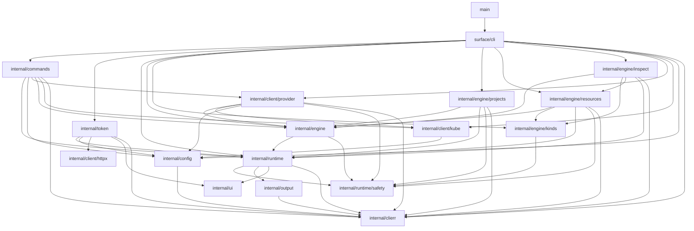

# Architecture

`rancher` is a kubectl-style CLI for Rancher Manager, built for both operators at a
terminal and coding agents (Claude Code, Codex, …). It is agent-first: every command
describes its own surface via `rancher schema`, so automation discovers capabilities
without reading docs, and non-interactive output is a stable, versioned JSON envelope.

## Overview

**Resource operations go exclusively through Rancher's Kubernetes API.** Every `get` /
`create` / `delete` request is a client-go call against Rancher's k8s proxy —
`/k8s/clusters/local` for management-plane kinds, `/k8s/clusters/<id>` for downstream
clusters. There is no Norman/`v3` code on the resource path.

**One documented exception: interactive auth-provider login.** `auth get-token` (the
kubectl exec-credential plugin) authenticates against Rancher's legacy public
endpoints — `/v1-public/authproviders`, falling back to `/v3-public/authProviders` on
404 — because no Kubernetes-native login equivalent exists yet. This is the only
subsystem that talks to Rancher's non-k8s API; migrating it is the intended first job of
the reserved `RancherClient` port (see [Key design decisions](#key-design-decisions)).

**Output envelope.** All commands emit the versioned `cli.rancher.io/v1` envelope on
stdout and exit with a typed code (`AUTH`, `RBAC`, `VALIDATION`, `CONFLICT`,
`NOT_FOUND`, `CONFIRMATION_REQUIRED`, `DRY_RUN_NOT_APPLICABLE`, `AMBIGUOUS_SELECTION`,
`NOT_IMPLEMENTED`, `CONTEXT_NOT_SET`, `GENERIC`) — with two raw exceptions. `auth
get-token`'s stdout is a bare `ExecCredential` JSON object for kubectl to parse; that
command sets `runtime.Result.Raw`, which tells the pipeline to emit `Data` with no
envelope. `kubeconfig`'s stdout is a bare kubeconfig YAML document; that command sets
`runtime.Result.RawBytes`, which tells the pipeline to write the bytes verbatim with no
envelope and no encoding.

## Layer map

Responsibilities only — **dependencies live in exactly one place, the mermaid diagram
below.** The `architecture_test.go` conformance test parses that diagram and fails the
build if it drifts from the real package import graph, so there is no "depends on"
column here to fall out of sync (keeping two hand-written views of the same facts is
what drifted the previous revision of this doc).

| Package | Responsibility |
|---|---|
| `main` | Process entrypoint: build the root command, run it, honor the adapter's exit code. |
| `surface/cli` | urfave/cli/v3 surface: declarative entry table, per-invocation cluster-client factory, adapts commands into the runtime pipeline. |
| `internal/commands` | Bespoke local commands: `auth login/logout/check`, context and server management, `config purge-legacy`, `kubeconfig`. |
| `internal/token` | `auth get-token/list-tokens/delete-token`: the exec-credential plugin (basic / SAML / OAuth login flows) and its token cache. |
| `internal/runtime` | Command contracts and the single middleware pipeline (validate → plan/gate → render), plus registry, resolver, and the `schema` command. |
| `internal/runtime/safety` | Safety value types: closed `Action` vocabulary, `Tier`/`Stability` `Binding`, and the `Effect` mutation-preview model. |
| `internal/engine` | Pure domain layer: `ClusterClient`/`ClusterClientFactory` ports and reusable plan/execute helpers; depends only on runtime + safety contracts. |
| `internal/engine/kinds` | Single source of kind knowledge for generic verbs: MCP keys, CLI names/aliases, GVRs, scope, deletability, tier bindings, table columns. |
| `internal/engine/resources` | Generic table-driven verbs (`get`, `delete`) parameterized by a `kinds.Kind`, including scope-based routing and table projection. |
| `internal/engine/inspect` | Read composites (`inspect pod`/`deployment`, `top node`, `images`, `usage`): bespoke ReadCommands joining several cluster reads into one document, degrading metrics/log fetch failures to warnings. |
| `internal/engine/projects` | The bespoke `create project` mutating command (dry-run plan → execute a `management.cattle.io/v3` Project). |
| `internal/config` | On-disk kubeconfig-shaped config plus credential store: load/write, effective resolution, env-override merge, legacy migration, store selection/pinning. |
| `internal/client/provider` | Concrete Rancher-proxied k8s adapter: dynamic `ClusterClient`, bespoke op→tier `Resolver`, connectivity `Preflight`, and k8s→`clierr` error mapping. |
| `internal/client/kube` | Builds client-go artifacts (`rest.Config`, dynamic + discovery clients) aimed at the Rancher k8s proxy endpoint. |
| `internal/client/httpx` | Constructs a hardened `*http.Client` (TLS floor / CA / insecure, proxy, timeouts) used only by `internal/token`'s auth-provider HTTP flows. |
| `internal/output` | The versioned stdout envelope and multi-format renderer (table / json / yaml / name / template), including the error envelope. |
| `internal/clierr` | Structured CLI error type with stable error codes, exit-code mapping, and candidate/hint enrichment. |
| `internal/ui` | TTY prompter/notifier: prompts and notices to stderr, refusing interaction without a TTY or under `--no-input`. |

## Package dependency diagram

Machine-checked against the real import graph by `architecture_test.go`
(`TestArchitectureDocMatchesImports`). Edit an import, and the test tells you exactly
which edge to add or remove here.

## Command pipeline

Every command runs through `runtime.Run`, which type-switches on the command interface.

**Mutating flow** (`MutatingCommand`, e.g. `delete pod`, `create project`):

1. `validateInput` — required positional args, required flags, enum membership.
2. `Plan(ctx, in)` returns `(safety.Effect, ExecuteFunc, error)`. Plan resolves the
   target object, its `resourceVersion`, and the `ClusterClient`, and returns a closure
   that captures them. Execute cannot diverge from what Plan previewed because Execute
   *is* the closure Plan built (Approach B). Plan issues a **server-side dry-run** of the
   write to surface admission/RBAC/webhook denials before the user confirms.
3. Pipeline invariants (enforced centrally, never trusted from command code):
   - `Effect.Action` must be in the closed enum `{create, update, delete, scale}`;
     unknown → structured error before any gate.
   - `Action == delete` ⇒ `Destructive == true`.
   - `Effect.Tier` / `Effect.Stability` are **overwritten** from the resolver binding,
     discarding whatever Plan set — gate inputs come from the resolver, not the command.
   - `Effect.Server` is stamped from the factory's resolved identity; `Effect.Cluster` is
     set by Plan. Dry-run output and gating state *where* the mutation lands.
4. `--dry-run` renders the Effect and stops (the executor closure is discarded).
5. Gates, in order: `--apply` (always) → `--yes` (only if `Destructive`) →
   `--allow-deprecated` (only if `Stability == deprecated`). A missing gate →
   `CONFIRMATION_REQUIRED`.
6. `exec(ctx)` runs the real write; the result renders through the envelope.

**Server-side dry-run has real RBAC semantics.** `--dry-run` sends `DryRunAll` to the API
server, which authorizes it with the *same* verb as the real write. An agent with
read-only permissions gets an `RBAC` error (exit code 6) from `--dry-run` — that means
"the write would be denied", **not** "dry-run is broken". The Norman-tier / no-conflict-
detection warning is emitted on both the dry-run Effect and the applied result.

**Read flow** (`ReadCommand`, e.g. `get pod`): `validateInput` → `Execute(ctx, in,
prompter)` → render. `--dry-run` on a read command is rejected with
`DRY_RUN_NOT_APPLICABLE`.

**`CommandType: local` does not mean offline.** `auth check` and `auth get-token` are
`local` (they own their own I/O rather than going through the cluster-client factory) yet
both do network + auth. The manifest's per-command `network` and `auth` booleans are the
authoritative "does this touch the network / need credentials" signal — not
`commandType`.

## Generic verbs & registration

**Kind table (`internal/engine/kinds`).** One row per resource kind: `Key` (canonical
MCP-vocabulary key — `managementcluster`, `project`, `pod`, …), `Name` (CLI-facing
singular — `cluster`, `project`, `pod`), `Aliases`, `GVR`, `Namespaced`, `Scope`
(`management` | `downstream`), `Deletable`, `Binding` (tier/stability for the generated
generic ops), and table `Columns`. `Key` is conformance-tested against a pinned fixture
copied from rancher-ai-mcp (`testdata/mcp-kinds-050e375.json`) — the test matches on
`Key`, never `Name`, so the CLI's user-facing vocabulary can evolve independently of the
MCP identity.

**Scope routing / safety rule** (`resources.route`, shared by get and delete):

- Management + Namespaced, addressing a resource *by name* → `--cluster` required.
- Downstream + Namespaced, by name → `--namespace` required (a downstream `--cluster`
  falls back to the context cluster, then errors if still unset).
- Nameless *list* requests may omit both. `delete` marks the required flags at the
  urfave layer, so they fail with `VALIDATION` before Plan runs.

**Binding ownership — one source per op.** The kind table owns bindings for the
*generated* generic ops (`get <kind>` for every kind, `delete <kind>` for deletable
kinds). The provider's bespoke `Resolver` owns everything else (today just `create
project`). `runtime.ComposeResolvers` merges the two and **rejects any op resolved by
both** at `BuildRoot`. Every engine command — read or mutating — must resolve to a
binding, or `BuildRoot` fails.

**Declarative registration (`surface/cli/root.go`).** Commands live in one `entry` table
(`group`, and exactly one of an `engine` or `local` constructor). `BuildRoot` loops the
table: probes `Describe()` for nil-safety, validates (unique name; command name is 1 or 2
space-separated tokens and its group matches the leading token; `commandType` matches the
implemented interface; engine commands resolve to a binding), registers into the registry
for schema, and wires the adapter. Command groups are derived from the entries in
first-appearance order — there is **no group allowlist**; an unknown group still yields a
reachable command.

**Extension checklist:**

- New resource kind → add a kind-table row (plus a fixture entry if MCP defines the key).
  No new code — `get`/`delete` are generated from the row.
- New bespoke command → add an `entry`-table row, plus a `Resolver`-map row if it is an
  engine command. Everything else (name shape, binding coverage, interface/commandType
  agreement) is validated at `BuildRoot`.

## Auth & credentials

**Login and the credential store.** `auth login` records the server and stores a manually
supplied token. The store backend is resolved by `config.OpenStore` with strict
precedence:

`RANCHER_CREDENTIAL_STORE` env > `credentialStore` in `config.yaml` > `credstore-pin`
file > one-time probe.

Under the default `auto` policy the backend is probed **once per machine** and the result
(`keychain` or `file`) is written to a machine-local `credstore-pin` file (0600) — never
into `config.yaml`, which is a portable user declaration that must not carry
machine-specific probe state. First resolution prints a loud stderr notice when it lands
on plaintext. Re-probe happens **only at `auth login`** and is **upgrade-only**: a `file`
(or absent) pin may re-pin to `keychain` if the keychain is now usable; a `keychain` pin
is never re-probed, so a transiently locked keychain can never silently downgrade to
plaintext. A pinned-but-unusable backend is a **hard error** with a remediation hint
(`delete the pin to re-probe, or set RANCHER_CREDENTIAL_STORE=file`), never a silent
fallback. `auth check` surfaces `credentialStore: {policy, pinned}`.

**Keyring read-through and logout drain.** With the keychain backend, `GetToken` falls
through to the file store on a keychain miss, so tokens written before an upgrade re-pin
keep working. `config.DrainToken` (logout) drains **both** backends unconditionally —
because read-through makes the file store part of the effective read path under every
policy — aggregating per-backend errors with `errors.Join` and reporting which backends a
token was `deletedFrom`. No orphaned live tokens.

**Exec-credential cache.** `auth get-token` caches short-lived bearer tokens as records
(`{Name, Server, Cluster, Token, Expiry}`) keyed `<name>@<serverHost>/<cluster>` in
`token-cache.yaml` (0600), separate from login tokens in `credentials.yaml`. A
**flags-first fast path** serves a warm hit from `--name`/`--server`/`--cluster` alone
with no config read, so a broken config never blocks kubectl's exec-credential path; full
connection resolution runs only on a miss. `delete-token <name>` resolves the bare name
against every record and **deletes all matches**, and is **idempotent** (zero matches →
success, never `NOT_FOUND`) so teardown scripts stay green.

**CS-5 posture (accepted).** Even under the keychain backend, the exec-credential cache
— live short-lived bearer tokens — still lives in `token-cache.yaml` on disk (0600). The
OS keychain has no list API, and `auth list-tokens` needs enumeration, so the cache is
file-backed regardless of policy. Accepted trade-off.

**Auth-provider subsystem (`internal/token`).** Login discovers providers at
`/v1-public/authproviders` (falling back to `/v3-public/authProviders` on 404) and then
runs the matching flow: **basic** (username/password), **SAML** (generates an RSA-2048
keypair, sends the public key, polls the auth-token URL every 10s up to 15 min, and
decrypts the returned token with RSA-OAEP/SHA-256), or **OAuth / Azure AD** (device-code
by default, or PKCE auth-code with a `127.0.0.1` callback). All of this HTTP goes through
`internal/client/httpx`, whose `Options` set the TLS floor, CA, proxy, and timeouts;
`--skip-verify` on `auth get-token` sets `InsecureSkipVerify` for that client only.

**Environment overrides.** Applied over the file-based context, env always wins:

| Variable | Effect |
|---|---|
| `RANCHER_URL` | Override the effective server URL. |
| `RANCHER_TOKEN` | Override the bearer token directly — used as-is, never read from or written to the store. |
| `RANCHER_CACERT` | Override the CA bundle. |
| `RANCHER_CONTEXT` | Set the target cluster (and project, as `cluster:project`). |
| `RANCHER_CONFIG_DIR` | Config directory (below `--config`, above `$XDG_CONFIG_HOME/rancher` then `~/.config/rancher`). |
| `RANCHER_CREDENTIAL_STORE` | Highest-precedence credential-store policy (`keychain` \| `file` \| `auto`). |

**Legacy migration.** On a run whose config dir has no `config.yaml`, if a legacy
`cli2.json` is found (`$RANCHER_CONFIG_DIR/cli2.json`, then `~/.rancher/cli2.json`), it is
imported **only** when the config dir was not explicitly overridden. An explicitly
overridden dir (`--config` or `RANCHER_CONFIG_DIR`) never auto-imports — it logs a hint
instead — so a run against a throwaway dir cannot silently pull in the real
`~/.rancher/cli2.json`. `config purge-legacy` deletes the migrated plaintext file.

## Key design decisions

**Deferred `ClusterClientFactory` (once-only identity).** `engine.ClusterClientFactory`
is a port; the concrete `clientFactory` (in `surface/cli`) loads config and computes the
effective connection **once per invocation** under a `sync.Once`. `Cluster(id)` builds
and memoizes a `ClusterClient` per cluster ID under a mutex (safe under future concurrent
fan-out); `""` is rejected. `ResolveCluster(nameOrID)` maps a display name or ID to a
cluster ID (matching `metadata.name` or `spec.displayName`), memoized per invocation.
Server identity is deliberately **not** on the port interface — it lives on the concrete
factory and the adapter reads it to stamp `Effect.Server`, so a `Plan`/`Execute` pair can
never see two different servers.

**Approach B — Plan returns the executor.** `MutatingCommand.Plan` returns the
`ExecuteFunc` closure rather than the pipeline calling a separate `Execute` method. The
object, resourceVersion, and client that Execute uses are captured at Plan time, so
Execute structurally cannot act on anything Plan did not preview.

**Pipeline-stamped gate inputs.** Tier, stability, destructiveness, and server identity
that drive the gates are stamped by the pipeline from the resolver binding and factory —
never read from values the command returned — so a command cannot weaken its own gates.

**Machine-local pin file.** The credential-store decision is a machine-local probe result
(`credstore-pin`), not portable config, and needs no lock: concurrent first-runs
last-writer-win with identical values and self-correct on the next run. Writing it into
`config.yaml` would be a lost-update race from read-only commands and would bake
machine-specific state into a portable file.

**Kind table + composed resolver.** Generic verbs are generated from a declarative kind
table whose MCP keys are conformance-pinned, and each op's safety binding has exactly one
owner (kind table for generated ops, bespoke `Resolver` for the rest), with overlaps
rejected at `BuildRoot`.

**Schema manifest as the discovery contract.** `rancher schema` emits a golden-tested
manifest: per-command args/flags, `commandType`, `destructive`
(`true`/`false`/`dependsOnInput`), `toolset` (`core` today), `network`, `auth`, tier,
stability, and aliases, plus the global flags, error-code enum, and an `effectSchema`
(the `Effect` field names and the closed `Action` enum) so agents can parse `--dry-run`
output from the manifest alone.

**Reserved `RancherClient` port.** `ClusterClient` covers the two cluster-scoped endpoint
families (`/k8s/clusters/local` and `/k8s/clusters/<id>`). Management-*plane* operations
that are not operations on any cluster — minting a token, generating a kubeconfig — need
a third scope against the Rancher server itself. That port, `RancherClient`, is reserved
now and added when the first consumer needs it: migrating `internal/token` off its
hand-rolled Norman HTTP, the `auth check` preflight, and a future `rancher kubeconfig`
command. The factory struct is the seam that will later hand out both.
