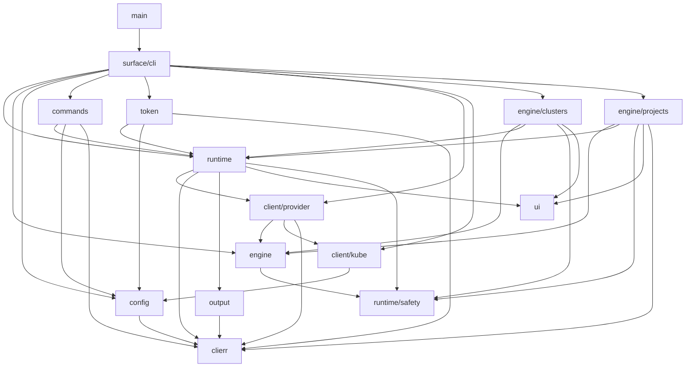
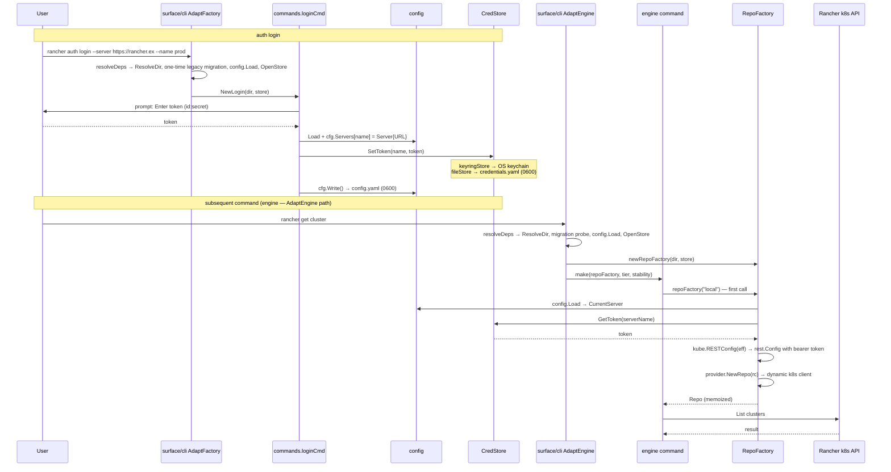

# Architecture

## Overview

`rancher` is a kubectl-style CLI for Rancher Manager, targeting both user operators and terminal coding agents (Claude Code, Codex, etc.). It talks exclusively to Rancher's Kubernetes API — no Norman dependency. Non-interactive commands emit a versioned JSON envelope on stdout; all commands exit with a typed code and describe their full surface via `rancher schema` so agents can discover capabilities without documentation.

## Layer map

| Layer | Package(s) | Responsibility | Depends on |
|---|---|---|---|
| Entry | `main` | Signal-cancellable context; exit-code dispatch | `surface/cli` |
| Wiring | `surface/cli` | Root command, `AdaptFactory`, `AdaptEngine`, `newRepoFactory`, DI | All layers below |
| Commands | `internal/commands` | `auth login/logout/check`, `config *` | `runtime`, `config`, `clierr` |
| Token | `internal/token` | `auth get-token/list/delete` (exec-credential plugin) | `runtime`, `config`, `clierr` |
| Runtime | `internal/runtime` | `Command` contract, pipeline (Mutating: validate → Plan → gate → Execute; ReadOnly/Local: validate → Execute), Registry/schema | `client/provider`, `clierr`, `output`, `ui`, `runtime/safety` |
| Safety | `internal/runtime/safety` | `Effect` struct (`Action`, `Target`, `Diff`, `ResourceVersion`, `ConflictDetection`, `Reversible`, `Destructive`, `Tier`, `Stability`) | — |
| Engine | `internal/engine` | Pure domain ops (`PlanCreate`, …), `Repo` port, `RepoFactory` | `runtime/safety` |
| Engine subdomains | `internal/engine/clusters`, `internal/engine/projects` | Resource-specific Plan/Execute logic | `engine`, `runtime`, `runtime/safety`, `ui`, `clierr` (projects only) |
| Config | `internal/config` | XDG config load/write, `CredStore` (keyring + file), migration, env-override merge | `clierr` |
| Client/provider | `internal/client/provider` | Dynamic k8s client implementing `Repo`; `Resolver` (op → tier/stability map) | `engine`, `client/kube`, `clierr` |
| Client/kube | `internal/client/kube` | `rest.Config` builder from `config.Effective` | `config` |
| Output | `internal/output` | Versioned `cli.rancher.io/v1` envelope, table/JSON/YAML/template renderers | `clierr` |
| Errors | `internal/clierr` | Typed `Error` (code, hint, candidates, phase), exit codes | — |
| UI | `internal/ui` | TTY prompter; respects `--no-input` | — |

## Package dependency diagram



## Command invocation flow

Engine command (`create project --apply`). `AdaptFactory` commands follow the same path but skip the RepoFactory step. `--dry-run` exits after Plan, before the gate check and Execute.

```mermaid
sequenceDiagram
    participant U as User
    participant CLI as urfave/cli
    participant Adapt as surface/cli AdaptEngine
    participant RT as runtime.Run
    participant Cmd as engine command
    participant RF as RepoFactory
    participant Repo as client/provider
    participant API as Rancher k8s API

    U->>CLI: rancher create project web --cluster c-x --apply
    CLI->>Adapt: action(ctx, c)
    Adapt->>Adapt: resolveDeps → dir, store
    Adapt->>RF: newRepoFactory(dir, store) — closure, no I/O yet
    Adapt->>Cmd: make(repoFactory, tier, stability)
    Adapt->>RT: runtime.Run(ctx, cmd, input, io)
    RT->>RT: validateInput (required positional args, required flags, enum membership)
    RT->>Cmd: Plan(ctx, in)
    Cmd->>RF: repoFactory("clusterID") — first call
    RF->>RF: config.Load + cfg.Effective(store)
    RF->>RF: kube.RESTConfig(eff) → rest.Config
    RF->>Repo: provider.NewRepo(rc)
    RF-->>Cmd: Repo (memoized in closure)
    Cmd->>API: Create(dryRun=true) — server-side dry-run
    API-->>Cmd: validated object
    Cmd-->>RT: Effect
    RT->>RT: check gates (--apply; --yes if Destructive; --allow-deprecated if stability=deprecated)
    RT->>Cmd: Execute(ctx, in, eff, prompter)
    Cmd->>RF: repoFactory("clusterID") — cache hit, same Repo
    RF-->>Cmd: memoized Repo
    Cmd->>API: Create(dryRun=false)
    API-->>Cmd: created object
    Cmd-->>RT: Result
    RT->>RT: output.Render → versioned envelope on stdout
```

## Auth / credential resolution flow



## Key design decisions

**Deferred Repo construction via `RepoFactory`**
`engine.Repo` is a port interface; no live connection is created at command construction time. `newRepoFactory` returns a closure that builds a `Repo` on first call for a given cluster ID. Flag parsing, `--config` resolution, migration, and credential reads all complete before any network I/O. `--dry-run` previews an Effect without ever opening a live write connection.

**Per-invocation factory + memoization**
A fresh `RepoFactory` closure (with its own `cache map[string]Repo`) is created per command invocation inside the `AdaptEngine` action. `Plan` and `Execute` receive the same factory and share the same memoized `Repo` — one config read, one credential read, one TLS handshake per invocation. A concurrent `auth login` between Plan and Execute cannot swap credentials mid-flight.

**Pluggable credential store**
`config.CredStore` is an interface. `OpenStore` selects the backend from `credentialStore` in `config.yaml` or `RANCHER_CREDENTIAL_STORE`. `keyringStore` wraps `zalando/go-keyring` (OS keychain) for long-lived login tokens and delegates the exec-credential cache to `fileStore` — the keychain has no list API. `fileStore` keeps everything in `0600` YAML files. `auto` (the default) probes the keychain at startup and falls back to file if unusable.

**Registry-driven schema surface**
`runtime.Registry` holds one lightweight instance of every registered command (built with `nil` repo / empty dir). `rancher schema` merges each command's `Describe()` with `Resolver`'s tier/stability map to emit a versioned manifest: CLI version, output `apiVersion`, error-code enum, global flags, and per-command args/flags/`commandType`/tier/stability. Automation discovers the full surface without documentation. The `Resolver` is the single place a tier promotion lands — no command code changes needed.

## Extension points

### Adding an engine command

1. Implement `runtime.Command` in `internal/engine/<subdomain>/`. The constructor takes `(newRepo engine.RepoFactory, tier, stability string)`. `Describe()` must not call `newRepo`.
2. Add an entry to `NewResolver()` in `internal/client/provider/resolver.go` with the canonical singular op name, tier, and stability.
3. In `surface/cli/root.go`:
   - Define a factory: `myF := func(newRepo engine.RepoFactory, tier, stability string) runtime.Command { return mysubdomain.NewMyCmd(newRepo, tier, stability) }`
   - Obtain the tier binding: `tc, sc := reg.Binding("my op")`
   - Register for schema: `reg.Register(myF(nil, tc, sc))`
   - Wire into the command tree: `AdaptEngine("my op", reg, myF)` under the appropriate verb group.

### Adding a config-touching command

1. Implement `runtime.Command` in `internal/commands/` (or `internal/token/`). The constructor takes `(dir string, store config.CredStore)`. `Describe()` must not use `dir` or `store`.
2. In `surface/cli/root.go`:
   - Define a factory: `myF := func(dir string, s config.CredStore) runtime.Command { return commands.NewMyCmd(dir, s) }`
   - Register for schema: `reg.Register(myF("", nil))`
   - Wire into the command tree: `AdaptFactory(myF)` under the appropriate group.
