# Architecture

`rancher` is a kubectl-style CLI for Rancher Manager, built for both operators at a
terminal and coding agents (Claude Code, Codex, …). It is agent-first: every command
describes its own surface via `rancher schema`, so automation discovers capabilities
without reading docs, and non-interactive output is a stable, versioned JSON envelope.

## Overview

**Resource operations go exclusively through Rancher's Kubernetes API.** Every `get` /
`create` / `delete` request is a client-go call against Rancher's k8s proxy —
`/k8s/clusters/local` for management-plane kinds, `/k8s/clusters/<id>` for downstream
clusters. There is no Norman/`v3` code on the resource path.

**Two documented exceptions: interactive auth-provider login, and root reads.** `auth
get-token` (the kubectl exec-credential plugin) authenticates against Rancher's legacy
public endpoints — `/v1-public/authproviders` — because no Kubernetes-native login
equivalent exists yet; migrating it is the intended first job of the reserved
`RancherClient` port (see [Key design decisions](#key-design-decisions)). The other is
`engine.RootClient`, a GET-only read port for Steve `/v1` collections and the
channel-server release routes that no per-cluster `/k8s/clusters/<id>` proxy can reach —
writes remain CRD-through-proxy exclusively; nothing on this port can mutate state.

**Output envelope.** All commands emit the versioned `cli.rancher.io/v1` envelope on
stdout and exit with a typed code (`AUTH`, `RBAC`, `VALIDATION`, `CONFLICT`,
`NOT_FOUND`, `CONFIRMATION_REQUIRED`, `DRY_RUN_NOT_APPLICABLE`, `AMBIGUOUS_SELECTION`,
`CONTEXT_NOT_SET`, `GENERIC`) — with two raw exceptions. `auth
get-token`'s stdout is a bare `ExecCredential` JSON object for kubectl to parse; that
command sets `runtime.Result.Raw`, which tells the pipeline to emit `Data` with no
envelope. `kubeconfig`'s stdout is a bare kubeconfig YAML document; that command sets
`runtime.Result.RawBytes`, which tells the pipeline to write the bytes verbatim with no
envelope and no encoding.

## Layer map

Responsibilities only — **dependencies live in exactly one place, the mermaid diagram
below.** The `architecture_test.go` conformance test parses that diagram and fails the
build if it drifts from the real package import graph, so there is no "depends on"
column here to fall out of sync (keeping two hand-written views of the same facts is
what drifted the previous revision of this doc).

| Package | Responsibility |
|---|---|
| `main` | Process entrypoint: build the root command, run it, honor the adapter's exit code. |
| `surface/cli` | urfave/cli/v3 surface: declarative entry table, per-invocation cluster-client factory, adapts commands into the runtime pipeline. |
| `internal/commands` | Bespoke local commands: `auth login/logout/check`, context and server management, `kubeconfig`, `completion`. |
| `internal/commands/completions` | The four in-repo shell completion scripts `completion <shell>` emits (adapted from urfave/cli's own, MIT-attributed), embedded via `go:embed`. |
| `internal/token` | `auth get-token/list-tokens/delete-token`: the exec-credential plugin (basic / SAML / OAuth login flows) and its token cache. |
| `internal/runtime` | Command contracts and the single middleware pipeline (validate → plan/gate → render), plus registry, resolver, and the `schema` command. |
| `internal/runtime/safety` | Safety value types: closed `Action` vocabulary, `Contract`/`Stability` `Binding`, and the `Effect` mutation-preview model. |
| `internal/engine` | Pure domain layer: `ClusterClient`/`ClusterClientFactory` ports, downstream-cluster resolution, and reusable plan/execute helpers; depends only on runtime + safety + clierr contracts. |
| `internal/engine/kinds` | Single source of kind knowledge for generic verbs: MCP keys, CLI names/aliases, GVRs, scope, deletability, contract bindings, table columns. |
| `internal/engine/resources` | Generic table-driven verbs (`get`, `delete`) parameterized by a `kinds.Kind`, including scope-based routing (cluster/namespace, plus `--project` resolution and membership validation) and table projection. |
| `internal/engine/inspect` | Read composites (`inspect pod`/`deployment`/`project`/`cluster`, `images`, `usage`): bespoke ReadCommands joining several cluster reads into one document, degrading metrics/log/prtb/provisioning/registration fetch failures to warnings. |
| `internal/engine/projects` | The bespoke `create project` mutating command (dry-run plan → execute a `management.cattle.io/v3` Project), plus project name resolution and member-namespace lookup. |
| `internal/engine/provisioning` | Cloud-credential resolution (`cattle-global-data` Secrets, id-or-display-name matching) and the read-only `get cloud-credential` listing — reads Secret metadata and `data` key names only, never a `data` value. Also the per-kind overrides for `clusterregistrationtoken`: `get` reads Steve `/v1` directly (the only place the real token is spliced into the command/manifest fields) and `patch` is refused outright (read-only surface). The CRT decode is a policy-neutral exported boundary (`CRTObject`, `PlaceholderFields`, `FetchDefaultCRT`) consumed by both the get override and `inspect cluster`. |
| `internal/engine/extres` | The fixed mutating commands for the aggregated `ext.cattle.io/v1` API: `create token` (server-derived tokens) and `create kubeconfig` (server-minted kubeconfigs), plus the shared `--ttl` duration parser. |
| `internal/engine/managementtoken` | Per-kind overrides for `management-token` (management.cattle.io/v3 Token): `patch` is refused outright (writes must go through Rancher's auth lifecycle) and `delete` is guarded — deleting the token backing the active CLI session is rejected with a hint to use `auth logout` instead. |
| `internal/engine/observe` | Curated Rancher-component log reads (`logs <target>`) and the API-reachable support-bundle export: one target table (server/agent/fleet-agent/kube-api-auth/webhook), one per-pod log fetcher, and the archive writer. |
| `internal/engine/rbac` | Subject parsing, type inference, and scope resolution for grant/revoke commands, plus a delete-user override that guards against self-deletion: closed principal-type inference from fully qualified principals (user/group detection), bare-name handling, deterministic user-id hashing matching Rancher's EnsureUser, and binding-kind resolution (cluster/project/global). |
| `internal/config` | On-disk kubeconfig-shaped config plus credential store: load/write, effective resolution, env-override merge, store selection/pinning. |
| `internal/client/selfuser` | Shared GVR, object constructor, and userID extractor for the ext.cattle.io/v1 SelfUser identity probe — used by the auth check identity check (`internal/client/provider`) and the create cluster creatorId stamper (`internal/engine/provisioning`). |
| `internal/client/provider` | Concrete Rancher-proxied k8s adapter: dynamic `ClusterClient`, bespoke op→contract `Resolver`, connectivity `Preflight`, and k8s→`clierr` error mapping. |
| `internal/client/kube` | Builds client-go artifacts (`rest.Config`, dynamic + discovery clients) aimed at the Rancher k8s proxy endpoint. |
| `internal/client/httpx` | Constructs a hardened `*http.Client` (TLS floor / CA / insecure, proxy, timeouts) used by `internal/token`'s auth-provider HTTP flows and by `surface/cli`'s GET-only `engine.RootClient` (Steve `/v1` and channel-server reads). |
| `internal/output` | The versioned stdout envelope and multi-format renderer (table / json / yaml / name / template), including the error envelope. The render layer scrubs `metadata.managedFields` from all structured output formats (kubectl-parity, MF-2). |
| `internal/clierr` | Structured CLI error type with stable error codes, exit-code mapping, and candidate/hint enrichment. |
| `internal/ui` | TTY prompter/notifier: prompts and notices to stderr, refusing interaction without a TTY or under `--no-input`. |
| `internal/skillinstall` | Installs the embedded rancher agents skill into coding-agent harness skill directories (claude, codex, copilot, agents) with env-override support, user/project scope resolution, presence detection, and provenance/digest stamping. |
| `internal/testrancher` | Test-only fake of Rancher's public auth surface (`/v1-public/*`) and the ext.cattle.io/v1 Token store's imperative mint/revoke behavior, for the e2e harness and unit tests. No production package may import it. |
| `internal/testrancher/fidelity` | The fidelity oracle for that fake: data-defined probes recorded against a real, digest-pinned Rancher (`make e2e-real`) and replayed against the composite façade by `make e2e`, so drift from real-server behavior fails the build or is pinned as an explicit, machine-checked divergence. Test-only. |

## Package dependency diagram

Machine-checked against the real import graph by `architecture_test.go`
(`TestArchitectureDocMatchesImports`). Edit an import, and the test tells you exactly
which edge to add or remove here.

```mermaid
graph TD
    main["main"]
    cli["surface/cli"]
    commands["internal/commands"]
    completions["internal/commands/completions"]
    token["internal/token"]
    runtime["internal/runtime"]
    safety["internal/runtime/safety"]
    engine["internal/engine"]
    kinds["internal/engine/kinds"]
    resources["internal/engine/resources"]
    inspect["internal/engine/inspect"]
    projects["internal/engine/projects"]
    provisioning["internal/engine/provisioning"]
    extres["internal/engine/extres"]
    managementtoken["internal/engine/managementtoken"]
    observe["internal/engine/observe"]
    rbac["internal/engine/rbac"]
    config["internal/config"]
    fakehelper["internal/config/testdata/fakehelper"]
    credhelper["credhelper"]
    selfuser["internal/client/selfuser"]
    provider["internal/client/provider"]
    kube["internal/client/kube"]
    httpx["internal/client/httpx"]
    output["internal/output"]
    clierr["internal/clierr"]
    ui["internal/ui"]
    skillinstall["internal/skillinstall"]
    testrancher["internal/testrancher"]
    fidelity["internal/testrancher/fidelity"]

    main --> cli
    main --> skillinstall

    cli --> commands
    cli --> token
    cli --> runtime
    cli --> engine
    cli --> kinds
    cli --> projects
    cli --> provisioning
    cli --> managementtoken
    cli --> extres
    cli --> observe
    cli --> resources
    cli --> inspect
    cli --> rbac
    cli --> provider
    cli --> kube
    cli --> config
    cli --> credhelper
    cli --> clierr
    cli --> output
    cli --> httpx
    cli --> safety

    commands --> runtime
    commands --> completions
    commands --> config
    commands --> credhelper
    commands --> provider
    commands --> engine
    commands --> extres
    commands --> token
    commands --> kube
    commands --> httpx
    commands --> clierr
    commands --> skillinstall

    token --> runtime
    token --> config
    token --> credhelper
    token --> httpx
    token --> kube
    token --> ui
    token --> clierr
    token --> projects

    runtime --> safety
    runtime --> output
    runtime --> ui
    runtime --> clierr

    engine --> runtime
    engine --> safety
    engine --> clierr

    kinds --> clierr
    kinds --> safety

    resources --> engine
    resources --> kinds
    resources --> projects
    resources --> runtime
    resources --> safety
    resources --> clierr

    inspect --> engine
    inspect --> kinds
    inspect --> output
    inspect --> projects
    inspect --> provisioning
    inspect --> resources
    inspect --> runtime
    inspect --> clierr

    projects --> engine
    projects --> kinds
    projects --> runtime
    projects --> safety
    projects --> clierr
    projects --> config

    provisioning --> engine
    provisioning --> kinds
    provisioning --> projects
    provisioning --> resources
    provisioning --> runtime
    provisioning --> safety
    provisioning --> clierr

    extres --> engine
    extres --> kinds
    extres --> runtime
    extres --> safety
    extres --> clierr

    managementtoken --> engine
    managementtoken --> kinds
    managementtoken --> resources
    managementtoken --> runtime
    managementtoken --> safety
    managementtoken --> clierr

    observe --> engine
    observe --> kinds
    observe --> extres
    observe --> runtime
    observe --> clierr

    rbac --> engine
    rbac --> kinds
    rbac --> projects
    rbac --> resources
    rbac --> selfuser
    rbac --> runtime
    rbac --> safety
    rbac --> clierr

    provisioning --> selfuser

    provider --> selfuser
    provider --> engine
    provider --> kinds
    provider --> kube
    provider --> config
    provider --> safety
    provider --> clierr

    kube --> config
    kube --> clierr

    config --> clierr
    config --> credhelper

    fakehelper --> credhelper
    fakehelper --> config

    output --> clierr

    testrancher --> token

    fidelity --> token
    fidelity --> testrancher
```

## Command pipeline

Every command runs through `runtime.Run`, which type-switches on the command interface.

**Mutating flow** (`MutatingCommand`, e.g. `delete pod`, `create project`):

1. `validateInput` — required positional args, required flags, enum membership.
2. `Plan(ctx, in)` returns `(safety.Effect, ExecuteFunc, error)`. Plan resolves the
   target object, its `resourceVersion`, and the `ClusterClient`, and returns a closure
   that captures them. Execute cannot diverge from what Plan previewed because Execute
   *is* the closure Plan built (Approach B). Plan issues a **server-side dry-run** of the
   write to surface admission/RBAC/webhook denials before the user confirms.
3. Pipeline invariants (enforced centrally, never trusted from command code):
   - `Effect.Action` must be in the closed enum `{create, update, delete}`;
     unknown → structured error before any gate.
   - `Action == delete` ⇒ `Destructive == true`.
   - `Effect.Action` is validated against the closed enum; the resolver `Binding` drives
     gate inputs — the command's Plan cannot override the contract or stability.
   - `Effect.Server` is stamped from the factory's resolved identity; `Effect.Cluster` is
     set by Plan. Dry-run output and gating state *where* the mutation lands.
4. `--dry-run` renders the Effect and stops (the executor closure is discarded).
5. Gates, in order: `--apply` (always) → `--yes` (only if `Destructive`) →
   `--allow-deprecated` (only if `Stability == deprecated`). A missing gate →
   `CONFIRMATION_REQUIRED`.
6. `exec(ctx)` runs the real write; the result renders through the envelope.

**Server-side dry-run has real RBAC semantics.** `--dry-run` sends `DryRunAll` to the API
server, which authorizes it with the *same* verb as the real write. An agent with
read-only permissions gets an `RBAC` error (exit code 6) from `--dry-run` — that means
"the write would be denied", **not** "dry-run is broken".

**Deliberate Plan-time network write: `create cluster` creatorId pre-stamping.** Before
the server-side dry-run, `create cluster` resolves the caller's identity via the
ext.cattle.io/v1 SelfUser probe — a real (non-dry-run) Create — and stamps the
resolved id into the `field.cattle.io/creatorId` annotation. rancher-webhook's mutator
stamps this annotation from `userInfo` on real creates but skips dry-run, while its
validator requires the annotation on dry-run; pre-stamping makes the dry-run honest. If
the probe fails, a `"creatorId not stamped"` warning is emitted and the create proceeds
unstamped — rancher-webhook may then deny the dry-run, but a real `--apply` create is
still expected to succeed (the mutator stamps identity server-side on real creates).
These are the two deliberate network writes before or during Plan — `create cluster` uses the SelfUser
probe for creatorId stamping, and `delete user` uses it for the self-delete guard. The
`delete user` guard runs pre-Plan (before the server-side dry-run): Rancher's own users
webhook refuses a self-delete dry-run before a post-Plan guard could fire, surfacing raw
webhook text; running the guard first ensures the curated lockout refusal with its hint wins.
All other writes are deferred into the exec closure and run only after the `--apply` gate.

**Read flow** (`ReadCommand`, e.g. `get pod`): `validateInput` → `Execute(ctx, in,
prompter)` → render. `--dry-run` on a read command is rejected with
`DRY_RUN_NOT_APPLICABLE`.

**Text-mode results.** A command may set `runtime.Result.Text` for a user-facing plain
default rendering (e.g. `logs`): under format `""`/`table` the pipeline writes `Text`
verbatim to stdout and `Warnings` to stderr as `# warning: <w>` lines, while `json`/
`yaml`/template/`-o name` still render the normal envelope over `Data` — mutually
exclusive with `RawBytes`.

**`CommandType: local` does not mean offline.** `auth check` and `auth get-token` are
`local` (they own their own I/O rather than going through the cluster-client factory) yet
both do network + auth. The manifest's per-command `network` and `auth` booleans are the
authoritative "does this touch the network / need credentials" signal — not
`commandType`.

## Generic verbs & registration

**Kind table (`internal/engine/kinds`).** One row per resource kind: `Key` (canonical
MCP-vocabulary key — `managementcluster`, `project`, `pod`, …), `Name` (CLI-facing
singular — `cluster`, `project`, `pod`), `Aliases`, `GVR`, `Namespaced`, `Scope`
(`management` | `downstream`), `Deletable`, `Binding` (contract/stability for the generated
generic ops), and table `Columns`. `Key` is conformance-tested against a pinned fixture
copied from rancher-ai-mcp (`testdata/mcp-kinds-050e375.json`) — the test matches on
`Key`, never `Name`, so the CLI's user-facing vocabulary can evolve independently of the
MCP identity.

**Scope routing / safety rule** (`resources.route`, shared by get and delete):

- Management + Namespaced, addressing a resource *by name* → `--cluster` required.
- Downstream + Namespaced, by name → `--namespace` required (a downstream `--cluster`
  falls back to the context cluster, then errors if still unset).
- Nameless *list* requests may omit both. `delete` marks the required flags at the
  urfave layer, so they fail with `VALIDATION` before Plan runs.

**Binding ownership — one source per op.** The kind table owns bindings for the
*generated* generic ops (`get <kind>` for every kind, `delete <kind>` for deletable
kinds). The provider's bespoke `Resolver` owns everything else (today just `create
project`). `runtime.ComposeResolvers` merges the two and **rejects any op resolved by
both** at `BuildRoot`. Every engine command — read or mutating — must resolve to a
binding, or `BuildRoot` fails.

**Declarative registration (`surface/cli/root.go`).** Commands live in one `entry` table
(`group`, and exactly one of an `engine` or `local` constructor). `BuildRoot` loops the
table: probes `Describe()` for nil-safety, validates (unique name; command name is 1 or 2
space-separated tokens and its group matches the leading token; `commandType` matches the
implemented interface; engine commands resolve to a binding), registers into the registry
for schema, and wires the adapter. Command groups are derived from the entries in
first-appearance order — there is **no group allowlist**; an unknown group still yields a
reachable command.

**Extension checklist:**

- New resource kind → add a kind-table row (plus a fixture entry if MCP defines the key).
  No new code — `get`/`delete` are generated from the row.
- New bespoke command → add an `entry`-table row, plus a `Resolver`-map row if it is an
  engine command. Everything else (name shape, binding coverage, interface/commandType
  agreement) is validated at `BuildRoot`.

## Auth & credentials

**Login and the credential store.** `auth login` records the server and stores a manually
supplied token. The store backend is resolved by `config.OpenStore` with strict
precedence:

`RANCHER_CLI_CREDENTIAL_STORE` env > `credentialStore` in `config.yaml` > `credstore-pin`
file > one-time probe.

Under the default `auto` policy the backend is probed **once per machine** and the result
(`keychain` or `file`) is written to a machine-local `credstore-pin` file (0600) — never
into `config.yaml`, which is a portable user declaration that must not carry
machine-specific probe state. First resolution prints a loud stderr notice when it lands
on plaintext. Re-probe happens **only at `auth login`** and is **upgrade-only**: a `file`
(or absent) pin may re-pin to `keychain` if the keychain is now usable; a `keychain` pin
is never re-probed, so a transiently locked keychain can never silently downgrade to
plaintext. A pinned-but-unusable backend is a **hard error** with a remediation hint
(`delete the pin to re-probe, or set RANCHER_CLI_CREDENTIAL_STORE=file`), never a silent
fallback. `auth check` surfaces `credentialStore: {policy, pinned}`.

**Keyring read-through and logout drain.** With the keychain backend, `GetToken` falls
through to the file store on a keychain miss, so tokens written before an upgrade re-pin
keep working. `config.DrainLoginToken` drains a server's login token from **both**
backends unconditionally — because read-through makes the file store part of the
effective read path under every policy — aggregating per-backend errors with
`errors.Join` and reporting which backends were drained.

Logout has two paths, not one, because they need different completeness/cost tradeoffs:
- **Single-server** (`auth logout <name>`) calls `config.DrainToken`, which wraps
  `DrainLoginToken` and additionally drains every exec-credential cache entry whose
  `Server` matches THAT server's host (reported as `deletedCache`). Draining by HOST
  rather than by config-entry name is deliberate fail-safe behavior, not an oversight: a
  cache entry embeds the entry name only by kubeconfig naming convention (structurally
  unreliable to match on), while over-draining a neighbor account on the same host costs
  it one silent re-auth on next use (the exec plugin re-mints transparently) —
  under-draining leaves a live credential behind after the user asked to log out.
- **`--all`** calls `DrainLoginToken` per configured server (never `DrainToken` — a
  per-server host-scoped cache drain, looped over every server, would cost
  O(servers × cache entries) of the same file) and then `config.DrainAllExecCache`
  **once**, which wipes the whole cache file in one operation. This is not merely
  cheaper: it is the only path that reaches an orphaned cache entry — a legacy bare
  entry with no `Server` field, or one cached against a server since removed from
  `config.yaml` — that no per-server, host-scoped drain could ever match. Both fixes
  are required for the "no orphaned live tokens" guarantee to hold for `--all`; keep
  both. `auth delete-token` remains available for clearing cache entries outside a
  logout.

**Exec-credential cache.** `auth get-token` caches short-lived bearer tokens as records
(`{Name, Server, Cluster, Token, Expiry}`) keyed `<name>@<serverHost>/<cluster>` in
`token-cache.yaml` (0600), separate from login tokens in `credentials.yaml`. A
**flags-first fast path** serves a warm hit from `--name`/`--server`/`--cluster` alone
with no config read, so a broken config never blocks kubectl's exec-credential path; full
connection resolution runs only on a miss. `delete-token <name>` resolves the bare name
against every record and **deletes all matches**, and is **idempotent** (zero matches →
success, never `NOT_FOUND`) so teardown scripts stay green.

**CS-5 posture (accepted).** Even under the keychain backend, the exec-credential cache
— live short-lived bearer tokens — still lives in `token-cache.yaml` on disk (0600). The
OS keychain has no list API, and `auth list-tokens` needs enumeration, so the cache is
file-backed regardless of policy. Accepted trade-off.

**Config-directory lock inventory.** Three advisory cross-process locks guard their
respective files via `flock` (released by the OS on process exit):

- `<dir>/config.lock` — guards `config.yaml` and `credentials.yaml` writes; taken at
  command level via `config.WithLock`.
- `<dir>/token-cache.lock` — guards every cache write: `SetCachedCred`,
  `DeleteCachedCred`, `DeleteAllCachedCreds`, and the prune paths of
  `GetCachedCred` and `ListCachedCreds`; taken by `withCacheLock`. Plain
  reads stay lock-free. The credstore pin file (`credstore-pin`) is
  deliberately lock-free — last-writer-wins by design (see `pin.go`).
- `<dir>/credhelper-provenance.lock` — guards the helper-records file; taken by
  `withHelperRecordsLock`.

One ordering rule holds across all three: the config lock is always outermost. Code
holding either of the other two locks must never acquire it. `RANCHER_CLI_CONFIG_NO_LOCK`
(any non-empty value) skips the `flock` — escape hatch for filesystems with broken
advisory locking — while the process-level semaphore still serializes in-process callers.

**Auth-provider subsystem (`internal/token`).** Login discovers providers at
`/v1-public/authproviders` and then runs the matching flow: **basic**
(username/password), **SAML** (generates an RSA-2048 keypair, sends the public key,
polls the auth-token URL every 10s up to 15 min, and decrypts the returned token with
RSA-OAEP/SHA-256), or **OAuth / Azure AD** (device-code by default, or PKCE auth-code
with a `127.0.0.1` callback). All of this HTTP goes through
`internal/client/httpx`, whose `Options` set the TLS floor, CA, proxy, and timeouts;
`--skip-verify` on `auth get-token` sets `InsecureSkipVerify` for that client only.
`get-token`'s stored-credential fast path resolves a `--cluster` display
name to its id the same way `get`/`patch` do, sharing
`internal/engine/projects.MatchByIDOrDisplay`'s id-or-display collision
algorithm rather than carrying its own copy — hence the `token -->
projects` edge above.

**Environment overrides.** Applied over the file-based context, env always wins:

| Variable | Effect |
|---|---|
| `RANCHER_CLI_URL` | Override the effective server URL. |
| `RANCHER_CLI_TOKEN` | Override the bearer token directly — used as-is, never read from or written to the store. |
| `RANCHER_CLI_CACERT` | Override the CA bundle. |
| `RANCHER_CLI_CONTEXT` | Set the target cluster (and project, as `cluster:project`). |
| `RANCHER_CLI_CONFIG_DIR` | Config directory (below `--config`, above `$XDG_CONFIG_HOME/rancher` then `~/.config/rancher`). |
| `RANCHER_CLI_CREDENTIAL_STORE` | Highest-precedence credential-store policy (`keychain` \| `file` \| `auto`). |

**Legacy migration.** There is none: config and credentials are never imported
from a legacy `cli2.json`. Run `rancher auth login` once per server instead.

## Key design decisions

**Global `--project` removed; project scoping is backlog.** The global `--project`
flag was fully resolved through file/env/flag precedence but never consumed by any
routing or API-call code — every namespace/cluster in scope was returned/affected
regardless of `--project`, a false sense of narrower blast radius on destructive
commands. The flag is removed; `--context cluster[:project]` stays, but its project
axis is informational only (surfaced by `config current-context`/`auth check`), never
consumed for scoping. **Backlog: project scoping** — real namespace→project
resolution, so a project flag only returns once it actually does something.

**Deferred `ClusterClientFactory` (once-only identity).** `engine.ClusterClientFactory`
is a port; the concrete `clientFactory` (in `surface/cli`) loads config and computes the
effective connection **once per invocation** under a `sync.Once`. `Cluster(id)` builds
and memoizes a `ClusterClient` per cluster ID under a mutex (safe under future concurrent
fan-out); `""` is rejected. `ResolveCluster(nameOrID)` maps a display name or ID to a
cluster ID (matching `metadata.name` or `spec.displayName`), memoized per invocation.
Server identity is deliberately **not** on the port interface — it lives on the concrete
factory and the adapter reads it to stamp `Effect.Server`, so a `Plan`/`Execute` pair can
never see two different servers.

**Approach B — Plan returns the executor.** `MutatingCommand.Plan` returns the
`ExecuteFunc` closure rather than the pipeline calling a separate `Execute` method. The
object, resourceVersion, and client that Execute uses are captured at Plan time, so
Execute structurally cannot act on anything Plan did not preview.

**Pipeline-stamped gate inputs.** Contract, stability, destructiveness, and server identity
that drive the gates are stamped by the pipeline from the resolver binding and factory —
never read from values the command returned — so a command cannot weaken its own gates.

**Machine-local pin file.** The credential-store decision is a machine-local probe result
(`credstore-pin`), not portable config, and needs no lock: concurrent first-runs
last-writer-win with identical values and self-correct on the next run. Writing it into
`config.yaml` would be a lost-update race from read-only commands and would bake
machine-specific state into a portable file.

**Kind table + composed resolver.** Generic verbs are generated from a declarative kind
table whose MCP keys are conformance-pinned, and each op's safety binding has exactly one
owner (kind table for generated ops, bespoke `Resolver` for the rest), with overlaps
rejected at `BuildRoot`.

Verb reservation. get/create/patch/delete are reserved for kind-table resources — a GVR, a name, stored server state, and the full contract those verbs imply (list/named duality, --wait, -o name, generated siblings, schema kind vocabulary). Computed or derived views get dedicated verbs (inspect, top, usage, images). This mirrors kubectl's own get vs top/describe split and is deliberate: a hypothetical get usage could not be named, waited on, or deleted without breaking get's own contract. New surface work follows this rule.

**Two layers over one substrate.** Generic verbs are the exact, declarative substrate,
generated from the kind table: `get`/`patch` for every row, `delete` behind the row's
`Deletable` flag — an allowlist, because delete is irreversible and each kind earns the
verb on review. `create` is the one verb the table cannot generate (a creation input
shape is not expressible as a table row), so it is bespoke per kind, with
`create resource -f` as the manifest-driven generic path. Task-level commands —
`grant`/`revoke`, `create project`, … — compose over the same Plan* substrate and add
resolution and ergonomics (subject lookup, duplicate detection, partial-failure
reporting); both layers run the one safety pipeline. The RBAC binding kinds
(PRTB/CRTB/GRB) are intentionally mutable through BOTH layers — kubectl parity, where
`kubectl create rolebinding` is the sugar and `kubectl apply -f` the substrate:
`grant`/`revoke` for operators, the raw verbs for manifest-driven and declarative flows.

**Schema manifest as the discovery contract.** `rancher schema` emits a golden-tested
manifest: per-command args/flags, `commandType`, `destructive`
(`true`/`false`/`dependsOnInput`), `toolset` (`core` today), `network`, `auth`, `contract`,
`stability`, and aliases, plus the global flags, error-code enum, and an `effectSchema`
(the `Effect` field names and the closed `Action` enum) so agents can parse `--dry-run`
output from the manifest alone. `contract` and `stability` are NOT serialized in Effect
or Result envelopes — the schema manifest is the single published source.

**Reserved `RancherClient` port.** `ClusterClient` covers the two cluster-scoped endpoint
families (`/k8s/clusters/local` and `/k8s/clusters/<id>`). Management-*plane* operations
that are not operations on any cluster — minting a token, generating a kubeconfig — need
a third scope against the Rancher server itself. That port, `RancherClient`, is reserved
now and added when the first consumer needs it: migrating `internal/token` off its
hand-rolled Norman HTTP, the `auth check` preflight, and a future `rancher kubeconfig`
command. The factory struct is the seam that will later hand out both.

**Two-layer e2e test shim.** `e2e/harness_test.go`'s router — a bearer check plus the
`/k8s/clusters/<id>` proxy into envtest — stays exactly what it always was: a router, not
a Rancher emulator. `internal/testrancher` is a separate façade layered in front of it:
the public auth endpoints (`/v1-public/authproviders`, `/v1-public/login`) and the
ext.cattle.io/v1 Token store's imperative mint/revoke behavior are matched first and
served by the façade; everything else falls through to the router untouched. Every txtar
script gets its own façade + TLS server instance, composed over the one shared envtest
reverse-proxy transport, so deterministic per-instance token names and secrets stay
collision-free across parallel scripts. `internal/testrancher` is test-only by
convention — `architecture_test.go` asserts no production package imports it.

**Dynamic client, not typed Rancher structs.** Every resource flows through
the Kubernetes dynamic client and unstructured objects; the CLI imports no
rancher/rancher code. One binary serves many server versions — the CLI
declares a warn-only minimum (2.14) and the server's schema is authoritative
at request time, where compiled-in typed structs would encode exactly one
release's shape. The safety model already leans on the server for
correctness (previews are server-computed dry-runs under real admission and
RBAC), the kind table's generated verbs are only possible untyped, and parts
of the surface (ext.cattle.io, CAPI) resolve served versions by discovery at
call time. The stated cost is no compile-time field safety; the mitigations
are structural — field paths verified against Rancher source during design
review, conformance tests pinning the vocabulary, live acceptance exercises
against real servers, and thin hand-owned structs (a few fields, decoded
locally) where a specific shape matters. kubectl makes the same choice for
its generic verbs.

**Config-directory write locking.** Every config-dir mutation is a load-modify-write
cycle. `atomicWriteFile`'s temp-and-rename keeps any single file from being torn or
half-written, but it does not make the surrounding read-modify-write atomic. The lock
inventory above closes that window: `config.WithLock` takes an exclusive `flock` on
`<dir>/config.lock` plus a process-level semaphore (a channel, so the wait is cancellable), so the read that decides is the read
that wins, both within a process and across processes. kubectl's earlier attempt at
kubeconfig locking is the cautionary reference: it locked every file in `KUBECONFIG`,
so a read-only entry the command never intended to write could turn a valid operation
into `permission denied` (kubernetes/kubectl#708). The design here avoids that by using
a single dedicated lock file per protected data set rather than locking the data files
themselves, and by exposing `RANCHER_CLI_CONFIG_NO_LOCK` as an escape hatch for
filesystems with broken advisory locking. The grouping rule: one lock per set of
files that must change together atomically — `config.yaml` and `credentials.yaml`
share `config.lock` because login/logout must keep the server registration and its
credential in agreement, while the exec-credential cache and the helper records
evolve independently and each get their own lock. Cancellation (Ctrl-C) covers
lock acquisition end to end and the drains' helper-records waits; the
store-interface paths reachable inside a locked span — credential-helper
subprocess calls and cache-lock waits — remain bounded by their own timeouts but
are not interruptible, because `CredStore` carries no context parameter.
Threading a context through that interface is a tracked follow-up
(auth-token-modernization). Waits are bounded at 60 s; a
many-server `logout --all` can legitimately exceed it (each helper call takes
up to 30 s inside the lock); `RANCHER_CLI_CONFIG_NO_LOCK` is the escape hatch
for that case.
